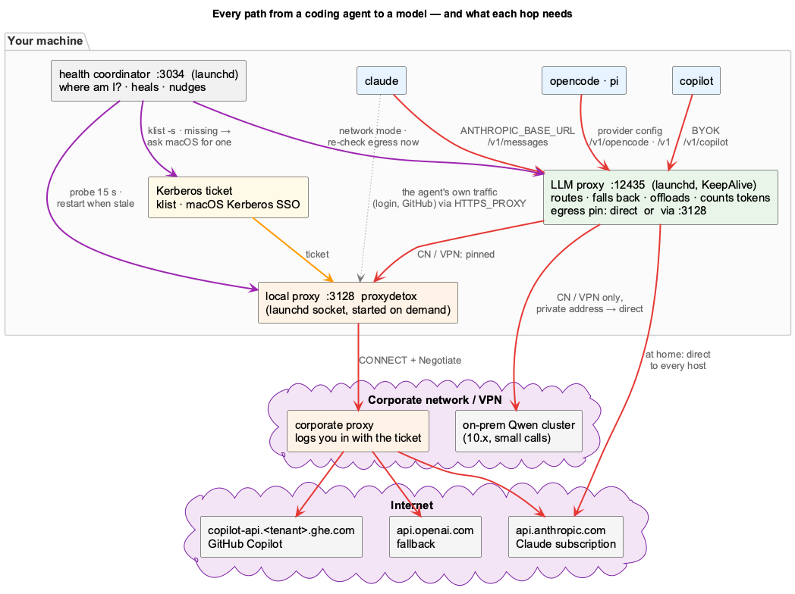
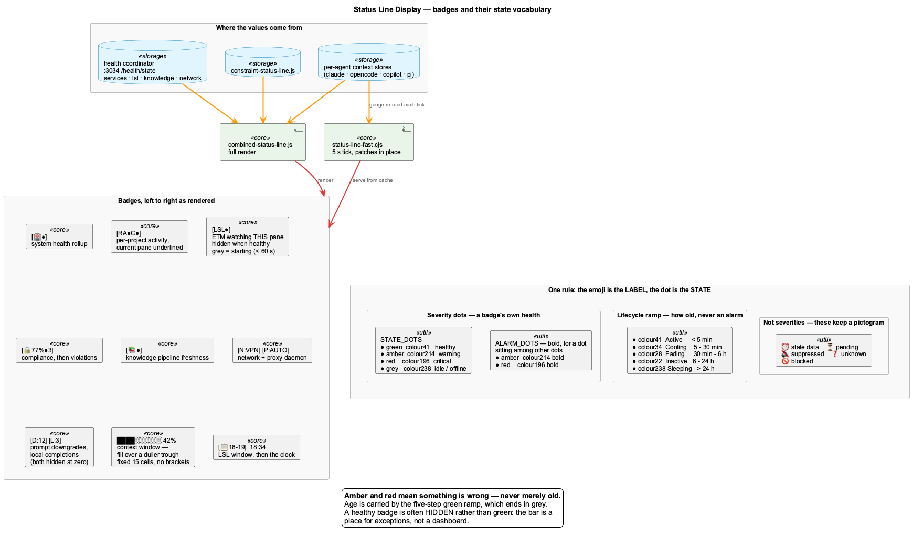
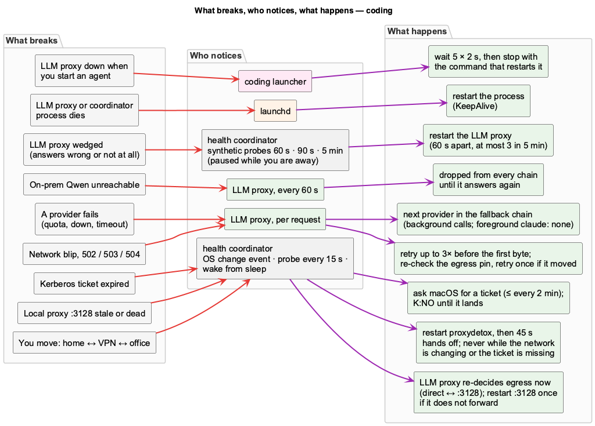

<div class="overview-deck" id="coding-connectivity" role="region" aria-label="coding connectivity presentation" markdown="1">

<div class="overview-toolbar" hidden>
  <span class="overview-label">coding / connectivity</span>
  <span class="overview-counter" role="status" aria-live="polite" aria-atomic="true"></span>
  <button type="button" data-fullscreen>Fullscreen</button>
</div>

<div class="overview-stage" markdown="1">

<section class="overview-slide overview-cover" id="slide-1" aria-labelledby="connectivity-title" markdown="1">
<div class="overview-copy" markdown="1">

<p class="overview-kicker">Every call, hop by hop</p>

# Every path to the model {#connectivity-title}

Every agent call goes through the **LLM proxy** on your machine. From there it
goes **directly** to the model host at home, or through the **local proxy** and
the **corporate proxy** on VPN or in the office.

<div class="overview-benefits" markdown="1">

**At home**  
agent → LLM proxy → model host

**On VPN / corporate**  
agent → LLM proxy → local proxy → corporate proxy → model host

**Small calls on VPN / corporate**  
LLM proxy → on-prem Qwen cluster, directly

</div>

</div>
<figure class="overview-figure" markdown="1">

[](images/agent-connectivity-paths.png){: target="_blank" rel="noopener" title="Open full-size diagram" }

<figcaption>Red: the request. Orange: the ticket. Purple: what keeps it working.</figcaption>
</figure>
<p class="overview-takeaway">One proxy on your machine decides the path for every call.</p>
</section>

<section class="overview-slide" id="slide-2" aria-labelledby="connectivity-in" markdown="1">
<div class="overview-copy" markdown="1">

<p class="overview-kicker">Into the LLM proxy</p>

## Four agents, four doors, one proxy {#connectivity-in}

| Agent | How it reaches `:12435` | Answered by |
|---|---|---|
| claude | `ANTHROPIC_BASE_URL`, `/v1/messages` | your Claude subscription, passed through unchanged |
| copilot | BYOK provider, `/v1/copilot` | GitHub Copilot |
| opencode | provider config, `/v1/opencode` | GitHub Copilot |
| pi | provider config, `/v1` | GitHub Copilot |

The launcher wires this. If the proxy does not answer, the launch **stops** and
tells you how to restart it, rather than running unmeasured.

The agent's own traffic (sign-in, GitHub) goes through the local proxy, not the
LLM proxy.

</div>
<figure class="overview-figure" markdown="1">

[](images/agent-connectivity-paths.png){: target="_blank" rel="noopener" title="Open full-size diagram" }

<figcaption>Top row: the four agents and their way into the proxy. Which account answers is config: llm-routing.yaml.</figcaption>
</figure>
<p class="overview-takeaway" markdown="1">
Every call counted, whatever the agent.
[LLM Routing](architecture/llm-routing.md)
</p>
</section>

<section class="overview-slide" id="slide-3" aria-labelledby="connectivity-out" markdown="1">
<div class="overview-copy" markdown="1">

<p class="overview-kicker">Out of the LLM proxy</p>

## Direct, or through the local proxy {#connectivity-out}

The LLM proxy asks the **health coordinator** where you are, and pins its
egress:

- **home**: direct;
- **VPN / office**: through the local proxy `:3128`, but only once a test
  request through it has worked.

It decides again every 30 s, immediately when the coordinator reports a
network change, and when a request through the pin fails.

Private addresses, such as the on-prem Qwen cluster, always go direct.

</div>
<figure class="overview-figure" markdown="1">

[](images/agent-connectivity-paths.png){: target="_blank" rel="noopener" title="Open full-size diagram" }

<figcaption>Nothing is pinned without being tested first.</figcaption>
</figure>
<p class="overview-takeaway">No restart to switch networks: the pin moves at runtime.</p>
</section>

<section class="overview-slide" id="slide-4" aria-labelledby="connectivity-needs" markdown="1">
<div class="overview-copy" markdown="1">

<p class="overview-kicker">What must be up</p>

## Seven things, and what you see if one is missing {#connectivity-needs}

| Element | Needed | Missing looks like |
|---|---|---|
| LLM proxy `:12435` | always | launch stops; API errors |
| Health coordinator `:3034` | always | no network field, no healing |
| Agent account | always | the account's own error |
| Local proxy `:3128` | VPN · office | `P:OFF`, "fetch failed" |
| Kerberos ticket | VPN · office | `K:NO`, 502 for every call |
| Corporate proxy | VPN · office | 502 naming the proxy |
| Qwen cluster | VPN · office, small calls | skipped; Copilot answers instead |

</div>
<figure class="overview-figure" markdown="1">

[](images/status-line-display.png){: target="_blank" rel="noopener" title="Open full-size image" }

<figcaption>N: where you are · P: the local proxy · K:NO no ticket.</figcaption>
</figure>
<p class="overview-takeaway" markdown="1">
Read the bar before reading the logs.
[Status Line](guides/status-line.md)
</p>
</section>

<section class="overview-slide" id="slide-5" aria-labelledby="connectivity-recover" markdown="1">
<div class="overview-copy" markdown="1">

<p class="overview-kicker">Recovery</p>

## What breaks, and what happens next {#connectivity-recover}

**The health coordinator** watches the network: on every OS network change,
every 15 s, and after sleep. It moves the egress, restarts a stale local proxy
and, on macOS, asks for a missing ticket (on Linux / WSL: `kinit`).

**The LLM proxy** handles each request: retries a blip, falls back to the next
provider, and drops the Qwen cluster while it is unreachable.

**launchd** (macOS) or **systemd** (Linux, WSL) restarts a process that dies.
**The launcher** refuses to start an agent without the proxy.

</div>
<figure class="overview-figure" markdown="1">

[](images/agent-connectivity-recovery.png){: target="_blank" rel="noopener" title="Open full-size diagram" }

<figcaption>Each failure has one place that notices it, and one answer.</figcaption>
</figure>
<p class="overview-takeaway" markdown="1">
Healing is automatic, and limited so it can't make things worse.
[Connectivity & Recovery](architecture/connectivity.md)
</p>
</section>

<section class="overview-slide" id="slide-6" aria-labelledby="connectivity-move" markdown="1">
<div class="overview-copy" markdown="1">

<p class="overview-kicker">Moving between networks</p>

## Joining VPN, step by step {#connectivity-move}

1. The OS reports a network change; the coordinator looks again **at once**.
   (macOS and Linux report one; on Windows / WSL the 15 s poll notices.)
2. It sees VPN and tells the LLM proxy to **re-decide its egress** now.
3. If `:3128` does not forward, it **restarts it once**, then leaves it alone
   for 45 s, so one restart is never killed by the next.
4. No Kerberos ticket? It **asks macOS for one** instead (on Linux / WSL it
   shows `K:NO` until you `kinit`), because a restart cannot help without a ticket.

Leaving VPN goes the other way. Without a change event from the OS, "open" has
to be seen three times in a row first, so a short drop does not undo the route.

</div>
<figure class="overview-figure" markdown="1">

[](images/agent-connectivity-recovery.png){: target="_blank" rel="noopener" title="Open full-size diagram" }

<figcaption>Bottom rows: what a network move triggers.</figcaption>
</figure>
<p class="overview-takeaway" markdown="1">
Move networks. The agent keeps working, after a short gap.
[Network Configuration](guides/network-configuration.md)
</p>
</section>

<section class="overview-slide" id="slide-7" aria-labelledby="connectivity-ticket" markdown="1">
<div class="overview-copy" markdown="1">

<p class="overview-kicker">The common one</p>

## Joined VPN, and nothing answers? {#connectivity-ticket}

The Kerberos ticket lasts about **10 hours**. When it expired overnight off the
network, the corporate proxy refused every call after joining VPN, and
`coding --claude` showed `502 proxy forward failed`.

macOS fetched a new ticket by itself after **2 min 20 s**; restarting the local
proxy in between changed nothing.

Now the coordinator asks for the ticket as soon as it sees `K:NO`: **about
12 s**, no dialog if your password is in the keychain. That is macOS's Kerberos
SSO extension; Linux and WSL have none, so there `K:NO` means run `kinit`.
Windows renews the logon's ticket itself.

</div>
<figure class="overview-figure" markdown="1">

[](images/agent-connectivity-paths.png){: target="_blank" rel="noopener" title="Open full-size diagram" }

<figcaption>No ticket, no tunnel, however healthy the proxies are.</figcaption>
</figure>
<p class="overview-takeaway" markdown="1">
`K:NO` in the bar? macOS: wait ~15 s. Linux / WSL: run `kinit`.
[Troubleshooting](reference/troubleshooting.md)
</p>
</section>

<section class="overview-slide" id="slide-8" aria-labelledby="connectivity-look" markdown="1">
<div class="overview-copy" markdown="1">

<p class="overview-kicker">When it still fails</p>

## Where to look {#connectivity-look}

```bash
coding --health                                   # everything, green or not
curl -s localhost:3034/health/state | jq .network  # where am I, why no heal
curl -s localhost:12435/health | jq .egress        # direct or which proxy
klist                                             # the Kerberos ticket
```

`.logs/health-coordinator.log` names every restart and its cause:
`stale-after-change`, `restarting`, `no-ticket`, `network-change`.

</div>
<figure class="overview-figure" markdown="1">

[](images/agent-connectivity-recovery.png){: target="_blank" rel="noopener" title="Open full-size diagram" }

<figcaption>Every heal decision is logged with its cause.</figcaption>
</figure>
<p class="overview-takeaway" markdown="1">
Four commands, one log.
[Connectivity & Recovery](architecture/connectivity.md)
</p>
</section>

</div>

<nav class="overview-controls" aria-label="Presentation controls" hidden>
  <button type="button" data-prev>Previous</button>
  <div class="overview-dots" aria-label="Choose a slide"></div>
  <button type="button" data-next>Next</button>
  <span class="overview-help">Arrow keys to navigate / F for fullscreen</span>
</nav>
<p class="overview-message" role="status" aria-live="polite"></p>

</div>
