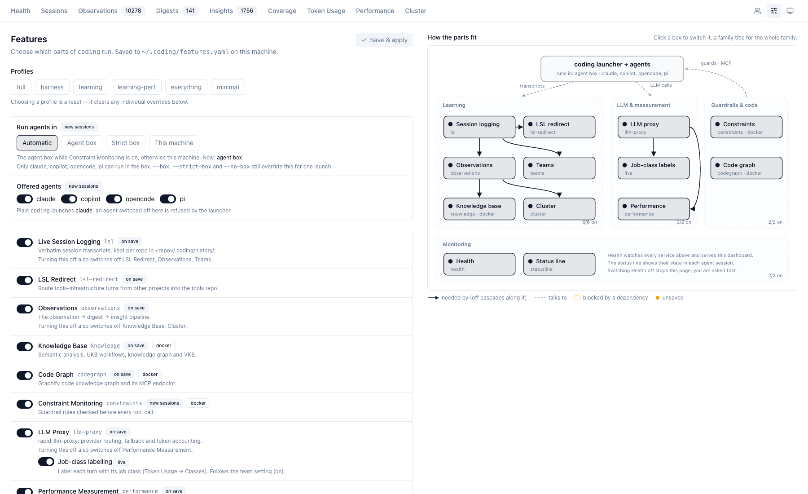

# Configuration

What runs (features, tiers, run mode, offered agents), optional provider keys, ports, and
where things are kept.

## What runs: features

`coding` is composed of twelve features. The tier you picked at install is a preset of them;
after that you can switch any one on or off.

| Feature | id | Needs | Docker |
|---|---|---|---|
| Live Session Logging | `lsl` | | |
| LSL Redirect | `lsl-redirect` | `lsl` | |
| Observations | `observations` | `lsl` | |
| Knowledge Base | `knowledge` | `observations` | yes |
| Teams | `teams` | `lsl` | |
| Cluster | `cluster` | `observations` | |
| LLM Proxy | `llm-proxy` | | |
| Performance Measurement | `performance` | `llm-proxy` | |
| Constraint Monitoring | `constraints` | | yes |
| Code Graph | `codegraph` | | yes |
| Health Monitoring | `health` | | |
| Status Line | `statusline` | | |

A feature whose dependency is off is switched off with it. A dependency is never switched
on for you. LLM Proxy also has a sub-switch, **Job-class labelling**, which labels each turn
with its job class. It is stored on the proxy, so it follows the team's setting until you set
it on this machine.

### In the dashboard

**Dashboard → Features** ([localhost:3032/features](http://localhost:3032/features)) has the
switches as a list, and beside it a map of how the parts fit together:



- click a box to switch that feature, or a family title (*Learning*, *LLM & measurement*,
  *Guardrails & code*, *Monitoring*) to switch the whole family
- a box with an amber dashed border is blocked: its dependency is off. Clicking it says which
  one.
- nothing changes until **Save & apply**. **Discard** drops the pending changes.
- each switch shows when it takes effect: *live* (immediately), *on save* (services are
  started or stopped), *new sessions* (agents launched afterwards)

Switching **Health Monitoring** off stops the dashboard itself, so it asks first. To get it
back: `coding-features profile full`, or `coding-features set health on`.

### From the shell

```bash
coding-features status                 # the resolved set, and why anything is off
coding-features explain knowledge      # why one feature is on or off
coding-features profiles               # the presets
coding-features profile learning-perf  # switch preset (clears single overrides)
coding-features set codegraph on       # one feature
coding-features repair                 # run the install steps a newly enabled feature needs
```

The presets are the install tiers `harness`, `learning`, `learning-perf` and `everything`,
plus `full` (everything and `lsl-redirect`, for developing `coding` itself) and `minimal`.

### Where agents run, and which are offered

```bash
coding-features run                    # show it
coding-features run host               # auto | box | strict-box | host
coding-features agents set claude,pi   # offer only these ('all' = every one)
```

`auto` runs agents in the [agent box](../core-systems/agent-box.md) while Constraint
Monitoring is on, and on this machine otherwise. `--box`, `--strict-box` and `--no-box` on
the `coding` command line override it for one launch. Plain `coding` launches Claude Code if
it is offered, otherwise the first offered agent.

### Where the settings are stored

Later layers win:

1. built-in defaults (everything on)
2. `config/features.yaml` in the release: the team default
3. `~/.coding/features.yaml`: this machine. The installer, the dashboard and
   `coding-features` write here.
4. `CODING_FEATURE_<ID>=on|off` in the environment, for CI and tests
   (`CODING_FEATURE_LLM_PROXY=off`)

```yaml
# ~/.coding/features.yaml
profile: learning
features:
  codegraph: on
run: auto
agents: [claude, copilot]
```

The full feature → service matrix is in `docs/architecture/features.md` in the repository,
and the user guide is [Composing What Runs](../guides/features.md).

## Provider keys (optional)

The LLM proxy routes through the subscriptions you already have (Claude Code, GitHub
Copilot), so no key is required. Keys add providers:

```env
# ~/.coding/releases/current/.env  (a git checkout: <checkout>/.env)
GROQ_API_KEY=...
ANTHROPIC_API_KEY=sk-ant-...
OPENAI_API_KEY=sk-...
```

`coding update` copies `.env` into each new release, so it survives updates. See
[LLM Providers](../guides/llm-providers.md).

## Ports

All ports are set in `.env.ports`:

| Port | Service | Runs |
|------|---------|------|
| 3032 | Dashboard UI | host under `harness`, in the container with Docker tiers |
| 3033 | Dashboard API | as 3032 |
| 3034 | Health coordinator (features, teams, release check) | host |
| 12435 | LLM proxy | host |
| 12436 | obs-api: knowledge store, retrieval, the viewer at `/viewer/` | host (`learning`+) |
| 12434 | Docker Model Runner | host |
| 3030 / 3031 | Constraint dashboard / API | container (`everything`) |
| 3848 / 3849 | Semantic analysis / constraint monitor SSE | container |
| 3851 | Graphify (HTTP MCP) | container (`everything`) |
| 6333 / 6379 | Qdrant / Redis | container |
| 5173 | Knowledge viewer dev server, only while developing it | host |

## MCP servers and hooks

The installer sets these up. By default they apply only to sessions started through
`coding`: it passes the MCP config and settings to each launch and leaves your own agent
configuration alone. Install with `--global-agents` to also write `~/.claude.json` and
`~/.claude/settings.json` for bare `claude` sessions.

## Where things are kept

| Path | What |
|---|---|
| `~/.coding/releases/<version>/` | an installed release; `current` points at the active one |
| `~/.coding/features.yaml`, `~/.coding/teams.yaml` | your settings |
| `~/.coding/install.json` | channel, version, previous version |
| `~/.coding/data/<scope>/` | this machine's runtime data and caches |
| `<repo>/.coding/` | what each repo learned: history, observations, insights, kb, tokens |
