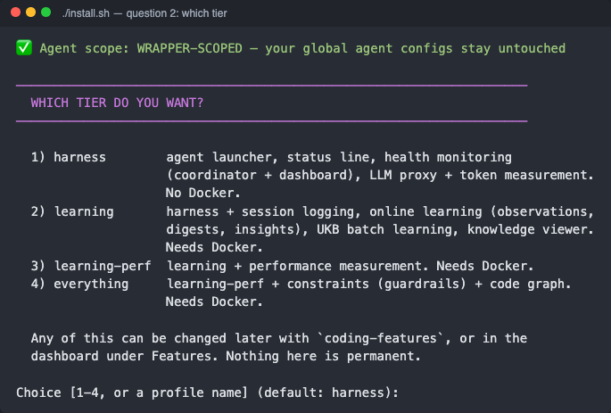
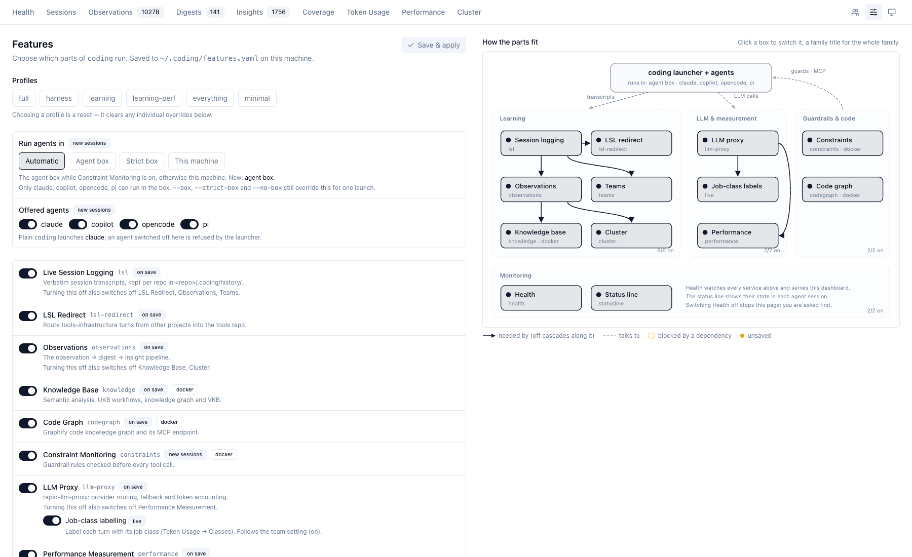
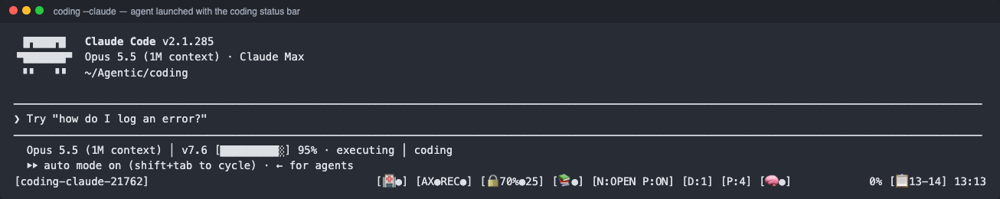
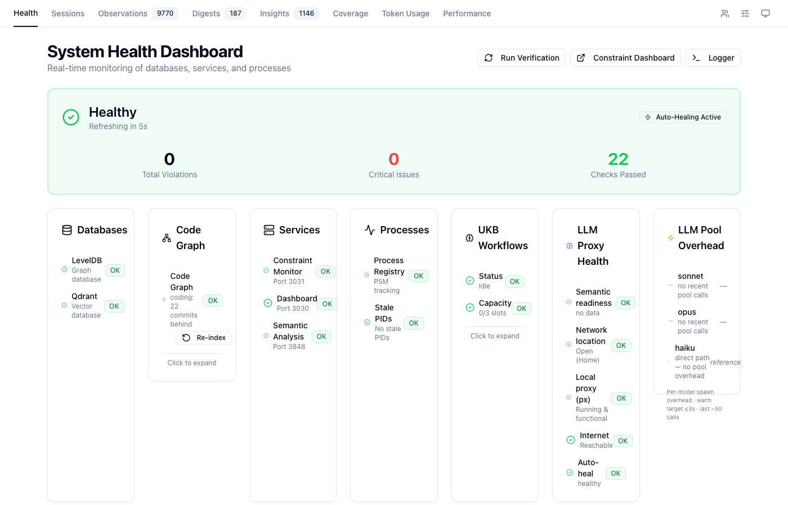

# Getting Started

Install, choose what runs, start your first session, and keep it up to date. About five
minutes for the `harness` tier, a little longer with Docker.

=== "⚡ Quick (~3 min)"

    ## Install

    ```bash
    curl -fsSL https://github.com/fwornle/coding/releases/latest/download/coding-install.sh | bash
    source ~/.zshrc          # or ~/.bashrc
    cd ~/my-project && coding
    ```

    The one-liner downloads the latest release, checks its checksum, unpacks it into
    `~/.coding/releases/<version>/` and runs that release's installer. Developing `coding`
    itself? Clone it instead: see [Installation](installation.md#developing-coding-itself).

    ## Two questions

    The installer asks whether bare agents should be observed too (Enter = no, only sessions
    started via `coding`), and which **tier** to install:

    

    `harness` needs no Docker. `learning` and up add session logging, online learning, the
    knowledge viewer and team sharing, and need Docker running.

    ## Configure

    Change the tier, or switch single features, any time:

    ```bash
    coding-features profile learning       # switch tier
    coding-features set codegraph on       # one feature
    coding-features status                 # what is on, and why anything is off
    ```

    Or click through it in **Dashboard → Features** at [localhost:3032/features](http://localhost:3032/features).
    The map beside the list shows how the parts depend on each other. See
    [Configuration](configuration.md).

    ## Update

    When a release is out, the status line shows `[⬆ x.y.z]` and the dashboard shows a banner.

    ```bash
    coding update              # install it beside the current one, switch, restart
    coding update --rollback   # back to the previous release
    ```

    See [Updating](updating.md).

    ## Check it worked

    The status line under the agent shows `[🏥●]` green when the system is healthy. For the
    full picture open the dashboard at [localhost:3032](http://localhost:3032). If something is
    not green: [Verify & Repair](verify-repair.md).

=== "📖 Standard (~15 min)"

    ## What you need

    | Tool | For |
    |------|-----|
    | Node.js 22 LTS+ | the launcher and every host service (18 and 20 are EOL) |
    | `curl`, `tar`, `shasum`/`sha256sum` | the one-line installer: download and verify a release |
    | Git | your learning repos (and the checkout, if you develop `coding` itself) |
    | `jq`, `tmux` | the scripts, and the session wrapper with the shared status bar |
    | Docker (running) | `learning` tiers and up only: the knowledge services are containers |
    | `gh`, logged in to `bmw.ghe.com` | optional: lets the first launch in a repo create its private `<repo>-history` for you |

    macOS, Linux, and Windows through **WSL** (with systemd enabled) are supported.

    ## Installing

    ```bash
    curl -fsSL https://github.com/fwornle/coding/releases/latest/download/coding-install.sh | bash
    source ~/.zshrc
    ```

    Installer options go after `bash -s --`, for example an unattended install of a tier:

    ```bash
    curl -fsSL https://github.com/fwornle/coding/releases/latest/download/coding-install.sh \
      | bash -s -- --yes --features=learning
    ```

    The installer first lists everything it would touch, then asks two questions (agent scope
    and tier) and installs only what that tier needs:

    | Tier | Adds | Docker |
    |---|---|---|
    | `harness` | agent launcher, status line, health monitoring, LLM proxy + token measurement | no |
    | `learning` | session logging, observations → digests → insights, UKB batch learning, knowledge viewer, teams | yes |
    | `learning-perf` | performance measurement | yes |
    | `everything` | constraints (guardrails), code graph, cluster tab | yes |

    The full walkthrough with every prompt, and the git-checkout install for developing
    `coding`, are on [Installation](installation.md).

    ## Configuring what runs

    The tier is only a starting point. Twelve features can be switched one by one, and two
    settings decide where agents run and which ones `coding` offers:

    ```bash
    coding-features status                 # the resolved set, with the reason for anything off
    coding-features profile everything     # switch tier (a reset: clears single overrides)
    coding-features set constraints off    # one feature
    coding-features run host               # run agents on this machine instead of the agent box
    coding-features agents set claude,pi   # offer only these agents
    ```

    **Dashboard → Features** does the same with switches, plus a map of how the parts depend on
    each other. Click a box to switch it, or a family title to switch the whole family; nothing
    changes until **Save & apply**. A feature whose dependency is off cannot be switched on,
    and switching a dependency off takes its dependents with it.

    

    API keys, ports and where things are kept: [Configuration](configuration.md).

    ## Your first session

    ```bash
    cd ~/my-project
    coding                  # the default agent (Claude Code, unless switched off)
    coding pi               # or pick one: copilot, opencode, claude (--pi etc. work too)
    coding --project DIR    # start in another directory
    ```

    The agent opens inside a tmux session with the shared status bar along the bottom:

    

    Launching the agent's own CLI directly skips session logging, knowledge injection and
    health monitoring. Prefer `coding`.

    ## Where what it learns goes

    With a `learning` tier, everything learned in a repo is kept in that repo's `.coding/`
    folder: session logs, observations, insights, knowledge-graph slice, token usage. On the
    first launch in a repo you decide whether that folder is a private `<repo>-history` repo
    (shareable with teammates through git), or local only. Commits happen automatically;
    pushing is always your call:

    ```bash
    coding sync              # what each learning repo has to push / pull
    coding sync --push       # asks, then pushes
    ```

    Group repos into teams in **Dashboard → Teams**; the knowledge viewer follows that
    selection. See [Per-Repo Tenancy](../architecture/tenancy.md) and
    [Teams & Shared Learning](../guides/teams.md).

    ## Staying up to date

    The health coordinator checks for a new release every six hours. When one is out, the status
    line shows `[⬆ x.y.z]` (click it to update) and the dashboard shows a banner.

    ```bash
    coding update --check      # is there a newer release? installs nothing
    coding update              # download, verify, install beside, switch, restart
    coding update --rollback   # switch back to the release before
    coding releases status     # which releases are installed, which one is current
    ```

    Your settings and data live outside the release folders, so an update or a rollback does
    not touch them. See [Updating](updating.md).

    ## Checking health

    The status line's `[🏥●]` is the summary. The dashboard at
    [localhost:3032](http://localhost:3032) shows each database, service and process, and
    **Run Verification** re-checks everything on demand:

    

    From a shell:

    ```bash
    coding-features status                 # which features are on, and why any are off
    curl -s localhost:3034/health          # the health coordinator
    ```

    [Verify & Repair](verify-repair.md) works through each service when something is red.

=== "📚 Deep Dive (full)"

    --8<-- "_tiers/getting-started/index.deep.md"
