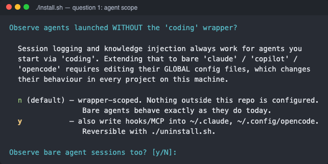
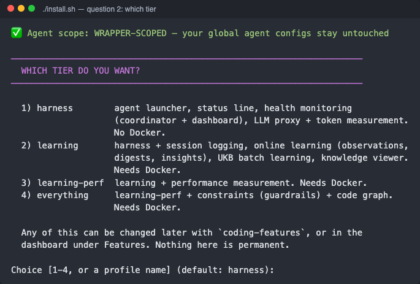
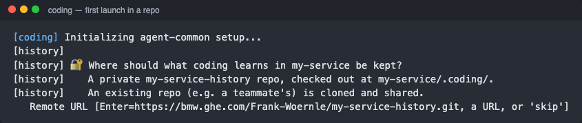
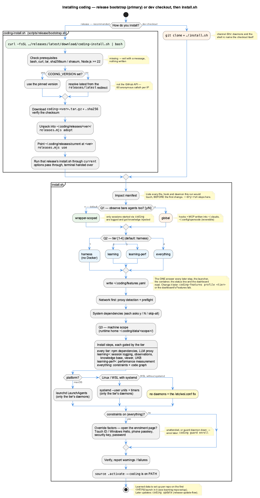

# Installation

Prerequisites, the install itself, and what it puts on your machine.

=== "⚡ Quick (~3 min)"

    ## Install

    ```bash
    curl -fsSL https://github.com/fwornle/coding/releases/latest/download/coding-install.sh | bash
    source ~/.zshrc          # or ~/.bashrc
    cd ~/my-project && coding
    ```

    This installs the latest release into `~/.coding/releases/<version>/` and runs its
    installer. Options go after `bash -s --`, e.g. `| bash -s -- --features=learning`.
    To develop `coding` itself, clone it instead:
    [Developing coding itself](#developing-coding-itself).

    ## The two questions

    **1 — agent scope.** Enter (`n`) keeps your global agent configs untouched: only sessions
    started through `coding` are logged and get knowledge injected.

    

    **2 — tier.** Each tier is a superset of the one before. Enter installs `harness`.

    

    | Tier | Adds | Docker |
    |---|---|---|
    | `harness` | agent launcher, status line, health monitoring (coordinator + dashboard), LLM proxy + token measurement | no |
    | `learning` | session logging, online learning (observations → digests → insights), UKB batch learning, knowledge viewer, teams | yes |
    | `learning-perf` | performance measurement | yes |
    | `everything` | constraints (guardrails), code graph, cluster tab | yes |

    Change it any time: `coding-features profile <tier>`, or Dashboard → Features. See
    [Configuration](configuration.md).

    ## The first launch in each repo

    With a `learning` tier, the first `coding` in a repo asks where its learned data goes —
    Enter creates a private `<repo>-history`, a teammate's URL shares theirs, `skip` keeps it
    local. See [Per-Repo Tenancy](../architecture/tenancy.md).

    

    ## What you need

    Node.js 22 LTS or newer, `curl`, `tar` and a SHA-256 tool (the one-liner checks these), plus
    `git`, `jq` and `tmux`. Docker (**running**, not just installed) only for `learning` and up.

    === "macOS"

        ```bash
        brew install git node jq tmux && brew install --cask docker
        ```

    === "Linux / WSL2"

        ```bash
        sudo apt update && sudo apt install -y git nodejs npm jq tmux
        curl -fsSL https://get.docker.com | sh
        ```

    On Windows, install inside **WSL** (with systemd enabled in `/etc/wsl.conf`); there is no
    native Windows installer.

    ## What it does to your machine

    Lists everything it would touch before the first change, prompts before each system-level
    change (answer `skip-all` to decline the rest), and backs up your shell config with a
    timestamp. The code goes to `~/.coding/releases/<version>/`, your settings to
    `~/.coding/features.yaml` and runtime data to `~/.coding/data/`. Updating later:
    [Updating](updating.md).

    ## If it fails

    Most first-run failures are Docker not running, or a shell not reloaded since the install.
    [Verify & Repair](verify-repair.md) works through the rest.

=== "📖 Standard (~15 min)"

    ## Before you start

    | Tool | Why |
    |------|-----|
    | Docker | `learning` tiers and up: the knowledge services are containers — it must be **running**, not merely installed. `harness` needs none |
    | Node.js 22 LTS+ | The host-side launcher and services; 18 and 20 are EOL |
    | `curl`, `tar`, `shasum` / `sha256sum` | The one-line installer downloads and verifies a release |
    | Git | Your learning repos, and the checkout if you develop `coding` |
    | `jq` | JSON handling throughout the scripts |
    | `tmux` | Session wrapping and the shared status bar |

    ## Installing

    ```bash
    curl -fsSL https://github.com/fwornle/coding/releases/latest/download/coding-install.sh | bash
    source ~/.zshrc
    ```

    The one-liner (`coding-install.sh`, published with every release) does only this:

    1. checks what it needs itself: bash, curl, tar, a SHA-256 tool, Node.js 22 or newer
    2. finds the latest release (or the one `CODING_VERSION=x.y.z` names)
    3. downloads `coding-<version>.tar.gz` and its `.sha256`, verifies, and unpacks into
       `~/.coding/releases/<version>/`
    4. points `~/.coding/releases/current` at it
    5. runs that release's `install.sh`, which asks the questions below

    Everything the installer registers (shell rc, background services, agent settings) names
    `current`, not the version, which is what lets [`coding update`](updating.md) swap releases
    later.

    Under `harness` everything runs on the host: the launcher, the LLM proxy, the health
    coordinator and the dashboard. The `learning` tiers and up add the `coding-services`
    container for the knowledge services; `everything` runs the constraint monitor and the code
    graph in it too.

    ## What the installer asks, in order

    

    1. **Impact manifest** — every file, hook and background service this run would touch,
       shown before the first change. `--dry-run` stops here.
    2. **Agent scope** — wrapper-scoped (default) or also observe bare `claude` / `copilot` /
       `opencode` by writing their global configs.
    3. **Tier** — `harness` · `learning` · `learning-perf` · `everything`, written to
       `~/.coding/features.yaml`. Every later step, the launcher, the container, the status line
       and the dashboard read that one file.
    4. **System dependencies** — each missing one asks `y` / `N` / `skip-all`.
    5. **Machine scope** — the name of this machine's runtime home `~/.coding/data/<scope>/`
       (caches only; what is shared lives in each repo, see
       [Per-Repo Tenancy](../architecture/tenancy.md)).
    6. **Override factors** (tiers with `constraints`) — opens a browser page to enrol how you
       approve an agent's rule bypass: Touch ID / Windows Hello, your phone (QR code), a security
       key, a password. Several are allowed; save the recovery codes it shows. Later:
       `coding guard enroll`. See [Agent Box & Overrides](../core-systems/agent-box.md).

    With `constraints` on and the run mode left at *Automatic*, `coding` runs the agent in the
    [agent box](../core-systems/agent-box.md): build its image once with `coding box build`, and
    log the agent in once inside the box. `coding-features run host` runs agents on this machine
    instead.

    Unattended:

    ```bash
    curl -fsSL https://github.com/fwornle/coding/releases/latest/download/coding-install.sh \
      | bash -s -- --yes --features=learning
    ```

    (default tier `harness`). `--dry-run` lists what the installer would change and stops (the
    one-liner has still downloaded and unpacked the release by then). `--global-agents`
    also configures bare `claude` / `copilot` / `opencode`. `~/.coding/releases/current/install.sh --help`
    lists all options. Changing the tier later needs no re-install: `coding-features profile <tier>`.

    Background services are installed per platform — launchd on macOS, systemd user units on
    Linux and WSL — and only for the features of the chosen tier. WSL without systemd gets no
    services and the `/etc/wsl.conf` fix printed instead.

    ## What the installer is careful about

    It is deliberately non-intrusive, and each of these is a decision rather than an accident: it
    **prompts before any system-level change**, writes a **timestamped backup** of your shell
    config before touching it, and lets you answer **`skip-all`** at a prompt to decline every
    remaining system change. What it keeps is in three places under `~/.coding/`: the code in
    `releases/`, your settings in `features.yaml` and `teams.yaml`, runtime data in `data/`.

    ## What you end up with

    | Component | Does |
    |-----------|------|
    | `coding` | Launches an agent with every enabled integration attached |
    | `coding-features` | Shows and changes the tier, single features, run mode and offered agents |
    | `coding update` | Installs a newer release, or rolls back ([Updating](updating.md)) |
    | `coding releases` | Lists installed releases and switches between them |
    | `coding sync` | Commits, pulls and pushes each repo's learning repo |
    | `coding box` / `coding guard` | Agent box image, and override approvals (`everything`) |
    | `semantic` | Knowledge-base workflows and ontology management (`learning`+) |
    | `vkb` | Opens the knowledge viewer (`learning`+) |
    | Dashboard | [localhost:3032](http://localhost:3032) — health, sessions, insights, tokens, teams, features |
    | Session logging | Automatic transcript capture into each repo's `.coding/history/` (`learning`+) |

    ## When it does not work

    Work in this order, because the failures nest:

    1. **Is Docker running?** (`learning` tiers and up) Not installed — running. This is the
       most common first-run failure.
    2. **Has the shell been reloaded?** `source ~/.zshrc`, or open a new terminal.
    3. **A git checkout only:** did the submodules come down? `git submodule update --init
       --recursive` if the clone omitted `--recurse-submodules`.
    4. **Then** the dashboard at [localhost:3032](http://localhost:3032), `coding-features status`,
       and [Verify & Repair](verify-repair.md) for anything remaining.

    ## Developing coding itself

    To work on `coding`, install from a git checkout instead of a release:

    ```bash
    git clone --recurse-submodules https://github.com/fwornle/coding ~/Agentic/coding
    cd ~/Agentic/coding && ./install.sh
    source ~/.zshrc
    ```

    `--recurse-submodules` is not optional: several integrations are submodules, and the install
    fails confusingly without them. A checkout is the `dev` channel: no release notice, and
    `coding update --pull` updates it with git. The developer profile `full` adds `lsl-redirect`
    on top of `everything`.

=== "📚 Deep Dive (full)"

    --8<-- "_tiers/getting-started/installation.deep.md"
