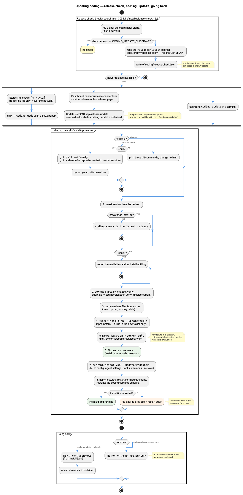

# Updating

How you learn that a new release is out, how to install it, and how to go back.

## You are told when a release is out

The health coordinator checks the release page every six hours. When a newer release
exists:

- the status line shows **`[⬆ x.y.z]`**. Clicking it runs `coding update`.
- the dashboard at [localhost:3032](http://localhost:3032) shows a banner:
  *coding x.y.z is available*, with **Update**, **Release notes** and a link to the release on
  GitHub. The × hides it until the next release.

The check is display only. Without a network nothing is shown, and nothing retries in a
loop. `CODING_UPDATE_CHECK=off` switches it off. A development checkout is never checked,
because releases do not apply to it.

## Update

```bash
coding update --check      # is there a newer release? installs nothing
coding update              # install it and switch to it
```



`coding update` installs the new release **beside** the running one, and only switches when
everything up to that point worked:

1. finds the latest release and downloads it with its checksum, then verifies and unpacks it
   into `~/.coding/releases/<version>/`
2. copies this machine's local files (`.env`, `.npmrc`, `.coding/`, `.data/`) over from the
   current release
3. installs its dependencies and builds it, inside its own folder only
4. pulls the matching `coding-services` image when a Docker feature is on
5. points `~/.coding/releases/current` at the new release
6. registers it (MCP config, agent settings, hooks, background services), all through
   `current`
7. applies your features, restarts the background services and recreates the container

If step 6 or 7 fails, it switches back and restarts again, so the machine ends on a release
that ran before. Steps 1 to 4 leave the running install untouched, so a failure there needs no
undo.

The **Update** button in the dashboard banner runs the same thing and shows its log. Reload
the page when it reports the new version.

## What an update does not touch

Your settings and data sit outside the release folders, so neither an update nor a rollback
changes them:

| Kept across updates | What it is |
|---|---|
| `~/.coding/features.yaml` | your tier, single feature switches, run mode, offered agents |
| `~/.coding/teams.yaml` | team memberships |
| `~/.coding/data/` | this machine's runtime data and caches |
| `<repo>/.coding/` | what each repo learned (and its `<repo>-history` repo) |

## Go back

```bash
coding update --rollback        # switch back to the previous release and restart
coding releases status          # channel, current version, installed releases
coding releases use 8.0.1       # switch to another installed release
coding releases remove 8.0.0    # delete an installed release you no longer need
```

`coding releases use` and `coding releases rollback` only switch which release the next start
runs. `coding update --rollback` also restarts the services, so prefer it.

## A pinned version

```bash
curl -fsSL https://github.com/fwornle/coding/releases/latest/download/coding-install.sh | CODING_VERSION=8.0.1 bash
```

`CODING_VERSION` makes the installer fetch that release instead of the latest.

## Developing coding itself

A git checkout is the `dev` channel. `coding update` never changes it without being asked:
it prints the git commands instead, and `coding update --pull` runs them
(`git pull --ff-only`, then `git submodule update --init --recursive`). Restart your `coding`
sessions afterwards to pick up the change. See [Installation](installation.md#developing-coding-itself).

Where the release folders are and why everything points at `current`: see
`docs/architecture/release-layout.md` in the repository.
