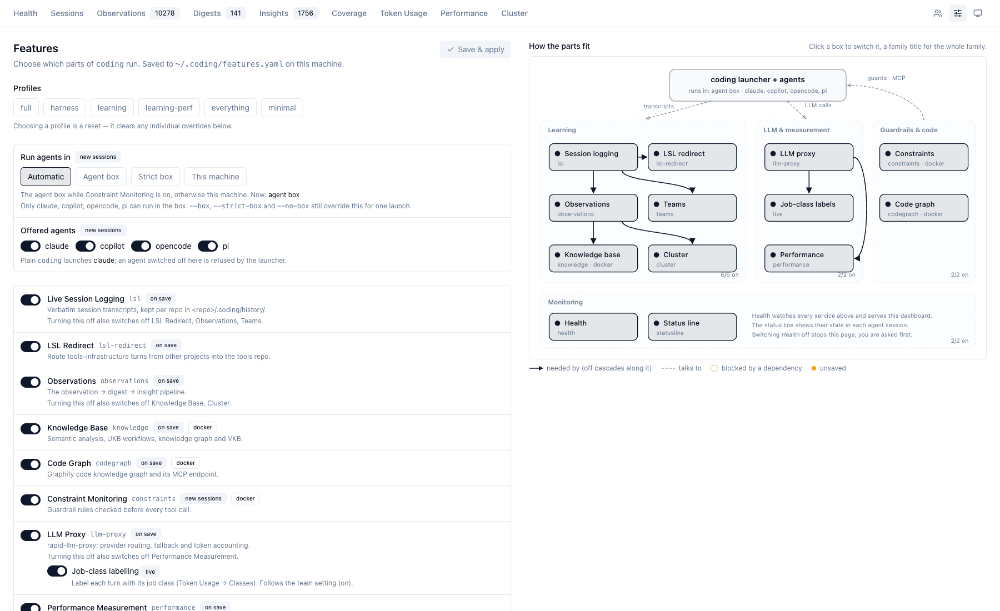
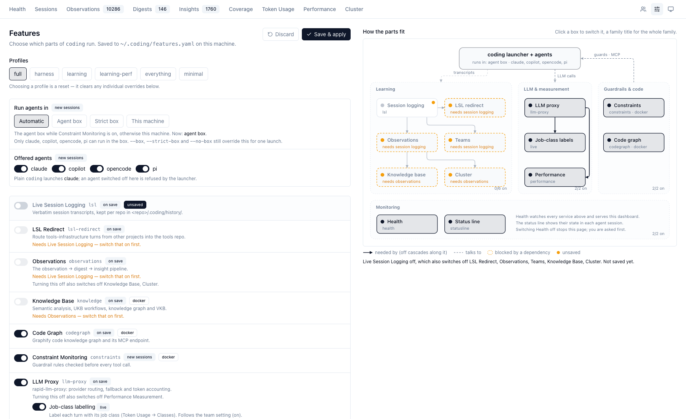

# Composing What Runs

`coding` is twelve features, not one system. Some people want the whole stack; some want the
LLM proxy and nothing else; some cannot run Docker at all. Rather than forking the install,
you choose a tier and switch parts on or off.

=== "⚡ Quick (~3 min)"

    ## The features

    | id | what it is | needs Docker |
    |----|------------|--------------|
    | `lsl` | Verbatim session transcripts, kept per repo in `<repo>/.coding/history/` | no |
    | `lsl-redirect` | Route tools-infrastructure turns from other projects into the tools repo (developer only) | no |
    | `observations` | The observation → digest → insight pipeline | no |
    | `knowledge` | Semantic analysis, UKB workflows, the knowledge graph, VKB | **yes** |
    | `codegraph` | The graphify code knowledge graph and its MCP endpoint | **yes** |
    | `constraints` | Guardrail rules checked before every tool call | **yes** |
    | `llm-proxy` | Provider routing, fallback and token accounting | no |
    | `performance` | Per-task measurement, experiments, the kgbench benchmark | no |
    | `teams` | Share learning with a team: the Teams tab, teammates' shared repos, team-wide insight injection | no |
    | `cluster` | The on-prem GPU cluster tab: nodes, models, jobs and the routing decisions beside them | no |
    | `health` | Health coordinator, auto-healing, the monitoring dashboard | no |
    | `statusline` | The tmux / agent status line | no |

    `llm-proxy` has one sub-switch, **Job-class labelling**: label each turn with its job
    class (Token Usage → Classes). It is stored on the proxy, not in `features.yaml`, and the
    dashboard shows it under LLM Proxy.

    Two **settings** sit beside the features:

    | setting | values | meaning |
    |---------|--------|---------|
    | `run` | `auto` (default), `box`, `strict-box`, `host` | where agents run. `auto` = the agent box while `constraints` is on, otherwise the host; `box` and `strict-box` fall back to the host without `constraints` |
    | `agents` | a list, default every agent | which agents `coding` offers; plain `coding` launches Claude Code when it is offered |

    ## Install tiers

    The installer always asks for a tier (an unattended run takes `harness`) and writes it to
    `~/.coding/features.yaml`. Each tier includes the one before:

    | tier | adds | Docker |
    |------|------|--------|
    | `harness` (default) | launcher, `statusline`, `health`, `llm-proxy` | **no** |
    | `learning` | `lsl`, `observations`, `knowledge`, `teams` | yes |
    | `learning-perf` | `performance` | yes |
    | `everything` | `constraints`, `codegraph`, `cluster` | yes |

    Two more profiles exist: `full`, the developer profile (everything plus `lsl-redirect`),
    which the installer never offers; and `minimal`, the status line only. Only a checkout that
    was never installed — no `features.yaml` anywhere — resolves to everything on.

    ```bash
    ./install.sh --features=learning
    curl -fsSL https://github.com/fwornle/coding/releases/latest/download/coding-install.sh | bash -s -- --features=learning
    ```

    ## Change it from the terminal

    ```bash
    coding-features                    # what is on, and why
    coding-features set knowledge off  # one feature
    coding-features profile learning   # a tier or profile
    coding-features explain knowledge  # why is this off?
    coding-features run host           # where agents run
    coding-features agents set claude,pi
    ```

    A feature switched on after install is set up by `coding-features repair`.

    ## Or from the dashboard

    **Health → Features**, or [localhost:3032/features](http://localhost:3032/features)
    directly.

    

    Each row carries its id, when the change takes effect, and whether it needs Docker.
    Beside the list, **How the parts fit** draws the same switches as the system they compose.
    Click a box to switch that feature; click a family title — Learning, LLM & measurement,
    Guardrails & code, Monitoring — to switch the whole family. The map honours dependencies
    exactly like the list. Below the features, **Run agents in** and the agent list edit the
    `run` and `agents` settings. Nothing happens until **Save & apply**.

    Only `knowledge`, `codegraph` and `constraints` need Docker. Switch all three off and the
    launcher never starts the container or asks for a daemon — which is what makes `harness`
    and `minimal` work on a machine without Docker Desktop.

=== "📖 Standard (~15 min)"

    ## Dependencies resolve downwards, never upwards

    Six features are built on others:

    ```
    lsl ──▶ lsl-redirect
    lsl ──▶ teams
    lsl ──▶ observations ──▶ knowledge
                observations ──▶ cluster
    llm-proxy ──▶ performance
    ```

    Job-class labelling needs `llm-proxy` too.

    **A dependent whose dependency is off is switched off too. The dependency is never
    switched on for you.** Turning something off is an explicit instruction and is honoured
    exactly; turning something on by implication would start services you did not ask for.

    The editor previews the whole cascade before you commit to it. One click on Live Session
    Logging takes LSL Redirect, Teams, Observations, Knowledge Base and Cluster with it — each
    greyed out, each saying which dependency it is waiting on, and the footer counting what would survive the save:

    

    A blocked feature's toggle is not merely greyed — it will not move. Turning Knowledge Base
    back on from that state would be undone by the resolver a moment later, and a switch that
    silently flips itself back is worse than one that refuses.

    ## When a change takes effect

    Not everything can apply instantly, and the UI says which is which rather than implying
    they are all the same.

    | tier | what it covers | when |
    |------|----------------|------|
    | `live` | status line, dashboard gating, coordinator checks, CLI gates | next read — no restart |
    | `on save` | host daemons and container programs | immediately; only the delta is started or stopped |
    | `new sessions` | agent hooks | next agent launch — `--settings` is fixed at launch |

    ## Where the setting lives

    Four layers, last one wins:

    1. built-in defaults — everything on (only reached by a checkout that was never installed)
    2. `<repo>/config/features.yaml` — committed, shared by the team
    3. `~/.coding/features.yaml` — this machine; what the CLI and the dashboard write
    4. `CODING_FEATURE_<ID>=on|off` — this shell only

    The `run:` and `agents:` settings live in the two files (layers 2 and 3), last one wins;
    with neither set, `run` is `auto` and every agent is offered.

    `coding-features explain <id>` names the layer that decided, so "why is this off" has one
    answer everywhere — the CLI, the status line tooltip and the dashboard chip all quote the
    same reason string.

    ## Turning off the thing you are looking at

    The dashboard is served *by* the `health` feature. Saving `minimal`, or switching
    Health Monitoring off, from the editor therefore stops the editor. It asks first, and whatever terminal or log the
    apply lands in prints the way back:

    ```
    ⚠️  Health Monitoring is now off: the coordinator and the dashboard have stopped.
        The dashboard cannot turn it back on, because the dashboard is part of it.
        To restore everything:  coding-features profile full
    ```

    ## What a pared-down install looks like

    The status line is the fastest way to see the effect — a disabled feature contributes no
    badge at all, rather than a greyed-out one:

    `full` — everything on:

    <span class="statusline">[🏥<span class="sl-green">●</span>] [AX<span class="sl-green">●</span><span class="sl-under">C</span><span class="sl-green">●</span>] [🔒72%<span class="sl-amber">●</span>7] [📚<span class="sl-green">●</span>] [N:OPEN P:AUTO] [🧠<span class="sl-green">●</span>] <span class="gauge gauge-ok">███░░░░░  46%</span> [📋8-9] 08:19</span>

    `learning` — health, sessions, observations and the log tranche; the constraint badge
    goes with its feature:

    <span class="statusline">[🏥<span class="sl-green">●</span>] [AX<span class="sl-green">●</span><span class="sl-under">C</span><span class="sl-green">●</span>] [📚<span class="sl-green">●</span>] [N:OPEN P:AUTO] [🧠<span class="sl-green">●</span>] <span class="gauge gauge-ok">███░░░░░  47%</span> [📋8-9] 08:19</span>

    `harness` — health, the network badge and the proxy badge; no session or knowledge
    badges, because `lsl` and `observations` are off:

    <span class="statusline">[🏥<span class="sl-green">●</span>] [N:OPEN P:AUTO] [🧠<span class="sl-green">●</span>] <span class="gauge gauge-ok">███░░░░░  47%</span> 08:19</span>

    `minimal`:

    <span class="statusline"><span class="gauge gauge-ok">███░░░░░  47%</span> 08:19</span>

    The context gauge and the clock are core, not a feature, so they survive every profile.
    The examples above come from real renders of `scripts/combined-status-line.js` with each
    tier's features set through `CODING_FEATURE_<ID>` overrides (markup as produced by
    `scripts/render-statusline-png.mjs --spans`), not typed from memory — hand-written bars on this site had
    already drifted to ten-cell gauges and a split `[N:] [P:]` pair months after both changed.

=== "📚 Deep Dive (full)"

    --8<-- "_tiers/guides/features.deep.md"
