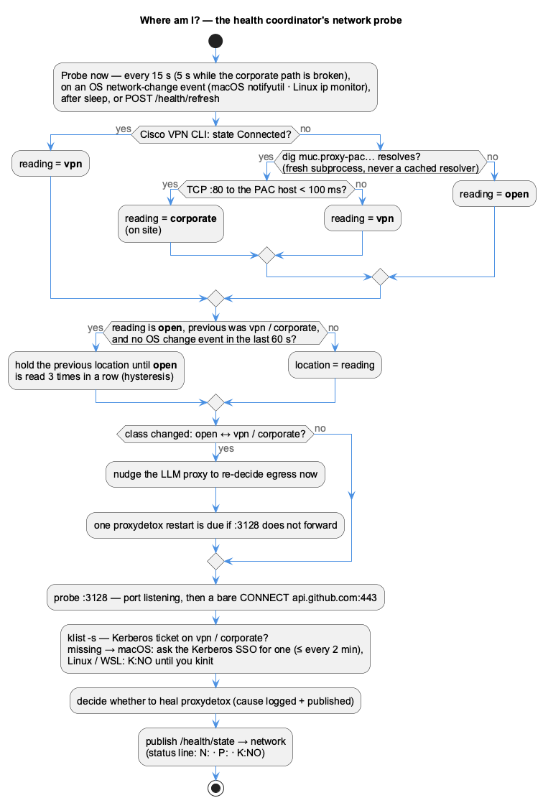
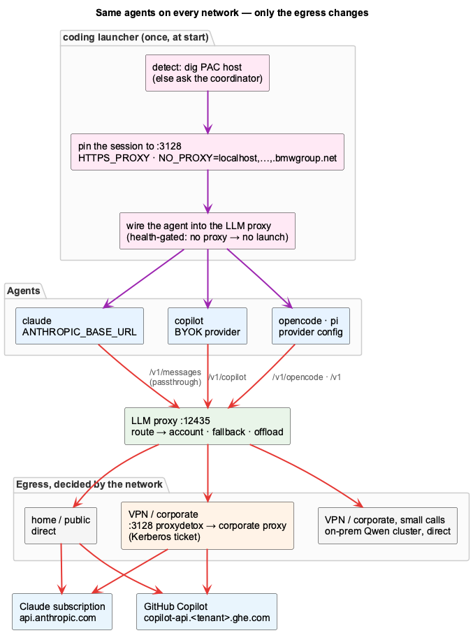

# Network Configuration

!!! tip "Every path, and how it recovers"
    [Connectivity & Recovery](../architecture/connectivity.md) maps every path from an agent
    to a model, what has to be up, and each automatic recovery, with the current rules
    (Kerberos ticket requests, the 45 s restart cooldown, the egress pin).
    [Connectivity](../connectivity.md) is the same as slides.

Corporate VPN, proxy detection, and how each agent's API traffic is routed on either
network.

=== "⚡ Quick (~3 min)"

    ## Three environments, one detector

    | Where you are | Path to the model |
    |---------------|-------|
    | On the corporate network | LLM proxy → proxydetox `127.0.0.1:3128` → corporate proxy (Kerberos) |
    | On VPN | the same |
    | At home or anywhere public | LLM proxy → direct |

    The **health coordinator is the single authority** on which one you are in. It probes every
    15 seconds and at once when the OS reports a network change (macOS, Linux); the launcher, the status line and
    the LLM proxy all read its answer rather than detecting independently.

    ## Check where the system thinks you are

    ```bash
    curl -s localhost:3034/health/state | jq .network
    ```

    ## `vpn` and `corporate` mean the same thing

    The coordinator says `vpn`, `corporate` or `open`. The LLM proxy says `corporate` or
    `public`. **`vpn` and `corporate` are the same network** — comparing the two vocabularies as
    raw strings is a real and recurring source of restart loops.

    ## When calls fail on the corporate network

    Routing can look perfect while every off-premises call fails. Check egress, not routing:

    ```bash
    curl -s localhost:12435/health | jq '.egress, .networkMode'
    ```

    `"degraded": true` means no proxy answered on the corporate network. The pin moves on its own
    (every 30 s, and at once when the coordinator sees a network change); if it stays degraded,
    the local proxy or the Kerberos ticket is the problem — `K:NO` in the status line says which.

=== "📖 Standard (~15 min)"

    ## How the network is detected

    Three probes:

    | Signal | Gives |
    |--------|-------|
    | Cisco VPN CLI reports a connected tunnel | `vpn` |
    | The internal PAC host resolves, and answers on :80 in under 100 ms | `corporate` (slower: `vpn`) |
    | Nothing resolves | `open` |

    Moving to `open` needs three readings in a row (unless the OS just reported a change), so a
    short DNS blip does not flip anything.

    

    The DNS probe deliberately shells out to `dig` rather than using Node's resolver. Node caches
    the system DNS servers at process start, so a coordinator that started on a hotspot and then
    moved onto the office LAN would keep querying the public resolvers, fail to resolve internal
    names, and report `open` indefinitely. Spawning `dig` reads the current OS configuration
    every time.

    The launcher has its own one-time bootstrap check for the moment before the coordinator is
    up, also DNS-based — the previous version fetched a corporate URL, which required the proxy
    to already be configured, which required knowing the network. Once the coordinator is
    running, everything defers to it.

    ## What each agent does on each network

    

    Every session is pinned to proxydetox on `127.0.0.1:3128`, **on every network**: on VPN / CN
    it forwards to the corporate proxy, off it it goes direct, so the pin stays correct across a
    network change mid-session. The launcher makes sure `:3128` answers before pinning, and only
    leaves the session direct if it cannot be brought up. Every agent's LLM calls go to the LLM
    proxy, which keeps its own egress pin.

    ## The two network vocabularies

    This is worth stating plainly because it has caused real restart loops: the coordinator
    speaks `corporate | vpn | open`, and the LLM proxy speaks `corporate | public`. **`vpn` and
    `corporate` are the same network under two names.** Any code comparing the two must map them
    first, and the flip detector must compare against the last *settled* classification rather
    than the last raw reading, or a single transitional sample triggers a restart.

    The bug this describes is invisible on a public network, where both sides happen to spell it
    the same way. Diagnose it on the VPN specifically.

    ## Egress can fail while routing is perfect

    Distinguish two questions that look identical from the outside: *where was this call routed*,
    and *could the process reach the internet at all*. On the corporate network with direct
    egress, every off-premises provider fails with a bare connection error while the routing
    decision was entirely correct.

    ```bash
    curl -s localhost:12435/health | jq '.egress, .networkMode'
    ```

    The tell is one on-premises provider succeeding while everything else fails. Fallback depth
    does not help — every hop in a chain shares the same egress pin, so a stale pin fails all of
    them identically.

    ## Diagnosing

    ```bash
    curl -s localhost:3034/health/state | jq .network       # what the coordinator sees
    curl -s localhost:12435/health | jq '.networkMode'      # what the proxy believes
    ```

    If those two disagree after mapping `vpn` to `corporate` for three ticks (~15 s), the
    coordinator nudges the proxy and, if that does not settle it, restarts it. `network.proxy_heal_cause` and
    `.logs/health-coordinator.log` say what it decided and why.

=== "📚 Deep Dive (full)"

    --8<-- "_tiers/guides/network-configuration.deep.md"
