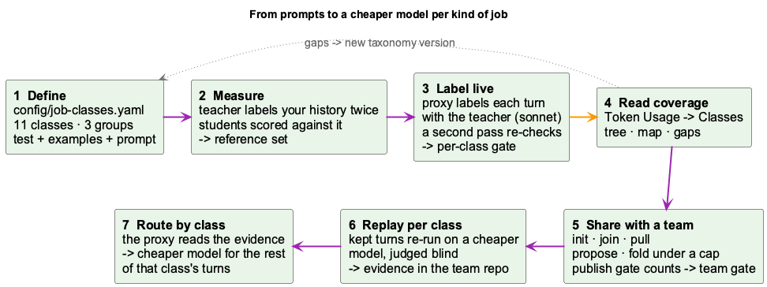
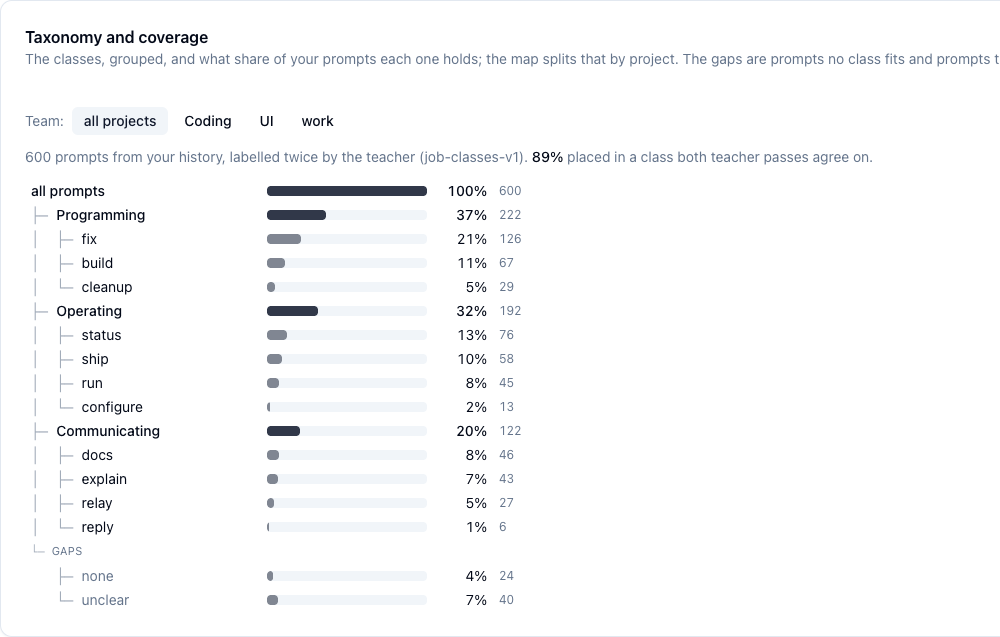
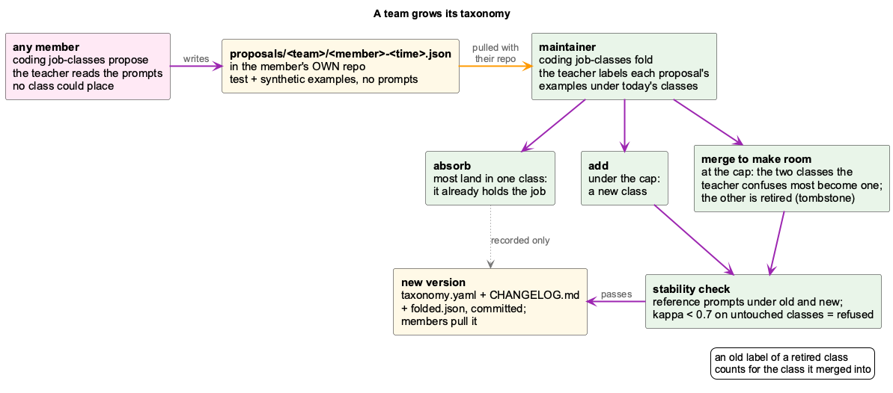
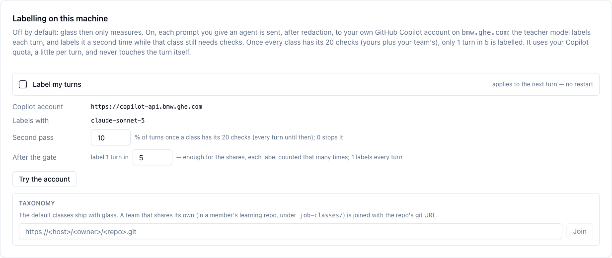

<div class="overview-deck" id="coding-job-classes" role="region" aria-label="coding job classes presentation" markdown="1">

<div class="overview-toolbar" hidden>
  <span class="overview-label">coding / job classes</span>
  <span class="overview-counter" role="status" aria-live="polite" aria-atomic="true"></span>
  <button type="button" data-fullscreen>Fullscreen</button>
</div>

<div class="overview-stage" markdown="1">

<section class="overview-slide overview-cover overview-essential" id="slide-1" aria-labelledby="jc-title" markdown="1">
<div class="overview-copy" markdown="1">

<p class="overview-kicker">What kind of job is this prompt?</p>

# The cheapest model that does each job well {#jc-title}

Every prompt you give an agent is one of a few **kinds of job**: fix something,
build something, ship it, check on it, explain it. A strong model labels each
turn with its kind, and a second pass checks that it labels consistently. Then
each kind can **earn** a cheaper model with evidence from a trial, not by
reputation.

<div class="overview-benefits" markdown="1">

**Built and running**  
define · measure · label live · gate each class · pool the gate as a team · read the coverage · share and grow as a team · replay per class · route by class · in glass too

**Waiting on data**  
no class has passed its gate or has evidence yet, so nothing is routed cheaper today

</div>

</div>
<figure class="overview-figure" markdown="1">

[](images/job-class-lifecycle.png){: target="_blank" rel="noopener" title="Open full-size diagram" }

<figcaption>All seven steps are built. Gaps found in step 4 feed back into step 1.</figcaption>
</figure>
<p class="overview-takeaway">Labels first, evidence second, cheaper routing last.</p>
</section>

<section class="overview-slide overview-essential" id="slide-2" aria-labelledby="jc-glance" markdown="1">
<div class="overview-copy" markdown="1">

<p class="overview-kicker">At a glance</p>

## Save, learn, share {#jc-glance}

**Save.** Routine jobs such as status, ship and run are about 40 % of the
coding team's prompts, and today the strong model answers every one of them.
Once a kind of job has proven a cheaper model, the proxy sends that kind of job
to it. Hard jobs like fix stay on the strong one. This works for pi, opencode
and Copilot CLI, whose model the proxy picks; Claude Code picks its own.

**Learn.** A strong model labels every prompt. A second pass of the same
model re-labels some of them, to check that its labels are consistent. Past
prompts of one kind are replayed on the cheaper model, and a blind judge
compares its answers with the current model's. Nothing switches without that
evidence.

**Share.** The kinds of job, the gate counts and the evidence go into the
team's repo, with no prompts in it. One member's proof spares the rest of the
team from repeating it.

</div>
<figure class="overview-figure" markdown="1">

[](images/job-class-at-a-glance.png){: target="_blank" rel="noopener" title="Open full-size diagram" }

<figcaption>All four steps run today. Step 4 switches a class only once steps 2 and 3 have proven it.</figcaption>
</figure>
<p class="overview-takeaway">The label picks the jobs to try; the evidence picks the model; the team shares both.</p>
</section>

<section class="overview-slide overview-essential" id="slide-3" aria-labelledby="jc-plain" markdown="1">
<div class="overview-copy" markdown="1">

<p class="overview-kicker">The idea in plain words</p>

## Not every job needs the strongest model {#jc-plain}

Some of what you ask an agent is hard: finding why something broke.
Much of it is routine: commit and push, is it finished, rerun the tests.
Today the same strong, expensive model answers all of it.

The idea, in three steps:

1. **Sort** every prompt into a kind of job. A strong model does the
   sorting. A second pass of it checks that the sorting is consistent.
2. **Try** a cheaper model on past jobs of one kind: replay them on it and
   compare its answers with the current model's.
3. **Switch** that kind of job to the cheaper model only if it does the job
   as well, and nothing else.

All three steps are built. Step 3 waits for the evidence from step 2.

</div>
<figure class="overview-figure" markdown="1">

| You type | Kind of job | A cheaper model? |
|---|---|---|
| "The export test fails since this morning, find out why." | fix | unlikely: an open search for a cause |
| "Add a CSV export to the trials tab." | build | to be tried |
| "Commit this and push." | ship | likely |
| "Is the benchmark finished?" | status | likely |
| "How does the router pick a band?" | explain | to be tried |

<figcaption>Made-up examples. Which kinds really can go cheaper is decided by a trial on your own prompts, never by this table.</figcaption>
</figure>
<p class="overview-takeaway">Sort the jobs, try a cheaper model per kind, switch only on evidence.</p>
</section>

<section class="overview-slide" id="slide-4" aria-labelledby="jc-words" markdown="1">
<div class="overview-copy" markdown="1">

<p class="overview-kicker">Words used in this deck</p>

## Who does what {#jc-words}

| Word | Meaning |
|---|---|
| **turn** | One message you send the agent, and all it does to answer. One label each. |
| **class** | A kind of job (fix, ship, status, …), defined by its **test**: which prompts belong. |
| **taxonomy** | All classes with tests and examples: one versioned file. |
| **group** | Classes put together for reading: programming, operating, communicating. |
| **teacher** | The strong model (Sonnet 5). It labels every turn live: no cheap model cleared the gate. |
| **student** | A cheap model (Haiku 5.5), scored in the offline measurement only. |

</div>
<figure class="overview-figure" markdown="1">

| Word | Meaning |
|---|---|
| **shadow** | Labels are recorded; nothing acts on a class until it has passed its gate and has evidence. |
| **reference set** | Past prompts the teacher labelled twice, giving the same class both times. |
| **dev / test set** | Prompts read while writing the tests, and prompts never read. Only the test set scores honestly. |
| **agreement · kappa** | How often two labellers agree; kappa removes luck (0 chance, 1 perfect). |
| **precision** | Of the turns the labeller put in a class, the share the second pass put there too. |
| **gate** | The bar a class must clear before anything acts on it: 90 % agreement over at least 20 checked turns. |
| **pool** | The team's gate counts on the same models and taxonomy version, added up. |
| **band** | How hard the router thinks a prompt is (small, medium, high). A class says what kind of job it is. |
| **replay · judge** | A past turn rerun on the current and a cheaper model; a judge compares the answers blind. |

</figure>
<p class="overview-takeaway">The teacher labels, a second pass checks, the gate decides when a label can be trusted.</p>
</section>

<section class="overview-slide" id="slide-5" aria-labelledby="jc-why" markdown="1">
<div class="overview-copy" markdown="1">

<p class="overview-kicker">Why classes</p>

## Most of the work is not programming {#jc-why}

The router already picks a **band** (small, medium, high) per prompt. That
says how hard a prompt looks, not what kind of job it is. Each kind fails
differently on a cheap model:

- **fix** is an open-ended search for a cause. It usually needs the strong model.
- **status**, **run** and **ship** report or operate what exists, so a cheap model
  is the obvious candidate for them.
- **cleanup** is mechanical, but a cheap model can quietly drop details doing it.

Programming (fix + build + cleanup) is a group of three classes, not one class.
As one class it would hide those differences.

</div>
<figure class="overview-figure" markdown="1">

[](images/job-classes-tree.png){: target="_blank" rel="noopener" title="Open full-size screenshot" }

<figcaption>Token Usage → Classes → Tree: the coding team's prompts, each labelled twice by the teacher.</figcaption>
</figure>
<p class="overview-takeaway">Route by kind of job, not only by how hard a prompt looks.</p>
</section>

<section class="overview-slide" id="slide-6" aria-labelledby="jc-define" markdown="1">
<div class="overview-copy" markdown="1">

<p class="overview-kicker">Step 1 · built</p>

## Define the classes {#jc-define}

One file, `config/job-classes.yaml` (or a team's own copy), holds:

- **classes**, each with an id, a **test** (when a prompt belongs to it) and examples;
- **groups** for reading (programming, operating, communicating). They are never sent to a model;
- a **precedence** order: a prompt that fits two classes takes the more demanding one;
- the **prompt** template, which every classifier is sent as is.

The classes are **written by a person**. A model deriving its own classes was
tried first, and two derivations from the same prompts disagreed (kappa 0.54).
Version 2 sharpened the line between **run** (try the thing) and **status**
(read what is recorded), the boundary the student missed most.

</div>
<figure class="overview-figure" markdown="1">

```yaml
version: 2
groups:
  - id: programming
    label: Programming
classes:
  - id: fix
    group: programming
    test: Something that should work does not,
      and the job is to find out why and/or
      make it work.
    examples:
      - "git push fails with 403 since this morning."
precedence: [relay, fix, build, cleanup, ...]
```

<figcaption>The measurement and the live tagger render the same template, so a score measured offline still describes the live tagger.</figcaption>
</figure>
<p class="overview-takeaway">Write the tests sharply, because the student only knows what they say.</p>
</section>

<section class="overview-slide" id="slide-7" aria-labelledby="jc-measure" markdown="1">
<div class="overview-copy" markdown="1">

<p class="overview-kicker">Step 2 · built</p>

## Measure: teacher twice, students once {#jc-measure}

```bash
node scripts/measure-job-classes.mjs \
  --taxonomy=config/job-classes.yaml --team=coding \
  --students=claude-haiku-5.5,gpt-5.6-luna
```

1. The prompts come from **your team's history** (the session logs, already redacted).
2. The **teacher** labels every prompt **twice**. Prompts where its two passes agree form the **reference set**.
3. Each **student** labels them once and is scored against the teacher.

Results stay on your machine (`~/.coding/data/…/var/job-classes/<team>/`). They
are never committed, because they are your real prompts.

</div>
<figure class="overview-figure" markdown="1">

| On the test set (never read while writing the tests) | agreement |
|---|---|
| teacher vs itself (sonnet-5) | kappa 0.96 |
| **claude-haiku-5.5** (the student) | **86 %**, kappa 0.83 |
| claude-haiku-5.5, on the coding team's own prompts | 81 %, kappa 0.79 |
| gpt-5.6-luna · gpt-5.6-terra (version 1) | kappa 0.77 |
| gpt-4o-mini (version 1) | kappa 0.71 |
| decima:agent, a local decision model (version 1) | 36 % |

<figcaption>Taxonomy version 2 unless marked. What the student still misses is mostly short follow-ups ("do the other ones too"), which need the conversation, not just the prompt.</figcaption>
</figure>
<p class="overview-takeaway">A cheap student agrees with the teacher more than 4 times in 5, but none reached the 90 % gate, so the teacher labels live.</p>
</section>

<section class="overview-slide" id="slide-8" aria-labelledby="jc-live" markdown="1">
<div class="overview-copy" markdown="1">

<p class="overview-kicker">Step 3 · built</p>

## Label every turn, in shadow {#jc-live}

The LLM proxy labels the **first call of each human turn** with the teacher
(claude-sonnet-5), **after** forwarding it. The turn itself never waits for the
label and is never changed by it.

- Skipped: sub-agents, tool loops, harness messages and **automated runs** (benchmarks, replays, `claude -p`).
- The prompt is redacted first; if redaction fails, the turn is skipped.
- A **second teacher pass** checks consistency: every turn of a class while the team has under 20 checks for it (`sample_until_gate`), then 1 in 10 (status and explain: every turn, for replay).
- The label sits beside the turn's tokens: tokens per class for free.
- **Reporting phase** (`report_sample_every`, glass: 5): once every class has a verdict, 1 turn in N is labelled and counts N times. Off in coding, where routing needs every label.
- **On or off:** in coding, the dashboard's Features tab → LLM Proxy → *Job-class labelling* (or its box on the map). The choice is this machine's, stored on the proxy over the team's setting.

</div>
<figure class="overview-figure" markdown="1">

[![The agent's call goes through the LLM proxy unchanged; after forwarding, the tagger skips sub-agents, tool loops, harness text and automated runs, cleans and redacts the prompt, the teacher (sonnet) labels it, a second teacher pass re-checks every turn of a class until the team pool (the members' gate files plus this machine's live counts) has 20 checks for it and a sample after that, and both labels land in turn_job_class beside token_usage, read by the dashboard. The taxonomy is the team's, or the default file. In the optional reporting phase only 1 turn in N is labelled and counts N times.](images/job-class-live-tagging.png)](images/job-class-live-tagging.png){: target="_blank" rel="noopener" title="Open full-size diagram" }

<figcaption>Labelling happens after the turn has been forwarded, so nothing it does can slow a turn down.</figcaption>
</figure>
<p class="overview-takeaway">Labels arrive seconds after the turn starts; the turn's later calls can use them (step 7).</p>
</section>

<section class="overview-slide overview-essential" id="slide-9" aria-labelledby="jc-gate" markdown="1">
<div class="overview-copy" markdown="1">

<p class="overview-kicker">Step 3, continued · built</p>

## The gate: can the label be trusted? {#jc-gate}

A label is only useful if it is right and stable. For each class, the gate
asks: **of the turns the teacher put in this class, how many did its second
pass put there too?** Offline, the two passes agree about 94 % of the time.

- A class **passes** at 90 % or more, over at least 20 re-checked turns.
- Below 90 % it is **below the gate**: its test needs sharpening.
- With fewer than 20 checks it is still **collecting**.
- **none** has no gate.

Checks count over the last 90 days. Labels from every version of a taxonomy
are counted under today's classes. Only a class that passes may later drive a
route.

</div>
<figure class="overview-figure" markdown="1">

[](images/job-classes-gate.png){: target="_blank" rel="noopener" title="Open full-size screenshot" }

<figcaption>The gate panel with the team's pooled columns beside this machine's (see <i>Pool the gate</i>). <b>status</b> is consistent at 49 checks; the rest are still collecting.</figcaption>
</figure>
<p class="overview-takeaway">No class acts on its label until the second pass has confirmed it enough times.</p>
</section>

<section class="overview-slide" id="slide-10" aria-labelledby="jc-coverage" markdown="1">
<div class="overview-copy" markdown="1">

<p class="overview-kicker">Step 4 · built</p>

## Read the coverage, find the gaps {#jc-coverage}

**Token Usage → Classes** shows the taxonomy as a **tree** or as a **map**
(classes × projects), for the reference set or for live turns, for all
projects or one team. Groups open to show their classes, and clicking a class
shows its test next to real prompts it holds.

Two rows tell you where the taxonomy needs work:

- **none**: no class fits. If many prompts land here, a class is missing.
- **unclear**: the teacher's two passes disagree, so a test needs sharpening.

Then edit the YAML, bump the `version` and measure again.

</div>
<figure class="overview-figure" markdown="1">

[](images/job-classes-map.png){: target="_blank" rel="noopener" title="Open full-size screenshot" }

<figcaption>The map with its groups opened. Projects with few prompts are faded.</figcaption>
</figure>
<p class="overview-takeaway">Every gap is either a class to add or a test to sharpen.</p>
</section>

<section class="overview-slide" id="slide-11" aria-labelledby="jc-team" markdown="1">
<div class="overview-copy" markdown="1">

<p class="overview-kicker">Step 5 · built</p>

## Set up a team {#jc-team}

1. Declare the team's repos in `~/.coding/teams.yaml`, or in the dashboard's **Teams** tab.
2. The first member runs `coding job-classes init --team <id>`. It writes `job-classes/taxonomy.yaml` into their learning repo and commits it locally. `coding sync --push` shares it.
3. Every other member runs `coding job-classes join --team <id> --repo <url>`. After that, `coding sync` pulls new versions at launch.
4. Measure the team's taxonomy on the team's prompts: `measure-job-classes.mjs --team=<id> --taxonomy=<its file>`.

From then on, the proxy labels that team's projects with the team's taxonomy and
every other project with the default. Labels carry the taxonomy's name and
version, and **Classes** has a picker for which one to read.

</div>
<figure class="overview-figure" markdown="1">

[![The first member writes job-classes/taxonomy.yaml and CHANGELOG.md into their learning repo; each other member joins, which binds the team and clones the repo; a bindings index maps each project to its team's taxonomy file, and the LLM proxy labels each project with it. Each member and install (coding, glass) publishes job-classes/gate/<pseudonym>.json with per-class counts, its source and no prompts — by hand once, then on every coding sync (glass every 30 minutes); the Gate panel adds up the members of one pool, counting this machine live and never twice, and Team contributions lets this machine leave a member out.](images/job-class-team-sharing.png)](images/job-class-team-sharing.png){: target="_blank" rel="noopener" title="Open full-size diagram" }

<figcaption>The shared package holds no prompts: only the taxonomy, its changelog and each member's gate counts.</figcaption>
</figure>
<p class="overview-takeaway">A project in two teams with two taxonomies is not labelled, not guessed.</p>
</section>

<section class="overview-slide" id="slide-12" aria-labelledby="jc-grow" markdown="1">
<div class="overview-copy" markdown="1">

<p class="overview-kicker">Step 5, continued · built</p>

## Grow the taxonomy {#jc-grow}

1. Any member runs `coding job-classes propose --team <id>`. The teacher reads the prompts no class could place and drafts new classes, with examples it writes itself. The proposal goes into the member's own repo, and `coding sync --push` shares it.
2. The maintainer runs `coding job-classes fold --team <id>` (`--dry-run` first). In the maintainer's own learning repo the fold is committed and `coding sync --push` shares it. When the classes are in a repo of their own, joined with `coding job-classes join`, the fold pulls that repo first and pushes the new version itself (`--no-push` keeps it local), so anyone with write access can fold.
3. A proposal an existing class already holds is **absorbed**. A new kind of job is **added**. At the class cap, the two classes the teacher confuses most **merge** to make room.
4. Before anything is written, the **stability check** labels reference prompts under the old and the new version. A version that moves the untouched classes is refused.

</div>
<figure class="overview-figure" markdown="1">

[](images/job-class-team-growth.png){: target="_blank" rel="noopener" title="Open full-size diagram" }

<figcaption>A merged class leaves a tombstone, so its old labels still count for the class it merged into.</figcaption>
</figure>
<p class="overview-takeaway">One maintainer writes the taxonomy; every member can propose.</p>
</section>

<section class="overview-slide" id="slide-13" aria-labelledby="jc-pool" markdown="1">
<div class="overview-copy" markdown="1">

<p class="overview-kicker">Step 5, continued · built</p>

## Pool the gate as a team {#jc-pool}

One machine collects 20 checks per class slowly. A team adds up its members' counts.

1. Each member runs `coding job-classes publish --team <id>`. It writes `job-classes/gate/<pseudonym>.json` beside `taxonomy.yaml`: per class the turns labelled, checked and agreed, and which classes the two passes confused. Never a prompt. The file is named by a pseudonym, never your name (see *See who contributed*).
2. If the package is in your own learning repo, the file is only committed. `coding sync --push` pushes it, and asks first, because that repo also carries transcripts. A shared clone under `var/shared/` is pushed directly with `--push`.
3. The first publish is the opt-in. After it, every `coding sync` (launch pull, 30-minute commit, `--push`) publishes again, and glass does every 30 minutes. Unchanged counts commit nothing.

Every member needs write access to the team repo.

</div>
<figure class="overview-figure" markdown="1">

| Which counts are added up |
|---|
| Only within a **pool**: the same taxonomy version, the same labeller model, the same checker model. Model names are compared without provider prefix, and `.` counts as `-`. |
| A member on other models or an older version is listed under **Not added**. |
| Labels nobody has checked yet count with the checked pool of the same labeller. |
| A file older than 14 days is greyed out and not added. An invalid file is listed, not added. |
| This machine's own file is replaced by its live counts, so it is never counted twice. |

<figcaption>Token Usage → Classes → Gate shows this machine's columns beside <b>Team: checked</b>, <b>Team agreement</b> and <b>Team</b> (from <code>GET /api/job-classes/summary?scope=team</code>), the members with the age of their file, and the Not added lines. A badge says whether labelling is still <b>collecting: every turn</b> or <b>reporting: 1 turn in N</b>.</figcaption>
</figure>
<p class="overview-takeaway">The team's counts decide the gate together; no prompt leaves a machine.</p>
</section>

<section class="overview-slide" id="slide-14" aria-labelledby="jc-contrib" markdown="1">
<div class="overview-copy" markdown="1">

<p class="overview-kicker">Step 5, continued · built</p>

## See who contributed {#jc-contrib}

**Team contributions**, under the Gate table, opens what the team's classes repo
holds: one row per published file.

- **Who**: a pseudonym, the first 10 hex characters of sha1(hostname:user). glass uses sha1(hostname:user:glass), so this machine's coding and glass are two rows whose counts add up, both named. A turn glass forwards to coding's proxy is labelled by glass only, so nothing counts twice.
- **What**: the install that published it, its age, labelled / checked / agreed, and its pools. Click a row for its per-class counts.
- **Untick** a row to leave it out of this machine's sums: the Gate panel, sampling and class routing. The choice stays in `<data>/job-classes/gate-exclude.json`; the repo and your teammates' views do not change.

</div>
<figure class="overview-figure" markdown="1">

[](images/job-classes-team-contributions.png){: target="_blank" rel="noopener" title="Open full-size screenshot" }

<figcaption>Every team number traced to a member and an install. Unticking a row changes only this machine's sums.</figcaption>
</figure>
<p class="overview-takeaway">You see whose counts you add up, and you decide.</p>
</section>

<section class="overview-slide overview-essential" id="slide-15" aria-labelledby="jc-trial" markdown="1">
<div class="overview-copy" markdown="1">

<p class="overview-kicker">Step 6 · built</p>

## Replay past turns on a cheaper model {#jc-trial}

For a turn labelled with a kept class (`status`, `explain`), the proxy keeps
what a replay needs: the prompt as sent, the conversation before it, the
answer you read, and the repo as it was when the turn began. Everything passes
the redactor first. This works the same for Claude Code, Copilot CLI, opencode
and pi, because every agent's turns pass through the proxy.

```bash
coding job-classes replay candidates --class status
coding job-classes replay run --candidate claude-haiku-5.5
coding job-classes replay report
```

Each turn runs twice in a sandbox, in the agent that ran it: once on the
current model and once on the candidate. A judge compares the two answers
blind, in both orders. A class passes for that agent and model after at least
20 pairs, with at least 90 % giving the same core answer.

</div>
<figure class="overview-figure" markdown="1">

[![Turns labelled status are answered as usual while the proxy keeps the prompt, the conversation, the answer read and the repo state; the current model and the cheaper candidate each replay the turn in a sandbox; a blind judge compares the answers; the verdict per class, agent and model needs 20 pairs and 90 % the same core; the maintainer records it as evidence/status.json in the team repo, and the proxy's class floor sends the rest of each status turn to the cheaper model, on the same provider, once the gate has passed on this machine or for the team, as gate_scope says (default: this machine).](images/job-class-trial-routing.png)](images/job-class-trial-routing.png){: target="_blank" rel="noopener" title="Open full-size diagram" }

<figcaption>A replay never touches your live repos, data or agent sessions, and its own calls are not labelled.</figcaption>
</figure>
<p class="overview-takeaway">No model gets cheaper without evidence from your own past turns.</p>
</section>

<section class="overview-slide overview-essential" id="slide-16" aria-labelledby="jc-route" markdown="1">
<div class="overview-copy" markdown="1">

<p class="overview-kicker">Step 7 · built</p>

## Route one kind of job to a cheaper model {#jc-route}

The maintainer records a passing verdict (`coding job-classes replay evidence
--team <id> --class <c> --candidate <model>`) as `evidence/<class>.json` in the
team repo — counts and models, never prompts; every member pulls it.

The proxy's **class floor** then sends a labelled turn's later calls to the
cheaper model, only if:

- the class **passed its gate** — this machine's checks by default, or the team's (`gate_scope: team`, set in the Gate panel; an unreadable pool routes nothing);
- the evidence is for **this agent** and the model the call would get;
- the route's **own provider** serves the cheaper model in a **lower band**.

For pi, opencode and Copilot CLI. Claude Code picks its own model, so there
the evidence is a recommendation.

</div>
<figure class="overview-figure" markdown="1">

```json
{
  "schema": 1,
  "class": "status",
  "verdicts": [{
    "candidate": "claude-haiku-5.5",
    "incumbents": ["claude-opus-5"],
    "agent": "pi",
    "pairs": 24,
    "sameRate": 0.96
  }]
}
```

<figcaption>evidence/status.json, shortened, made-up numbers. <code>GET /api/job-classes</code> → <code>routing</code> shows how often the floor applied, and why not.</figcaption>
</figure>
<p class="overview-takeaway">The class picks which jobs to try; the evidence decides the model.</p>
</section>

<section class="overview-slide" id="slide-17" aria-labelledby="jc-glass" markdown="1">
<div class="overview-copy" markdown="1">

<p class="overview-kicker">In glass · built</p>

## The same, on machines without coding {#jc-glass}

Most people will only ever run **glass**. It labels their turns the same way, opt-in:

- Sonnet labels through **their own Copilot account** (their `gh` login); after the gate, 1 turn in 5;
- prompts are redacted, and nothing is sent until they tick **Label my turns**;
- `glass job-classes measure` reads the **agents' own transcripts**, so no session logs are needed;
- `glass job-classes join <url>` takes a team's taxonomy; after a first `publish`, glass shares its gate counts and pulls the team's every 30 minutes.

The Classes tab, the gate and the map are the same; routing by class is coding only.

</div>
<figure class="overview-figure" markdown="1">

[](images/glass-job-classes-settings.png){: target="_blank" rel="noopener" title="Open full-size screenshot" }

<figcaption>glass → Token Usage → Classes: off until the user switches it on.</figcaption>
</figure>
<p class="overview-takeaway">One taxonomy, one gate, whether a colleague runs coding or only glass.</p>
</section>

</div>

<nav class="overview-controls" aria-label="Presentation controls" hidden>
  <button type="button" data-prev>Previous</button>
  <div class="overview-dots" aria-label="Choose a slide"></div>
  <button type="button" data-next>Next</button>
  <span class="overview-help">Arrow keys to navigate / F for fullscreen</span>
</nav>
<p class="overview-message" role="status" aria-live="polite"></p>

</div>
