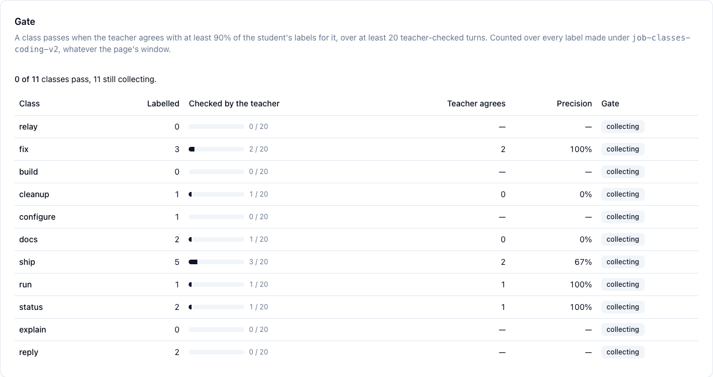
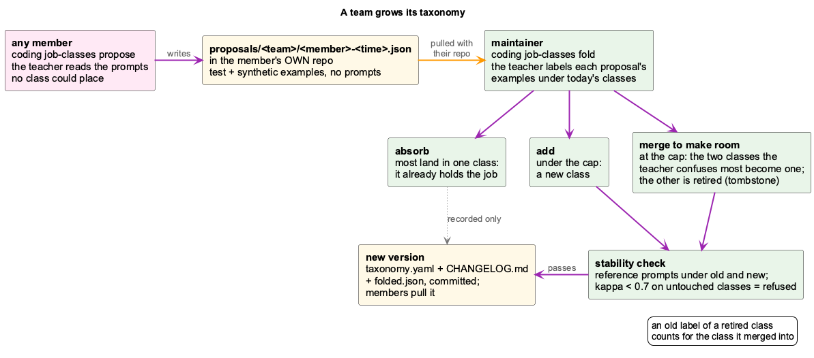

<div class="overview-deck" id="coding-job-classes" role="region" aria-label="coding job classes presentation" markdown="1">

<div class="overview-toolbar" hidden>
  <span class="overview-label">coding / job classes</span>
  <span class="overview-counter" role="status" aria-live="polite" aria-atomic="true"></span>
  <button type="button" data-fullscreen>Fullscreen</button>
</div>

<div class="overview-stage" markdown="1">

<section class="overview-slide overview-cover" id="slide-1" aria-labelledby="jc-title" markdown="1">
<div class="overview-copy" markdown="1">

<p class="overview-kicker">What kind of job is this prompt?</p>

# The cheapest model that does each job well {#jc-title}

Every prompt you give an agent is one of a few **kinds of job**: fix something,
build something, ship it, check on it, explain it. A cheap model labels each
turn with its kind. Then each kind can **earn** a cheaper model with evidence
from a trial, not by reputation.

<div class="overview-benefits" markdown="1">

**Built and running**  
define · measure · label live · gate each class · read the coverage · share and grow as a team

**Next**  
trial per class · route by class · the same in glass

</div>

</div>
<figure class="overview-figure" markdown="1">

[](images/job-class-lifecycle.png){: target="_blank" rel="noopener" title="Open full-size diagram" }

<figcaption>Green: built and running. Gray: next. Gaps found in step 4 feed back into step 1.</figcaption>
</figure>
<p class="overview-takeaway">Labels first, evidence second, cheaper routing last.</p>
</section>

<section class="overview-slide" id="slide-2" aria-labelledby="jc-plain" markdown="1">
<div class="overview-copy" markdown="1">

<p class="overview-kicker">The idea in plain words</p>

## Not every job needs the strongest model {#jc-plain}

Some of what you ask an agent is hard: finding why something broke.
Much of it is routine: commit and push, is it finished, rerun the tests.
Today the same strong, expensive model answers all of it.

The idea, in three steps:

1. **Sort** every prompt into a kind of job. A cheap, fast model does the
   sorting. A strong model checks a sample of its work.
2. **Try** a cheaper model on one kind of job, beside the current one, and
   compare the answers.
3. **Switch** that kind of job to the cheaper model only if it does the job
   as well, and nothing else.

Step 1 is built and running. Steps 2 and 3 come next.

</div>
<figure class="overview-figure" markdown="1">

| You type | Kind of job | A cheaper model? |
|---|---|---|
| "The export test fails since this morning, find out why." | fix | unlikely: an open search for a cause |
| "Add a CSV export to the trials tab." | build | to be tried |
| "Commit this and push." | ship | likely |
| "Is the benchmark finished?" | status | likely |
| "How does the router pick a band?" | explain | to be tried |

<figcaption>Made-up examples. Which kinds really can go cheaper is decided by a trial on your own prompts, never by this table.</figcaption>
</figure>
<p class="overview-takeaway">Sort the jobs, try a cheaper model per kind, switch only on evidence.</p>
</section>

<section class="overview-slide" id="slide-3" aria-labelledby="jc-words" markdown="1">
<div class="overview-copy" markdown="1">

<p class="overview-kicker">Words used in this deck</p>

## Who does what {#jc-words}

| Word | Meaning |
|---|---|
| **turn** | One message you send the agent, and all it does to answer. One label each. |
| **class** | A kind of job (fix, ship, status, …), defined by its **test**: which prompts belong. |
| **taxonomy** | All classes with tests and examples: one versioned file. |
| **group** | Classes put together for reading: programming, operating, communicating. |
| **student** | The cheap, fast model (Haiku 5.5) that labels every turn. |
| **teacher** | The strong model (Sonnet 5); its labels count as right. It checks the student. |

</div>
<figure class="overview-figure" markdown="1">

| Word | Meaning |
|---|---|
| **shadow** | Labels are recorded; nothing acts on them yet. |
| **reference set** | Past prompts the teacher labelled twice, giving the same class both times. |
| **dev / test set** | Prompts read while writing the tests (dev), and prompts never read (test). Only the test set gives an honest score. |
| **agreement · kappa** | How often two labellers give the same class. Kappa removes the agreement luck alone would give: 0 is chance, 1 is perfect. |
| **precision** | Of the turns the student put in a class, the share the teacher put there too. |
| **gate** | The bar a class must clear before anything acts on it: 90 % precision over at least 20 checked turns. |
| **band** | How hard the router thinks a prompt is (small, medium, high). A class says what kind of job it is. |
| **trial · judge** | A cheaper model answers beside the current one. A strong judge compares the two answers without knowing which is which. |

</figure>
<p class="overview-takeaway">The student labels, the teacher checks, the gate decides when a label can be trusted.</p>
</section>

<section class="overview-slide" id="slide-4" aria-labelledby="jc-why" markdown="1">
<div class="overview-copy" markdown="1">

<p class="overview-kicker">Why classes</p>

## Most of the work is not programming {#jc-why}

The router already picks a **band** (small, medium, high) per prompt. That
says how hard a prompt looks, not what kind of job it is. Each kind fails
differently on a cheap model:

- **fix** is an open-ended search for a cause. It usually needs the strong model.
- **status**, **run** and **ship** report or operate what exists, so a cheap model
  is the obvious candidate for them.
- **cleanup** is mechanical, but a cheap model can quietly drop details doing it.

Programming (fix + build + cleanup) is a group of three classes, not one class.
As one class it would hide those differences.

</div>
<figure class="overview-figure" markdown="1">

[](images/job-classes-tree.png){: target="_blank" rel="noopener" title="Open full-size screenshot" }

<figcaption>Token Usage → Classes → Tree: the coding team's prompts, each labelled twice by the teacher.</figcaption>
</figure>
<p class="overview-takeaway">Route by kind of job, not only by how hard a prompt looks.</p>
</section>

<section class="overview-slide" id="slide-5" aria-labelledby="jc-define" markdown="1">
<div class="overview-copy" markdown="1">

<p class="overview-kicker">Step 1 · built</p>

## Define the classes {#jc-define}

One file, `config/job-classes.yaml` (or a team's own copy), holds:

- **classes**, each with an id, a **test** (when a prompt belongs to it) and examples;
- **groups** for reading (programming, operating, communicating). They are never sent to a model;
- a **precedence** order: a prompt that fits two classes takes the more demanding one;
- the **prompt** template, which every classifier is sent as is.

The classes are **written by a person**. A model deriving its own classes was
tried first, and two derivations from the same prompts disagreed (kappa 0.54).
Version 2 sharpened the line between **run** (try the thing) and **status**
(read what is recorded), the boundary the student missed most.

</div>
<figure class="overview-figure" markdown="1">

```yaml
version: 2
groups:
  - id: programming
    label: Programming
classes:
  - id: fix
    group: programming
    test: Something that should work does not,
      and the job is to find out why and/or
      make it work.
    examples:
      - "git push fails with 403 since this morning."
precedence: [relay, fix, build, cleanup, ...]
```

<figcaption>The measurement and the live tagger render the same template, so a score measured offline still describes the live tagger.</figcaption>
</figure>
<p class="overview-takeaway">Write the tests sharply, because the student only knows what they say.</p>
</section>

<section class="overview-slide" id="slide-6" aria-labelledby="jc-measure" markdown="1">
<div class="overview-copy" markdown="1">

<p class="overview-kicker">Step 2 · built</p>

## Measure: teacher twice, students once {#jc-measure}

```bash
node scripts/measure-job-classes.mjs \
  --taxonomy=config/job-classes.yaml --team=coding \
  --students=claude-haiku-5.5,gpt-5.6-luna
```

1. The prompts come from **your team's history** (the session logs, already redacted).
2. The **teacher** labels every prompt **twice**. Prompts where its two passes agree form the **reference set**.
3. Each **student** labels them once and is scored against the teacher.

Results stay on your machine (`~/.coding/data/…/var/job-classes/<team>/`). They
are never committed, because they are your real prompts.

</div>
<figure class="overview-figure" markdown="1">

| On the test set (never read while writing the tests) | agreement |
|---|---|
| teacher vs itself (sonnet-5) | kappa 0.96 |
| **claude-haiku-5.5** (the student) | **86 %**, kappa 0.83 |
| claude-haiku-5.5, on the coding team's own prompts | 81 %, kappa 0.79 |
| gpt-5.6-luna · gpt-5.6-terra (version 1) | kappa 0.77 |
| gpt-4o-mini (version 1) | kappa 0.71 |
| decima:agent, a local decision model (version 1) | 36 % |

<figcaption>Taxonomy version 2 unless marked. What the student still misses is mostly short follow-ups ("do the other ones too"), which need the conversation, not just the prompt.</figcaption>
</figure>
<p class="overview-takeaway">A cheap student agrees with the strong teacher more than 4 times in 5.</p>
</section>

<section class="overview-slide" id="slide-7" aria-labelledby="jc-live" markdown="1">
<div class="overview-copy" markdown="1">

<p class="overview-kicker">Step 3 · built</p>

## Label every turn, in shadow {#jc-live}

The LLM proxy labels the **first call of each human turn** with the student,
**after** forwarding it. The turn itself never waits for the label and is
never changed by it.

- Sub-agents, tool loops and harness messages are skipped.
- **Automated runs** are skipped too: benchmark and experiment cells, replays and `claude -p`. Their prompts are scripted, not work a person handed over.
- The prompt is redacted before the student sees it. If redaction fails, the turn is skipped.
- The teacher labels a sample of turns as well (`teacher_sample_pct`). Until every class has passed or failed its gate, the sample is every turn.
- The label is stored beside the turn's tokens, so tokens per class come for free.

</div>
<figure class="overview-figure" markdown="1">

[](images/job-class-live-tagging.png){: target="_blank" rel="noopener" title="Open full-size diagram" }

<figcaption>Labelling happens after the turn has been forwarded, so nothing it does can slow a turn down.</figcaption>
</figure>
<p class="overview-takeaway">Labels arrive about 2 s after the turn; nothing routes on them yet.</p>
</section>

<section class="overview-slide" id="slide-8" aria-labelledby="jc-gate" markdown="1">
<div class="overview-copy" markdown="1">

<p class="overview-kicker">Step 3, continued · built</p>

## The gate: can the label be trusted? {#jc-gate}

A label is only useful if it is right. For each class, the gate asks: **of
the turns the student put in this class, how many did the teacher put there
too?**

- A class **passes** at 90 % or more, over at least 20 turns the teacher checked.
- Below 90 % it is **below the gate**: its test needs sharpening.
- With fewer than 20 checks it is still **collecting**.

Only a class that passes may later drive a trial or a route. The count starts
again at zero with every new taxonomy version, because the tests changed.

</div>
<figure class="overview-figure" markdown="1">

[](images/job-classes-gate.png){: target="_blank" rel="noopener" title="Open full-size screenshot" }

<figcaption>The gate panel, a day after version 2 went live: every class still collecting.</figcaption>
</figure>
<p class="overview-takeaway">No class acts on its label until the teacher has confirmed it enough times.</p>
</section>

<section class="overview-slide" id="slide-9" aria-labelledby="jc-coverage" markdown="1">
<div class="overview-copy" markdown="1">

<p class="overview-kicker">Step 4 · built</p>

## Read the coverage, find the gaps {#jc-coverage}

**Token Usage → Classes** shows the taxonomy as a **tree** or as a **map**
(classes × projects), for the reference set or for live turns, for all
projects or one team. Groups open to show their classes, and clicking a class
shows its test next to real prompts it holds.

Two rows tell you where the taxonomy needs work:

- **none**: no class fits. If many prompts land here, a class is missing.
- **unclear**: the teacher's two passes disagree, so a test needs sharpening.

Then edit the YAML, bump the `version` and measure again.

</div>
<figure class="overview-figure" markdown="1">

[](images/job-classes-map.png){: target="_blank" rel="noopener" title="Open full-size screenshot" }

<figcaption>The map with its groups opened. Projects with few prompts are faded.</figcaption>
</figure>
<p class="overview-takeaway">Every gap is either a class to add or a test to sharpen.</p>
</section>

<section class="overview-slide" id="slide-10" aria-labelledby="jc-team" markdown="1">
<div class="overview-copy" markdown="1">

<p class="overview-kicker">Step 5 · built</p>

## Set up a team {#jc-team}

1. Declare the team's repos in `~/.coding/teams.yaml`, or in the dashboard's **Teams** tab.
2. The first member runs `coding job-classes init --team <id>`. It writes `job-classes/taxonomy.yaml` into their learning repo and commits it locally. `coding sync --push` shares it.
3. Every other member runs `coding job-classes join --team <id> --repo <url>`. After that, `coding sync` pulls new versions at launch.
4. Measure the team's taxonomy on the team's prompts: `measure-job-classes.mjs --team=<id> --taxonomy=<its file>`.

From then on, the proxy labels that team's projects with the team's taxonomy and
every other project with the default. Labels carry the taxonomy's name and
version, and **Classes** has a picker for which one to read.

</div>
<figure class="overview-figure" markdown="1">

[](images/job-class-team-sharing.png){: target="_blank" rel="noopener" title="Open full-size diagram" }

<figcaption>The shared package holds no prompts: only the taxonomy and its changelog.</figcaption>
</figure>
<p class="overview-takeaway">A project in two teams with two taxonomies is not labelled, not guessed.</p>
</section>

<section class="overview-slide" id="slide-11" aria-labelledby="jc-grow" markdown="1">
<div class="overview-copy" markdown="1">

<p class="overview-kicker">Step 5, continued · built</p>

## Grow the taxonomy {#jc-grow}

1. Any member runs `coding job-classes propose --team <id>`. The teacher reads the prompts no class could place and drafts new classes, with examples it writes itself. The proposal goes into the member's own repo, and `coding sync --push` shares it.
2. The maintainer runs `coding job-classes fold --team <id>` (`--dry-run` first).
3. A proposal an existing class already holds is **absorbed**. A new kind of job is **added**. At the class cap, the two classes the teacher confuses most **merge** to make room.
4. Before anything is written, the **stability check** labels reference prompts under the old and the new version. A version that moves the untouched classes is refused.

</div>
<figure class="overview-figure" markdown="1">

[](images/job-class-team-growth.png){: target="_blank" rel="noopener" title="Open full-size diagram" }

<figcaption>A merged class leaves a tombstone, so its old labels still count for the class it merged into.</figcaption>
</figure>
<p class="overview-takeaway">One maintainer writes the taxonomy; every member can propose.</p>
</section>

<section class="overview-slide" id="slide-12" aria-labelledby="jc-trial" markdown="1">
<div class="overview-copy" markdown="1">

<p class="overview-kicker">Step 6 · built per process, per class next</p>

## Trial a cheaper model {#jc-trial}

**Token Usage → Trials** runs a cheaper candidate **beside** the current model
on real calls:

- you only ever get the current model's answer;
- a judge compares each pair **blind, in both orders**;
- it passes with ≥ 20 pairs, ≥ 90 % "at least as good" and ≥ 90 % of details kept.

Here haiku-5.5 **failed** on `consolidator-insight`: it was at least as good on only
56 % of pairs and kept 87 % of the details. That's why the process stays on sonnet.

**Next:** a trial keyed by **job class**, sampling only, say, `status` turns.

</div>
<figure class="overview-figure" markdown="1">

[](images/job-classes-trials.png){: target="_blank" rel="noopener" title="Open full-size screenshot" }

<figcaption>A failed trial: nothing switches unless you accept one.</figcaption>
</figure>
<p class="overview-takeaway">No model gets cheaper without evidence from your own traffic.</p>
</section>

<section class="overview-slide" id="slide-13" aria-labelledby="jc-route" markdown="1">
<div class="overview-copy" markdown="1">

<p class="overview-kicker">Step 7 · next</p>

## Change the config for one kind of job {#jc-route}

**Today**, accepting a trial writes the model into **one process's route**:

```yaml
# llm-routing.yaml: the band, or a model pin
bg-consolidator-insight: { provider: gh-copilot, complexity: medium }
```

**Next:** an accepted class trial writes `evidence/<class>.json` to the team
repo. A class may then be **downgraded** on a member's machine **only** if it
has passed its gate and a passing verdict exists for the model it would go to on
*that* member's route. Downgrade-only and fail-open still apply: no evidence, no change.

</div>
<figure class="overview-figure" markdown="1">

[](images/job-class-trial-routing.png){: target="_blank" rel="noopener" title="Open full-size diagram" }

<figcaption>One member's accepted trial spares the rest of the team from running it.</figcaption>
</figure>
<p class="overview-takeaway">The class picks which jobs to try; the evidence decides the model.</p>
</section>

<section class="overview-slide" id="slide-14" aria-labelledby="jc-status" markdown="1">
<div class="overview-copy" markdown="1">

<p class="overview-kicker">Where it stands</p>

## What runs today, what comes next {#jc-status}

Labelling runs on every human turn, and the gate is collecting. Once a class
passes it, that class can be trialled on a cheaper model.

See it yourself:

- **Token Usage → Classes** on the dashboard (`localhost:3032/token-usage`): the gate, the tree and the map.
- `curl -s localhost:12435/api/job-classes`: is the proxy labelling, and what did it skip?

</div>
<figure class="overview-figure" markdown="1">

| Step | | |
|---|---|---|
| Measure | ✅ | taxonomy version 2: the student agrees 86 % |
| Label live, in shadow | ✅ | every human turn; automated runs skipped |
| The gate | ⏳ | collecting: 90 % over 20 checked turns |
| Share with a team | ✅ | `init` / `join`, pulled on sync |
| Grow the taxonomy | ✅ | `propose` / `fold`, stability check |
| Trials and routing per class | next | replays per class, evidence, band floor |
| glass | later | opt-in, with your own model, after the gate |

<figcaption>The plan: .planning/shared-job-classes.md</figcaption>
</figure>
<p class="overview-takeaway">Today: classes, counts and the gate. Next: cheaper routing per class, backed by trials.</p>
</section>

</div>

<nav class="overview-controls" aria-label="Presentation controls" hidden>
  <button type="button" data-prev>Previous</button>
  <div class="overview-dots" aria-label="Choose a slide"></div>
  <button type="button" data-next>Next</button>
  <span class="overview-help">Arrow keys to navigate / F for fullscreen</span>
</nav>
<p class="overview-message" role="status" aria-live="polite"></p>

</div>
