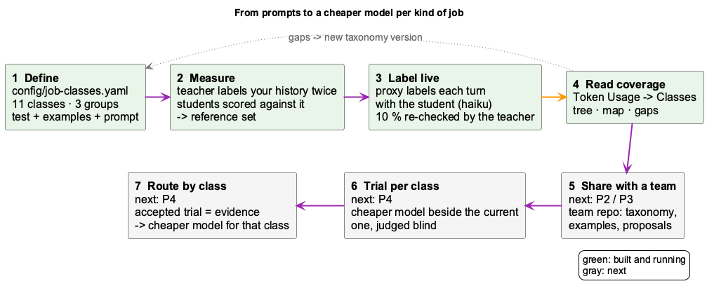
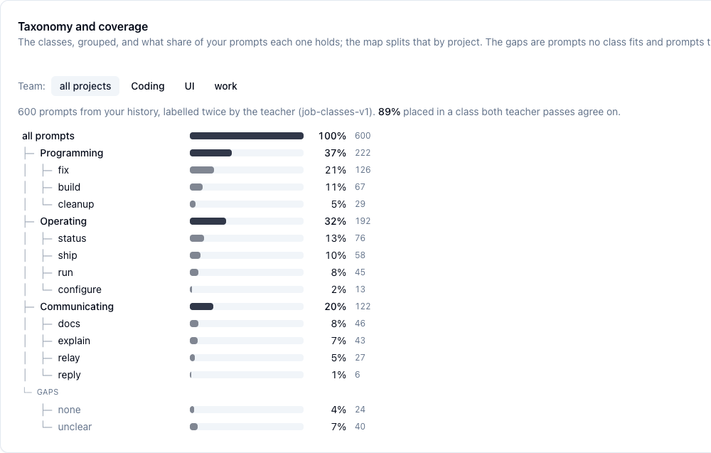
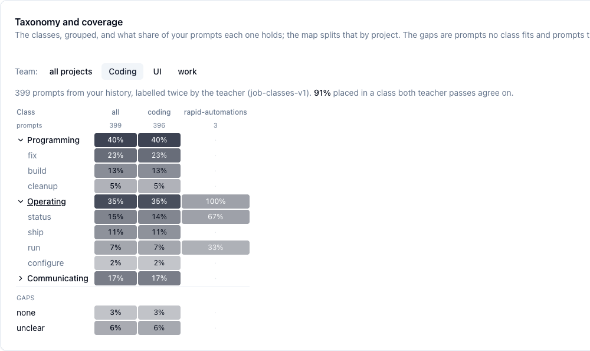

<div class="overview-deck" id="coding-job-classes" role="region" aria-label="coding job classes presentation" markdown="1">

<div class="overview-toolbar" hidden>
  <span class="overview-label">coding / job classes</span>
  <span class="overview-counter" role="status" aria-live="polite" aria-atomic="true"></span>
  <button type="button" data-fullscreen>Fullscreen</button>
</div>

<div class="overview-stage" markdown="1">

<section class="overview-slide overview-cover" id="slide-1" aria-labelledby="jc-title" markdown="1">
<div class="overview-copy" markdown="1">

<p class="overview-kicker">What kind of job is this prompt?</p>

# The cheapest model that does each job well {#jc-title}

Every prompt you give an agent is one of a few **kinds of job**: fix something,
build something, ship it, check on it, explain it. A cheap model labels each
turn with its kind. Then each kind can **earn** a cheaper model with evidence
from a trial, not by reputation.

<div class="overview-benefits" markdown="1">

**Built and running**  
define the classes · measure them · label live turns · read the coverage

**Next**  
share with a team · trial per class · route by class

</div>

</div>
<figure class="overview-figure" markdown="1">

[](images/job-class-lifecycle.png){: target="_blank" rel="noopener" title="Open full-size diagram" }

<figcaption>Green: built and running. Gray: next. Gaps found in step 4 feed back into step 1.</figcaption>
</figure>
<p class="overview-takeaway">Labels first, evidence second, cheaper routing last.</p>
</section>

<section class="overview-slide" id="slide-2" aria-labelledby="jc-why" markdown="1">
<div class="overview-copy" markdown="1">

<p class="overview-kicker">Why classes</p>

## A third of the work is not programming {#jc-why}

The router already picks a **band** (small, medium, high) per prompt. That
says how hard a prompt looks, not what kind of job it is. Each kind fails
differently on a cheap model:

- **fix** is an open-ended search for a cause. It usually needs the strong model.
- **status**, **run** and **ship** report or operate what exists, so a cheap model
  is the obvious candidate for them.
- **cleanup** is mechanical, but a cheap model can quietly drop details doing it.

Programming (fix + build + cleanup) is a group of three classes, not one class.
As one class it would hold ~40 % of all prompts and hide those differences.

</div>
<figure class="overview-figure" markdown="1">

[](images/job-classes-tree.png){: target="_blank" rel="noopener" title="Open full-size screenshot" }

<figcaption>Token Usage → Classes → Tree: 600 prompts from the history, labelled twice by the teacher.</figcaption>
</figure>
<p class="overview-takeaway">Route by kind of job, not only by how hard a prompt looks.</p>
</section>

<section class="overview-slide" id="slide-3" aria-labelledby="jc-define" markdown="1">
<div class="overview-copy" markdown="1">

<p class="overview-kicker">Step 1 · built</p>

## Define the classes {#jc-define}

One file, `config/job-classes.yaml`, holds:

- **classes**, each with an id, a **test** (when a prompt belongs to it) and examples;
- **groups** for reading (programming, operating, communicating). They are never sent to a model;
- a **precedence** order: a prompt that fits two classes takes the more demanding one;
- the **prompt** template, which every classifier is sent as is.

The classes are **written by a person**. A model deriving its own classes was
tried first, and two derivations from the same prompts disagreed (kappa 0.54).

</div>
<figure class="overview-figure" markdown="1">

```yaml
version: 1
groups:
  - id: programming
    label: Programming
classes:
  - id: fix
    group: programming
    test: Something that should work does not,
      and the job is to find out why and/or
      make it work.
    examples:
      - "git push fails with 403 since this morning."
precedence: [relay, fix, build, cleanup, ...]
```

<figcaption>The measurement and the live tagger render the same template, so a score measured offline still describes the live tagger.</figcaption>
</figure>
<p class="overview-takeaway">Write the tests sharply, because the students learn from them.</p>
</section>

<section class="overview-slide" id="slide-4" aria-labelledby="jc-measure" markdown="1">
<div class="overview-copy" markdown="1">

<p class="overview-kicker">Step 2 · built</p>

## Measure: teacher twice, students once {#jc-measure}

```bash
node scripts/measure-job-classes.mjs \
  --taxonomy=config/job-classes.yaml --team=coding \
  --students=claude-haiku-5.5,gpt-5.6-luna
```

1. The prompts come from **your team's history** (the LSL, already redacted).
2. A strong **teacher** labels every prompt **twice**. Prompts where its two passes agree form the **reference set**.
3. Each cheap **student** labels them once and is scored against the teacher.

Results stay on your machine (`~/.coding/data/…/var/job-classes/<team>/`). They
are never committed, because they are your real prompts.

</div>
<figure class="overview-figure" markdown="1">

| On 300 unseen prompts | agreement |
|---|---|
| teacher vs itself (sonnet-5) | kappa 0.93 |
| **claude-haiku-5.5** (chosen student) | **80 %**, kappa 0.78 |
| gpt-5.6-luna | kappa 0.77 |
| gpt-5.6-terra | kappa 0.77 |
| gpt-4o-mini | kappa 0.71 |
| decima:agent (local decision model) | 36 % |

<figcaption>The test prompts were never read while the classes were being written.</figcaption>
</figure>
<p class="overview-takeaway">A cheap student agrees with the strong teacher 4 times in 5.</p>
</section>

<section class="overview-slide" id="slide-5" aria-labelledby="jc-live" markdown="1">
<div class="overview-copy" markdown="1">

<p class="overview-kicker">Step 3 · built</p>

## Label every turn, in shadow {#jc-live}

The LLM proxy labels the **first call of each human turn** with the student,
**after** forwarding it. The turn itself never waits for the label and is
never changed by it.

- Sub-agents, tool loops and harness messages are skipped.
- The prompt is redacted before the student sees it. If redaction fails, the turn is skipped.
- 10 % of turns are also labelled by the teacher, which gives the student's live accuracy.
- The label is stored beside the turn's tokens, so tokens per class come for free.

Switched on in `llm-routing.yaml` under `job_classes:`.

</div>
<figure class="overview-figure" markdown="1">

[](images/job-class-live-tagging.png){: target="_blank" rel="noopener" title="Open full-size diagram" }

<figcaption>Labelling happens after the turn has been forwarded, so nothing it does can slow a turn down.</figcaption>
</figure>
<p class="overview-takeaway">Labels arrive about 2 s after the turn; nothing routes on them yet.</p>
</section>

<section class="overview-slide" id="slide-6" aria-labelledby="jc-coverage" markdown="1">
<div class="overview-copy" markdown="1">

<p class="overview-kicker">Step 4 · built</p>

## Read the coverage, find the gaps {#jc-coverage}

**Token Usage → Classes** shows the taxonomy as a **tree** or as a **map**
(classes × projects), for the reference set or for live turns, for all
projects or one team. Groups open to show their classes, and clicking a class
shows its test next to real prompts it holds.

Two rows tell you where the taxonomy needs work:

- **none**: no class fits. If many prompts land here, a class is missing.
- **unclear**: the models disagree on the class, so a test needs sharpening.

Then edit the YAML, bump the `version` and measure again.

</div>
<figure class="overview-figure" markdown="1">

[](images/job-classes-map.png){: target="_blank" rel="noopener" title="Open full-size screenshot" }

<figcaption>The map, filtered to one team. Projects with fewer than 10 prompts are faded.</figcaption>
</figure>
<p class="overview-takeaway">Every gap is either a class to add or a test to sharpen.</p>
</section>

<section class="overview-slide" id="slide-7" aria-labelledby="jc-team" markdown="1">
<div class="overview-copy" markdown="1">

<p class="overview-kicker">Step 5 · next (P2 / P3)</p>

## Set up a team {#jc-team}

**Today:** declare the team's repos in `~/.coding/teams.yaml`, or in the
dashboard's **Teams** tab, then measure with `--team=<id>`. Only that team's
prompts are read.

**Next:**

1. The first member runs `coding job-classes init --team <id>`. This seeds the team repo from their history.
2. Every member's `teams.yaml` points the team at that repo, and `coding sync` pulls it at launch.
3. Members **propose** new classes, examples and verdicts in their own folder, pushed with `coding sync --push`.
4. One **maintainer** run folds the proposals in. It keeps the class count under a cap, re-scores the reference set and refuses churn.

</div>
<figure class="overview-figure" markdown="1">

[](images/job-class-team-sharing.png){: target="_blank" rel="noopener" title="Open full-size diagram" }

<figcaption>The team repo holds no raw prompts, only the taxonomy, synthetic examples and verdicts.</figcaption>
</figure>
<p class="overview-takeaway">One maintainer edits the taxonomy, so it never has merge conflicts.</p>
</section>

<section class="overview-slide" id="slide-8" aria-labelledby="jc-trial" markdown="1">
<div class="overview-copy" markdown="1">

<p class="overview-kicker">Step 6 · built per process, per class next (P4)</p>

## Trial a cheaper model {#jc-trial}

**Token Usage → Trials** runs a cheaper candidate **beside** the current model
on real calls:

- you only ever get the current model's answer;
- a judge compares each pair **blind, in both orders**;
- it passes with ≥ 20 pairs, ≥ 90 % "at least as good" and ≥ 90 % of details kept.

Here haiku-5.5 **failed** on `consolidator-insight`: it was at least as good on only
56 % of pairs. That's why the process stays on sonnet.

**Next (P4):** a trial keyed by **job class**, sampling only, say, `status` turns.

</div>
<figure class="overview-figure" markdown="1">

[](images/job-classes-trials.png){: target="_blank" rel="noopener" title="Open full-size screenshot" }

<figcaption>A failed trial: nothing switches unless you accept one.</figcaption>
</figure>
<p class="overview-takeaway">No model gets cheaper without evidence from your own traffic.</p>
</section>

<section class="overview-slide" id="slide-9" aria-labelledby="jc-route" markdown="1">
<div class="overview-copy" markdown="1">

<p class="overview-kicker">Step 7 · next (P4)</p>

## Change the config for one kind of job {#jc-route}

**Today**, accepting a trial writes the model into **one process's route**:

```yaml
# llm-routing.yaml: the band, or a model pin
bg-consolidator-insight: { provider: gh-copilot, complexity: medium }
```

**Next:** an accepted class trial writes `evidence/<class>.json` to the team
repo. A class may then be **downgraded** on a member's machine **only** if a
passing verdict exists for the model it would go to on *that* member's route.
Downgrade-only and fail-open still apply: no evidence, no change.

</div>
<figure class="overview-figure" markdown="1">

[](images/job-class-trial-routing.png){: target="_blank" rel="noopener" title="Open full-size diagram" }

<figcaption>One member's accepted trial spares the rest of the team from running it.</figcaption>
</figure>
<p class="overview-takeaway">The class picks which jobs to try; the evidence decides the model.</p>
</section>

<section class="overview-slide" id="slide-10" aria-labelledby="jc-status" markdown="1">
<div class="overview-copy" markdown="1">

<p class="overview-kicker">Where it stands</p>

## What runs today, what comes next {#jc-status}

| Phase | | |
|---|---|---|
| P0 measure | ✅ | a hand-written taxonomy: teacher vs itself 0.93, student 80 % |
| P1 shadow labels | ✅ running | every turn labelled; tokens, coverage and agreement per class |
| P1 gate | ⏳ collecting | enough teacher-checked live turns to trust the live accuracy |
| P2 team repo, read side | next | `job-classes init`, binding, pull on sync |
| P3 contributions | next | proposals, maintainer fold, class cap, stability check |
| P4 class trials + routing | next | `jobClass` on trials, evidence, per-class band floor |

</div>
<figure class="overview-figure" markdown="1">

```bash
# is it labelling?
curl -s localhost:12435/api/job-classes | jq '{labelled, skipped}'
# tokens and agreement by class, last 7 days
curl -s 'localhost:12435/api/job-classes/summary?days=7' | jq .byClass
# the tree and the map
open http://localhost:3032/token-usage   # → Classes
```

<figcaption>The plan: .planning/shared-job-classes.md</figcaption>
</figure>
<p class="overview-takeaway">Today: classes and counts. Next: cheaper routing per class, backed by trials.</p>
</section>

</div>

<nav class="overview-controls" aria-label="Presentation controls" hidden>
  <button type="button" data-prev>Previous</button>
  <div class="overview-dots" aria-label="Choose a slide"></div>
  <button type="button" data-next>Next</button>
  <span class="overview-help">Arrow keys to navigate / F for fullscreen</span>
</nav>
<p class="overview-message" role="status" aria-live="polite"></p>

</div>
