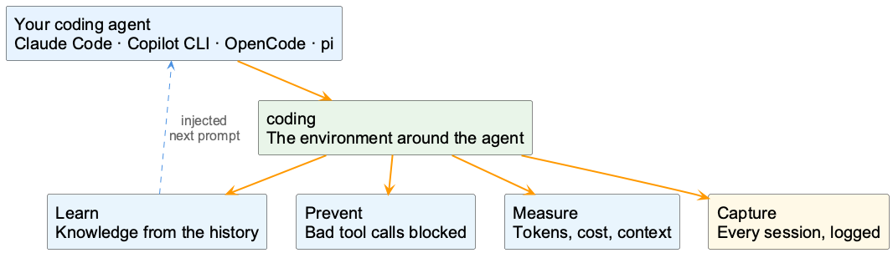
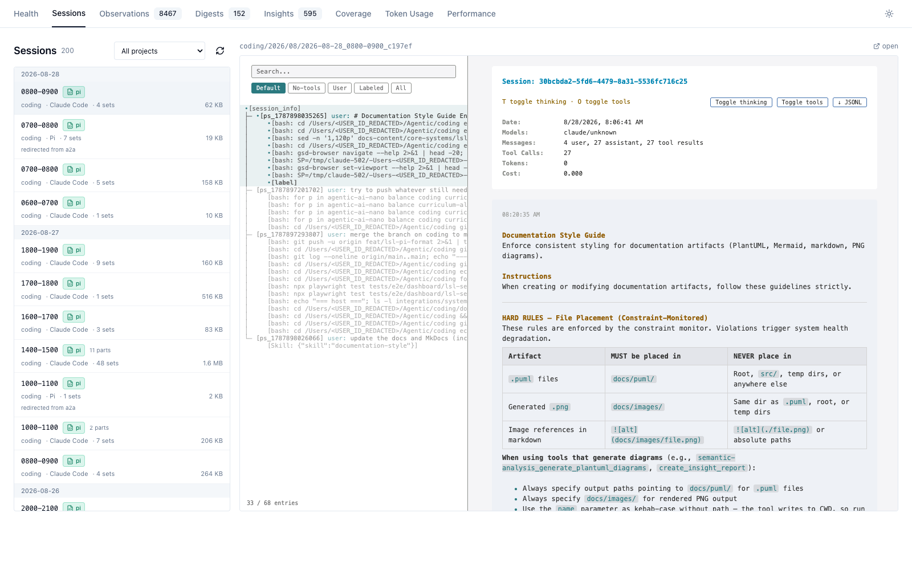
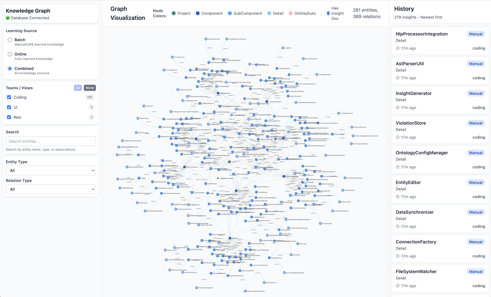
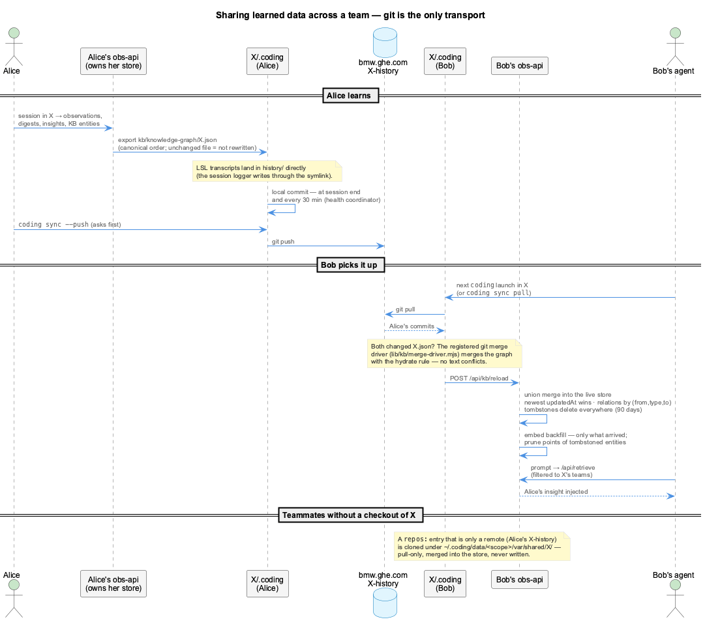
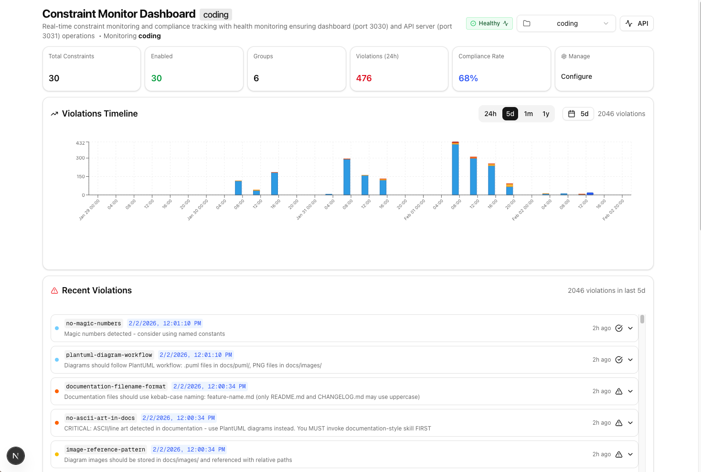
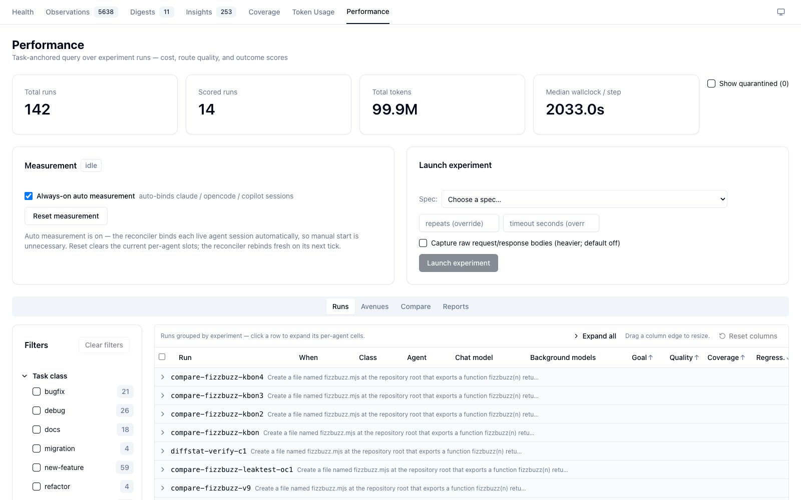
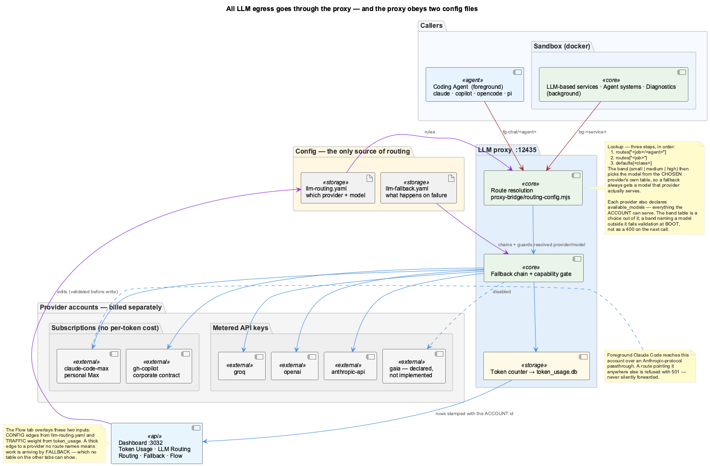
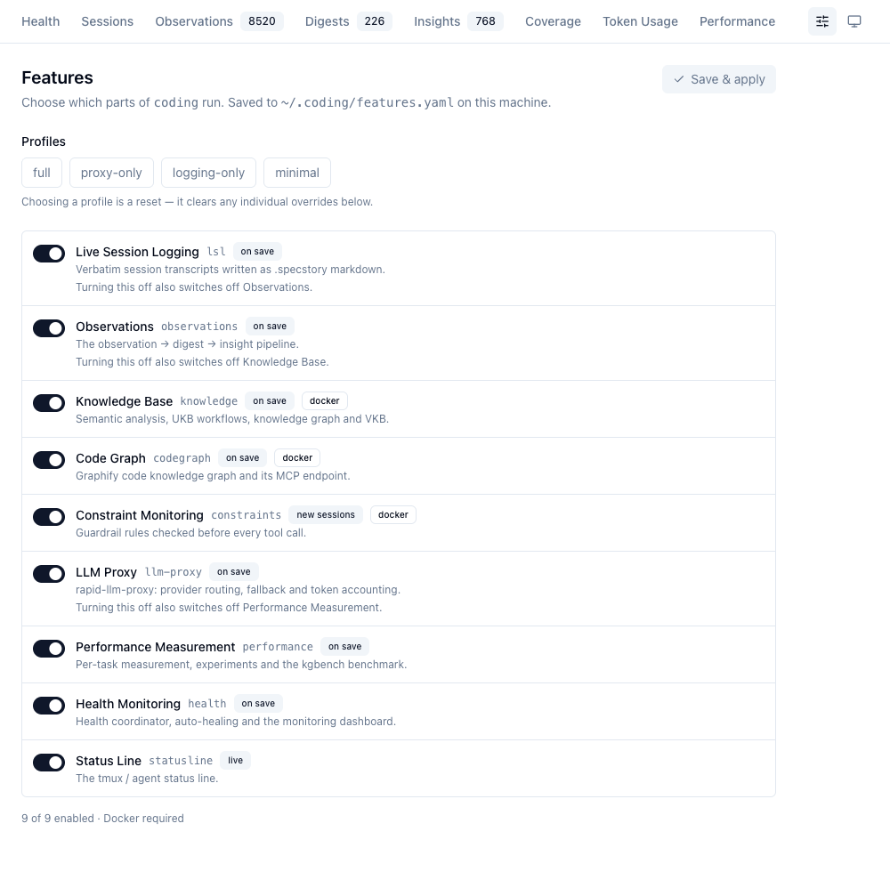

<div class="overview-deck" id="coding-overview" role="region" aria-label="coding overview presentation" markdown="1">

<div class="overview-toolbar" hidden>
  <span class="overview-label">coding / in ten slides</span>
  <span class="overview-counter" role="status" aria-live="polite" aria-atomic="true"></span>
  <button type="button" data-fullscreen>Fullscreen</button>
</div>

<div class="overview-stage" markdown="1">

<section class="overview-slide overview-cover" id="slide-1" aria-labelledby="overview-title" markdown="1">
<div class="overview-copy" markdown="1">

<p class="overview-kicker">The environment around your agent</p>

# Your agent forgets. coding doesn't. {#overview-title}

Your coding agent does the work. **coding is everything around it**: it records
each session, learns from them, blocks known mistakes and measures what the
work cost.

<div class="overview-benefits" markdown="1">

**Capture**  
Every session, logged and redacted

**Learn**  
Knowledge from the history, back in the next prompt

**Prevent**  
A bad tool call stopped before it runs

**Measure**  
Tokens, cost and context, per call

</div>

Use the agent you already know: **Claude Code, Copilot CLI, OpenCode or pi**.

</div>
<figure class="overview-figure" markdown="1">



<figcaption>The agent is replaceable. The environment around it is the point.</figcaption>
</figure>
<p class="overview-takeaway">Keep your agent. Give it a memory.</p>
</section>

<section class="overview-slide" id="slide-2" aria-labelledby="overview-launch" markdown="1">
<div class="overview-copy" markdown="1">

<p class="overview-kicker">How you use it</p>

## One command in front of your agent {#overview-launch}

```bash
coding              # Claude Code
coding --copilot    # GitHub Copilot CLI
coding --opencode   # OpenCode
coding --pi         # pi
```

The launcher checks the network, starts what is missing and hands over to the
agent. Everything after that runs in the background.

The status line shows whether it is all working: health, network, cost and
logging, in your tmux bar.

</div>
<figure class="overview-figure" markdown="1">

[](images/status-line-display.png){: target="_blank" rel="noopener" title="Open full-size image" }

<figcaption>One glance: is everything around the agent up?</figcaption>
</figure>
<p class="overview-takeaway" markdown="1">
Nothing new to learn in the agent itself.
[Getting Started](getting-started/index.md)
</p>
</section>

<section class="overview-slide" id="slide-3" aria-labelledby="overview-capture" markdown="1">
<div class="overview-copy" markdown="1">

<p class="overview-kicker">Capture</p>

## Every session, logged {#overview-capture}

**Live Session Logging** records every prompt, tool call and answer as it
happens, from every agent, into the project's `.coding/history/`.

Secrets are redacted on the way in. Work that touches another project is routed
to that project's log.

`/sl` loads the last sessions back, so the next one starts where the last one
stopped.

</div>
<figure class="overview-figure" markdown="1">

[](images/lsl-sessions-viewer.png){: target="_blank" rel="noopener" title="Open full-size image" }

<figcaption>Sessions from all four agents, in one format.</figcaption>
</figure>
<p class="overview-takeaway" markdown="1">
Nothing to remember to save.
[Live Session Logging](core-systems/lsl.md)
</p>
</section>

<section class="overview-slide" id="slide-4" aria-labelledby="overview-learn" markdown="1">
<div class="overview-copy" markdown="1">

<p class="overview-kicker">Learn</p>

## Knowledge from the history {#overview-learn}

Sessions become **observations**, observations become **insights**, and insights
land in a **knowledge graph** of your project: components, decisions and the
mistakes worth not repeating.

Before each prompt, the relevant part is **injected** into the agent's context,
so it starts with what earlier sessions found out.

`vkb` opens the graph in your browser.

</div>
<figure class="overview-figure" markdown="1">

[](images/vkb-hero.png){: target="_blank" rel="noopener" title="Open full-size image" }

<figcaption>The project as the agent has come to know it.</figcaption>
</figure>
<p class="overview-takeaway" markdown="1">
Learned once, used in every later session.
[Knowledge Injection](architecture/knowledge-injection.md)
</p>
</section>

<section class="overview-slide" id="slide-5" aria-labelledby="overview-share" markdown="1">
<div class="overview-copy" markdown="1">

<p class="overview-kicker">Share</p>

## Your team learns too {#overview-share}

What one person's sessions teach is stored **per repository**, in a learning
checkout next to the code, and shared over **git**, with no extra server.

A teammate's next launch pulls it in, and their agent gets the same insight.
Both people changing the graph at once is merged, not a conflict.

A **team** is a set of repositories, so knowledge stays within the repos it
belongs to.

</div>
<figure class="overview-figure" markdown="1">

[](images/learning-data-sharing.png){: target="_blank" rel="noopener" title="Open full-size diagram" }

<figcaption>git is the only transport.</figcaption>
</figure>
<p class="overview-takeaway" markdown="1">
One person finds out. Everyone's agent knows.
[Teams & Shared Learning](guides/teams.md)
</p>
</section>

<section class="overview-slide" id="slide-6" aria-labelledby="overview-prevent" markdown="1">
<div class="overview-copy" markdown="1">

<p class="overview-kicker">Prevent</p>

## A bad tool call never runs {#overview-prevent}

**Constraints** are checked *before* each tool call, not reported afterwards. A
call that breaks a rule is stopped, and the agent is told why and what to do
instead.

Rules cover things like secrets in code, file placement and naming. You can
add your own.

The dashboard shows what fired, where and how often.

</div>
<figure class="overview-figure" markdown="1">

[](images/constraint-dashboard.png){: target="_blank" rel="noopener" title="Open full-size image" }

<figcaption>Stopped at the moment of the call, with a suggested fix.</figcaption>
</figure>
<p class="overview-takeaway" markdown="1">
Fewer known mistakes to clean up.
[Constraints](core-systems/constraints.md)
</p>
</section>

<section class="overview-slide" id="slide-7" aria-labelledby="overview-measure" markdown="1">
<div class="overview-copy" markdown="1">

<p class="overview-kicker">Measure</p>

## What the work cost {#overview-measure}

Every LLM call is counted: **tokens, model, account and cost**, for the agent
in front of you and for the background services behind it.

Runs can be compared side by side, so a different model, prompt or setup is a
measured difference, not a feeling.

</div>
<figure class="overview-figure" markdown="1">

[](images/measurement-perf-landing.png){: target="_blank" rel="noopener" title="Open full-size image" }

<figcaption>Token usage, cost and run comparisons in the dashboard.</figcaption>
</figure>
<p class="overview-takeaway" markdown="1">
Know what a change saved before you keep it.
[Measurement & Cost Optimization](measurement/overview.md)
</p>
</section>

<section class="overview-slide" id="slide-8" aria-labelledby="overview-route" markdown="1">
<div class="overview-copy" markdown="1">

<p class="overview-kicker">Route</p>

## Every call through one proxy {#overview-route}

All LLM traffic, from the agent and from the background services, goes
through **one local proxy**. That is where it is counted and where it is
routed.

Two config files decide which provider and model each kind of call gets, and
what happens when one fails. Subscriptions are used before metered API keys.
On the corporate network, small background calls can go to the **on-prem Qwen
cluster** instead.

</div>
<figure class="overview-figure" markdown="1">

[](images/llm-routing-architecture.png){: target="_blank" rel="noopener" title="Open full-size diagram" }

<figcaption>Routing is config, not code: llm-routing.yaml and llm-fallback.yaml.</figcaption>
</figure>
<p class="overview-takeaway" markdown="1">
One place to count, route and fall back.
[LLM Routing](architecture/llm-routing.md)
</p>
</section>

<section class="overview-slide" id="slide-9" aria-labelledby="overview-connect" markdown="1">
<div class="overview-copy" markdown="1">

<p class="overview-kicker">Stay connected</p>

## At home, on VPN, in the office {#overview-connect}

The same agent call takes a different path on each network: direct at home,
through the local proxy and the corporate proxy on VPN or in the office.

coding watches the network and keeps the path working: it switches the route
when you move, restarts a stale local proxy and fetches a missing Kerberos
ticket, without you doing anything.

The status line says where you are: `N:` network, `P:` proxy, `K:NO` when the
ticket is missing.

</div>
<figure class="overview-figure" markdown="1">

[](images/agent-connectivity-paths.png){: target="_blank" rel="noopener" title="Open full-size diagram" }

<figcaption>Every path, and what keeps it up: the Connectivity deck.</figcaption>
</figure>
<p class="overview-takeaway" markdown="1">
Move between networks. The agent keeps working.
[Connectivity, in slides](connectivity.md)
</p>
</section>

<section class="overview-slide" id="slide-10" aria-labelledby="overview-compose" markdown="1">
<div class="overview-copy" markdown="1">

<p class="overview-kicker">Compose</p>

## Run only what you need {#overview-compose}

coding is nine features, and you choose which ones run: from **harness**
(logging, routing and the status line, no Docker) up to **everything**
(knowledge graph, code graph, constraints and performance tracking).

A feature that needs another one that is switched off is switched off too, and
every surface says why.

Change it with `coding-features` or the dashboard's **Features** tab.

</div>
<figure class="overview-figure" markdown="1">

[](images/features-editor.png){: target="_blank" rel="noopener" title="Open full-size image" }

<figcaption>Start small. Switch the rest on when you want it.</figcaption>
</figure>
<p class="overview-takeaway" markdown="1">
From a light harness to the full learning layer.
[Composing What Runs](guides/features.md)
</p>
</section>

</div>

<nav class="overview-controls" aria-label="Presentation controls" hidden>
  <button type="button" data-prev>Previous</button>
  <div class="overview-dots" aria-label="Choose a slide"></div>
  <button type="button" data-next>Next</button>
  <span class="overview-help">Arrow keys to navigate / F for fullscreen / Esc for home</span>
</nav>
<p class="overview-message" role="status" aria-live="polite"></p>

</div>
