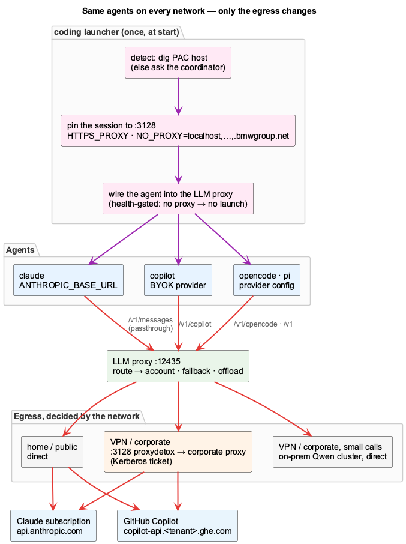

# Commands

CLI commands and shell usage reference.

## Core Commands

### coding

Launch a coding agent with the integrations your tier switches on — health monitoring, the
LLM proxy and the status line in the default `harness` tier; Docker services, LSL and
constraints when your tier includes them (see [Composing What Runs](../guides/features.md)).

The agent is named by the first word after `coding`, or by the equivalent flag.
Without one, `coding` starts Claude Code.

```bash
# Launch specific agents (bare word or flag — same thing)
coding               # Claude Code (the default)
coding claude        # Claude Code (Anthropic OAuth / Max subscription) — or --claude
coding opencode      # OpenCode (auto-selects provider based on network) — or --opencode
coding copilot       # GitHub Copilot CLI — or --copilot / --copi
coding pi            # Pi — or --pi

# Only the FIRST word picks the agent; the rest goes to the agent
coding claude explain this repo

# Specify project directory
coding --project ~/my-project

# Clean start (kills all coding processes, frees all ports, then launches)
coding --force
coding --force claude

# Dry run (validates config, network, Docker — does not launch)
coding opencode --dry-run

# Help
coding --help
```

### Network-Aware Agent Selection

The launcher detects your network environment; every agent then reaches its model through the LLM proxy, whose egress follows the network:



| Agent | Inside VPN / CN | Outside VPN | Answered by |
|---|---|---|---|
| `--claude` | LLM proxy → `:3128` → corporate proxy | LLM proxy, direct | Claude subscription (OAuth / Max) |
| `--opencode` · `--pi` | LLM proxy → `:3128` → corporate proxy | LLM proxy, direct | GitHub Copilot |
| `--copilot` | LLM proxy (BYOK) → `:3128` → corporate proxy | LLM proxy, direct | GitHub Copilot |

**Auto-configuration:**

- Every session is pinned to proxydetox on `127.0.0.1:3128`, which forwards to the corporate proxy on VPN / CN and goes direct elsewhere
- Each agent is wired into the LLM proxy (`:12435`); the launch stops if the proxy does not answer
- Each agent checks that its API endpoint is reachable before launch (warning only)
- See [Network Configuration](../guides/network-configuration.md) and [Connectivity & Recovery](../architecture/connectivity.md)

### `--force` Flag

Performs a full cleanup before startup — use when ports are stuck or orphaned processes prevent launch:

1. Stops all Docker coding containers (`docker compose down`)
2. Kills process supervisors and health monitors (prevents respawning)
3. Kills all processes on coding ports (3030-3033, 3847-3851, 8080, 9090, 12435)
4. Kills remaining coding-repo node processes
5. Verifies all ports are free
6. Proceeds with normal startup

```bash
# When "address already in use" errors block startup
coding --force

# Equivalent to a clean reboot of all coding services
coding --force --claude
```

### vkb

View Knowledge Base visualization.

```bash
# Open in browser
vkb

# Version info
vkb --version

# Debug mode
vkb --debug
```

## Install and Update

### One-line install

```bash
# Latest release; installer options pass through after `bash -s --`
curl -fsSL https://github.com/fwornle/coding/releases/latest/download/coding-install.sh | bash
curl -fsSL https://github.com/fwornle/coding/releases/latest/download/coding-install.sh | bash -s -- --features=learning
```

To develop `coding` itself, clone it instead and run `./install.sh` from the checkout.

### coding update

Install the latest release and switch to it.

```bash
coding update              # download, verify, install beside the current one, switch, restart
coding update --check      # report whether a newer release exists; install nothing
coding update --rollback   # switch back to the previous release and restart
coding update --pull       # on a development checkout: git pull + submodule update
```

When a newer release is out, the status line shows `[⬆ x.y.z]` (click it to run
`coding update`) and the dashboard shows a banner.

### coding releases

The releases installed on this machine.

```bash
coding releases [status] [--json]    # channel, current version, installed releases
coding releases list [--json]        # installed release folders
coding releases root                 # the code root daemons are registered against
coding releases use <version>        # flip `current` to an installed release
coding releases rollback             # flip back to the previous release
coding releases adopt <dir>          # install an unpacked release tree (needs release.json)
coding releases remove <version> [--force]
```

`use` and `rollback` change which code the next start runs; running daemons keep the old code
until restarted. `coding update` does both steps for you.

## Configuration Commands

### coding-features

Compose which parts of `coding` are active (see [Composing What Runs](../guides/features.md)).

```bash
coding-features [status]            # the resolved feature set
coding-features list                # enabled ids, one per line (for scripts)
coding-features enabled <id>        # exit 0 if on, 1 if off; prints nothing
coding-features explain <id>        # why a feature is on or off
coding-features set <id> on|off     # turn one feature on or off
coding-features profile [<name>]    # show, or switch to, a tier or profile
coding-features profiles            # list the available presets
coding-features run [<mode>]        # where agents run, or set it: auto | box | strict-box | host
coding-features agents              # the agents coding offers, one per line
coding-features agents set <a,b>    # offer only these agents ('all' = every one)
coding-features agent-enabled <a>   # exit 0 if agent <a> is offered, 1 if not
coding-features default-agent       # the agent plain `coding` launches
coding-features repair              # run install steps for features enabled after install
coding-features snapshot            # rewrite .coding/runtime/features.json
coding-features json                # machine-readable resolved state
```

Options: `--json` (for `status`, `explain`, `profile`) and `--no-apply` (after `set` or
`profile`, record the change without starting or stopping services).

### coding sync

Sync the per-repo learning checkouts (`<repo>/.coding/`) and the shared clones of
teammates' repos. The launcher pulls at session start, and local commits are made at session
end and on the coordinator's periodic sweep. Nothing pushes except `coding sync push` (or
`coding sync --push`), which asks first; `--yes` skips the question. Shared clones are
pull-only.

```bash
coding sync [status]                  # every checkout: ahead / behind / dirty
coding sync pull   [--repo <dir>]     # commit local changes, then pull (+ shared clones)
coding sync commit [--repo <dir>]     # local commit only
coding sync push   [--repo <dir>] [--yes]
coding sync status --json             # machine-readable
```

### coding job-classes

A team's shared job-class taxonomy (see [Job Classes](../job-classes.md)).

```bash
coding job-classes [status]                         # bindings on this machine
coding job-classes init --team <id> [--repo <url>]  # create the team's package, bind the team
coding job-classes join --team <id> --repo <url>    # use a teammate's package
coding job-classes validate [<file or package dir>]
coding job-classes index                            # rewrite the proxy's bindings index
coding job-classes propose --team <id> [--dry-run]  # draft new classes from unplaced prompts
coding job-classes fold --team <id> [--dry-run] [--no-push]   # maintainer: fold proposals into a new version
coding job-classes publish [--team <id>] [--push]   # this member's gate counts (no prompts)
coding job-classes replay candidates|run|report|evidence
```

`--json` gives machine-readable output. Labelling itself is switched on or off on the
Features tab (LLM Proxy → Job-class labelling).

## Agent Box and Guard

### coding box

The agent box image. Building is a deliberate user action: it bakes the committed guard and
rules into the image.

```bash
coding box build     # build the image from the COMMITTED guard + rules
coding box status    # image present? built from the current guard?
coding box redteam   # run agents against bypass scenarios inside the box
```

Whether an agent runs in the box is the `run` setting (`auto` = the box while `constraints`
is on); `--box`, `--strict-box` and `--no-box` override it for one launch.

### coding guard

Client of the host guard daemon: override requests, approvals and the audit log.

```bash
coding guard status                 # daemon up? key fingerprint, pending count
coding guard pending [--all]        # override requests
coding guard approve <id>           # open the approval page in your browser
coding guard deny <id>
coding guard enroll                 # enrol / manage factors (Touch ID, phone, key, password)
coding guard factors                # what is enrolled
coding guard audit [--limit N]      # tail + hash-chain check
coding guard note <event> [k=v …]   # record a host event (the launcher uses it)
```

Approving needs one of your factors, proven in the host browser. `enroll`, `audit` and
`note` need the approver token, which exists only on the host, so they fail inside the box.

### coding svc

The fixed Docker verbs the guard runs for an agent in the box.

```bash
coding svc status | logs | restart | graphify | up | rebuild
```

## Testing Commands

### Installation Test

```bash
# Check-only mode (default, safe)
./scripts/test-coding.sh

# Interactive repair
./scripts/test-coding.sh --interactive

# Auto-repair coding-internal issues
./scripts/test-coding.sh --auto-repair

# Help
./scripts/test-coding.sh --help
```

### LSL Validation

```bash
# Validate LSL configuration
node scripts/validate-lsl-config.js

# Generate repair script
node scripts/validate-lsl-config.js --generate-repair
```

## Docker Commands

### Start/Stop Services

```bash
# Start all services
docker compose -f docker/docker-compose.yml up -d

# Stop all services
docker compose -f docker/docker-compose.yml down

# Restart
docker compose -f docker/docker-compose.yml restart
```

### View Logs

```bash
# All services
docker compose -f docker/docker-compose.yml logs -f

# Specific service
docker compose -f docker/docker-compose.yml logs -f coding-services
```

### Rebuild

```bash
# Rebuild after code changes
docker compose -f docker/docker-compose.yml build --no-cache
docker compose -f docker/docker-compose.yml up -d

# Remove volumes (data loss!)
docker compose -f docker/docker-compose.yml down -v
```

## Health Checks

```bash
# All MCP health endpoints (semantic-analysis, constraint-monitor)
for port in 3848 3849; do
  echo "Port $port: $(curl -s http://localhost:$port/health | jq -r '.status')"
done
# Graphify serves an HTTP MCP endpoint (not /health):
curl -s http://localhost:3851/mcp >/dev/null && echo "Port 3851: graphify ok"

# LSL monitor health (Phase 33+: read from coordinator, not .health/*.json)
curl -fs http://localhost:3034/health/state \
  | jq '.lsl | to_entries | map(select(.key | endswith(":coding"))) | .[0].value | {status, lastBeat}'

# Container status
docker compose -f docker/docker-compose.yml ps
```

## Knowledge Base

### Within Claude Code Session

```
# Incremental analysis
"ukb" or "update knowledge base"

# Full analysis
"full ukb" or "fully update knowledge base"
```

### Command Line

```bash
# Purge entities from date
node scripts/purge-knowledge-entities.js 2025-12-23

# Dry run
node scripts/purge-knowledge-entities.js 2025-12-23 --dry-run

# With options
node scripts/purge-knowledge-entities.js 2025-12-23 --team=coding --verbose
```

## LSL Recovery

```bash
# Recover LSL files from transcripts
PROJECT_PATH=/path/to/project CODING_REPO=/path/to/coding \
  node scripts/batch-lsl-processor.js from-transcripts ~/.claude/projects/-path-to-project

# Recover specific date range
PROJECT_PATH=/path/to/project CODING_REPO=/path/to/coding \
  node scripts/batch-lsl-processor.js retroactive 2024-12-01 2024-12-03
```

## Git Submodules

```bash
# Update all submodules
git submodule update --remote

# Initialize missing submodules
git submodule update --init --recursive

# Update specific submodule
git submodule update --remote integrations/semantic-analysis
```

## Debugging

### Enable Debug Output

```bash
# LSL debugging
DEBUG_STATUS=1 TRANSCRIPT_DEBUG=true node scripts/enhanced-transcript-monitor.js

# Full debug mode
DEBUG_LSL=1 node scripts/generate-proper-lsl-from-transcripts.js --mode=foreign --verbose
```

### Process Management

```bash
# Clean start - kill ALL coding processes and restart fresh
coding --force

# Find running monitors
ps aux | grep enhanced-transcript-monitor

# Kill monitors
pkill -f enhanced-transcript-monitor

# Restart monitoring
coding --restart-monitor
```
