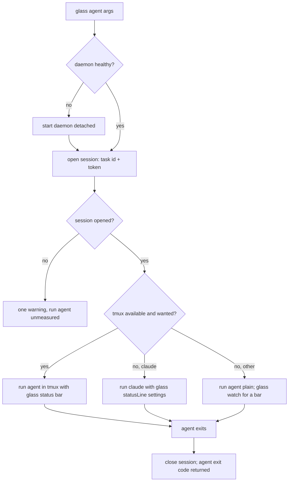
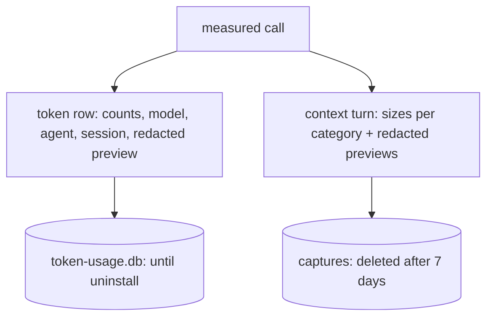

## Components

| Component | Role |
|---|---|
| `glass` CLI | Starts the daemon if needed, opens a measurement session, starts the agent with session-scoped environment variables, closes the session when the agent exits |
| Daemon | One Node.js process on 127.0.0.1 (default port 12445): forwarding, interception, measurement, the read API, the UI, the retention timer. Stops after 30 minutes idle |
| Anthropic forward | Receives Claude Code's `/v1/messages` calls (base URL) and forwards them to api.anthropic.com or the base URL you had set |
| Interception | Answers `CONNECT` for the model hosts with a certificate from the glass CA, reads the call, forwards it; every other host is a blind tunnel |
| Measurement | Reads usage from the response (streamed or not), writes one token row per call and a redacted context capture per turn, bound to the session |
| Read API + UI | Serves `/api/token-usage/*`, `/api/context-turns`, `/api/statusline` and the dashboards (`glass ui`) |
| `~/.glass` | Token database (SQLite), context captures, the CA, the log |

## A measured call, step by step

1. `glass copilot` makes sure the daemon runs and opens a session: the daemon returns a
   task id and a session token.
2. glass starts copilot with `HTTPS_PROXY=http://glass:<token>@127.0.0.1:12445` and
   `NODE_EXTRA_CA_CERTS=~/.glass/ca/ca.pem`.
3. copilot connects through the daemon. The token in `Proxy-Authorization` tells the
   daemon which session the call belongs to — concurrent sessions do not mix.
4. For a model host, the daemon completes the TLS handshake with a leaf certificate signed
   by the glass CA, reads the request, and sends it to the real host over a new, verified
   TLS connection — through your corporate proxy if you have one.
5. The response streams back unchanged. The daemon records the usage and the context
   composition.
6. When copilot exits, glass closes the session.

Claude Code skips steps 3–4: its base URL points at the daemon over plain HTTP on
127.0.0.1, so nothing needs to be decrypted.

opencode skips them for its model calls too. glass gives it a session-only config
(`OPENCODE_CONFIG_CONTENT`) that points each relayed provider at the daemon's
`/relay/<token>/<provider>`:

- **`github-copilot`**, when you are logged in to it and your config gives it no base URL
  of its own: the daemon forwards to the Copilot API of your login (`copilot-api.<tenant>`
  for GitHub Enterprise, `api.githubcopilot.com` otherwise). opencode sends its own login
  to the daemon by configuration, so these calls need no decryption.
- **Providers on plain HTTP** (a local model server, another tool's proxy): forwarded to
  their own URL.

pi's providers on plain HTTP take the same relay. pi has no session-only config in the
environment, so `glass pi` loads a small extension of glass's (`pi -e`) that sets each
such provider's base URL to its relay for the run; models, keys and headers stay those
of `~/.pi/agent/models.json`.

A call relayed to an address on 127.0.0.1 carries the session's `x-task-id`, `x-agent`
and `x-project`, so another local proxy on that address files its own record of the call
under glass's session id. The relay forwards only to these: any other HTTPS host still
goes through interception.

## Session lifecycle

glass never blocks your agent: if the daemon cannot start, the agent runs unmeasured
after one warning line.

## What is stored, and for how long

Details: [Privacy & Data](privacy.md).

## Network paths and recovery

Every call leaves the agent, passes the daemon and reaches the model host directly (no
`HTTPS_PROXY` in the daemon's environment) or through the local proxy and the corporate
proxy. [Connectivity](connectivity.md) is the same material as slides.

| Element | Needed when | Checked by | If it is missing |
|---|---|---|---|
| The agent's own login | always | the agent | the agent's sign-in error |
| glass daemon `127.0.0.1:12445` | always | `glass <agent>` / `glass ui` probe `/health` (1.5 s) | started detached; if that fails, the agent runs unmeasured |
| glass CA (`~/.glass/ca/`) | copilot, opencode, pi intercepted | the agent's TLS check | certificate error — `--no-intercept` |
| Local proxy `:3128` | `HTTPS_PROXY` set (VPN, corporate) | network monitor: port, then a bare `CONNECT api.github.com:443`, every 15 s while a session is open | `P:OFF`; requests fail as "fetch failed" or 502 |
| Kerberos ticket | the local proxy logs in with it | network monitor: `klist -s` (not on Windows) | `K:NO`; the corporate proxy refuses every tunnel |
| Corporate proxy | VPN, corporate | egress, per request | 502 naming the proxy, the host and the status |
| Model host | always | the forward, per request | the host's own error, passed through |

The network monitor works the same on every platform; only its tools differ:

| | macOS | Linux | WSL | Windows |
|---|---|---|---|---|
| VPN signal | Cisco `vpn state` | Cisco `vpn state` | the Windows host's `vpncli.exe`, through interop | `vpncli.exe state` |
| Network-change events | `notifyutil` | `ip monitor` | `ip monitor` (the default NAT networking does not see the host join VPN) | none — every 15 s |
| Kerberos ticket | `klist -s`; missing → asks the SSO extension | `klist -s`; missing → `K:NO`, run `kinit` | as Linux, with the distro's own cache | not checked; the logon renews it |

The daemon starts with the proxy settings of the `glass` command that started it, and then
follows each new session: `glass <agent>` sends its shell's `HTTPS_PROXY` / `NO_PROXY`, and when
they differ the daemon rebuilds its egress and points new interception tunnels at the new
proxy (calls already in flight keep their route). A proxy that points back at glass is never
adopted. A daemon started at home therefore moves to the VPN proxy with the first session
started on VPN.

| Failure | Noticed by | What happens | Where |
|---|---|---|---|
| Network error, or 502 / 503 / 504 from upstream | the forward | retried up to 3 times (0, 300, 900 ms; `LLM_PROXY_FORWARD_ATTEMPTS`), only before the first byte is written; then a 502 JSON error to the agent | `proxy-bridge/anthropic-forward.mjs` |
| The upstream proxy refuses the tunnel | egress | the error names proxy, host and status; the same host fails at once for 10 s, so retries do not hammer the proxy; shown in the network popup | `lib/glass/egress.mjs` |
| No Kerberos ticket on CN / VPN | network monitor | macOS: asks the Kerberos SSO extension (`app-sso -a REALM -R -q`), at most every 2 minutes, without waiting; ~12 s measured, against 2 min 20 s for macOS on its own. Linux / WSL: `K:NO` until you run `kinit`. Windows: not checked — the logon renews the ticket | `lib/glass/network.mjs` |
| Daemon not running | the next `glass <agent>` / `glass ui` | starts it; live sessions are re-adopted from `run/sessions.json`, dead ones closed | `lib/glass/client.mjs`, `daemon.mjs` |
| Daemon of another version | the next `glass <agent>` | replaced once it has no live session | `lib/glass/cli.mjs` |
| A blind tunnel or an intercepted host cannot be dialled | interception | 502 to the agent, no retry | `proxy-bridge/intercept.mjs` |
| Daemon started on another network | `glass <agent>`, at session open | adopts that shell's `HTTPS_PROXY` / `NO_PROXY` for new calls and tunnels; logged as `egress proxy A → B` | `lib/glass/daemon.mjs` |
| Local proxy stale after a VPN change | network monitor | shown as `P:OFF` only: glass never restarts the local proxy and never invents proxy settings | — |

## Where glass comes from

glass is generated from two source repositories by an extraction script — it is not a
hand-maintained fork:

The measurement code is shared with the `coding` development environment and the
`rapid-llm-proxy`; glass adds the CLI, the daemon and a reduced UI.
[Development & Releases](development.md) describes the pipeline.

What each source contributes, counted in an extract of v0.1.24 (runtime JavaScript, tests
excluded):

| Source | Lines | What |
|---|---|---|
| coding | 11.9k (3.9k of it a vendored YAML parser) | agent wiring, token rows for direct traffic, status line, network verdict, session timelines, paths |
| rapid-llm-proxy | 5.4k (2.2k compiled from TypeScript) | the Anthropic forward, OpenAI passthrough, interception, measurement, token database |
| glass only | 2.3k (12%) | `lib/glass/*` and `bin/glass.mjs`: CLI, daemon, agent wiring, UI read API, update |

The UI is coding's dashboard Token Usage pages built into one bundle, plus 0.9k lines for
the Models and Sessions tabs. Every copied file is listed in the manifest, and the extract
fails if an import reaches a file that is not. coding's router, classifier, background
services and knowledge base are never taken.
