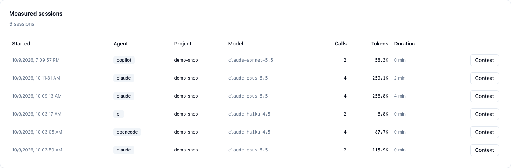

# Comparing Runs (A/B)

Run the same task on two models — a base model and a fine-tuned one, say — or with two
agents, and compare what each cost, how fast it answered and whether it got the job done.

=== "⚡ Quick (~3 min)"

    ## Two models, one agent: `glass ab`

    ```sh
    glass ab run --agent pi \
      --variant base=local-llama/Qwen/Qwen3.5-4B \
      --variant tuned=my-server/my-lora-adapter \
      --prompt "Fix the failing test in cart.py" \
      --check "python -m pytest -q" --repeats 3
    ```

    Each variant is `label=provider/model` as the agent names them (pi's `models.json`,
    opencode's config). glass runs every variant once per round, in a random order, each
    trial in a fresh copy of the repository (your uncommitted changes included), then runs
    `--check` in that copy: exit code 0 is a pass. At the end it prints the comparison:

    ```text
                            base                         tuned
    pass rate (--check)     60 % (3/5)                   100 % (5/5)
    wall time mean ± sd     1212 ms ± 49 ms              910 ms ± 117 ms
    call latency p50 / p95  368 ms / 399 ms              382 ms / 404 ms
    TTFT p50                165 ms (15 streamed)         180 ms (10 streamed)
    tokens out / trial      420                          280
    …
    ```

    `glass ui` → **A/B** shows the same table, live while it runs, with every trial linked
    to its session. `glass ab report latest --csv` gives one row per trial for a
    spreadsheet.

    The pass rate is only as good as your `--check`: glass has no judge of its own.

    ## Two agents, by hand

    ```sh
    P="Read cart.js and cart.test.js, run 'node cart.test.js', and suggest one improvement."
    glass claude -p "$P"
    glass opencode run --model github-copilot/claude-haiku-5.5 "$P"
    ```

    Then `glass ui` → **Sessions**: both runs side by side — calls, tokens, model — and
    **Context** on each row for the window and cache comparison.

    

=== "📚 Deep Dive (full)"

    --8<-- "_tiers/comparing-runs.deep.md"
