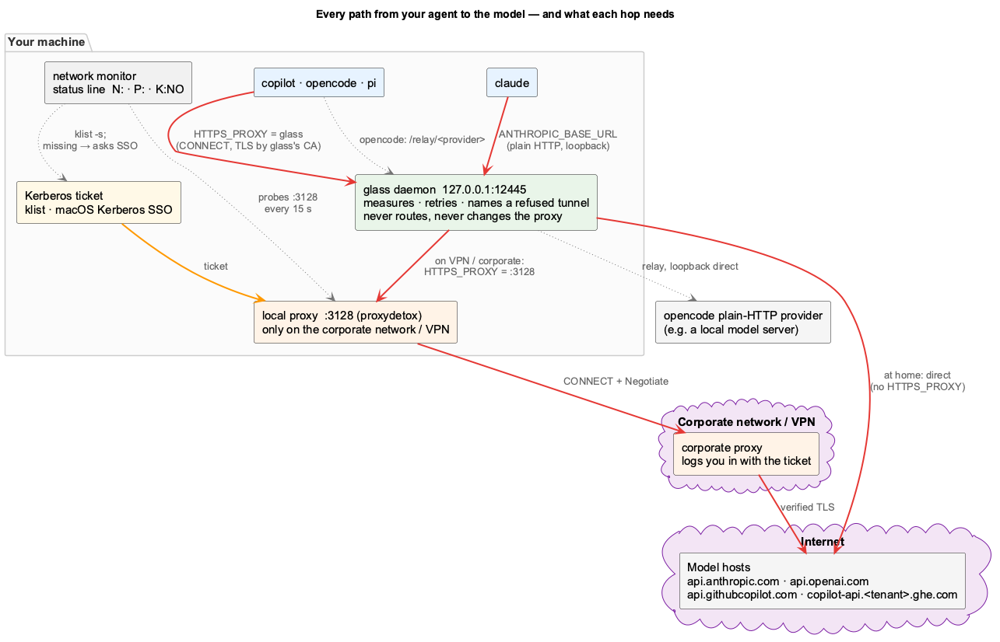
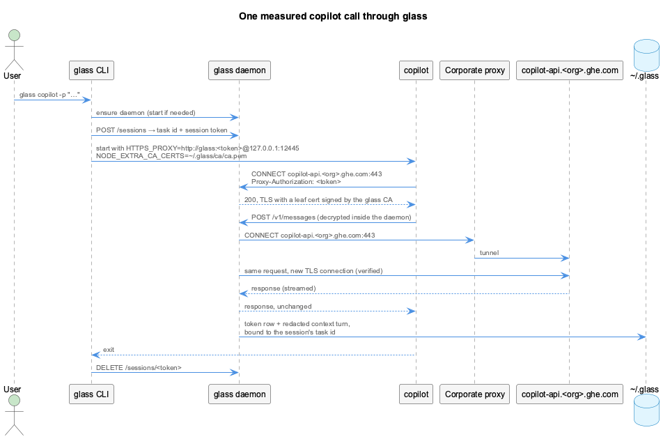
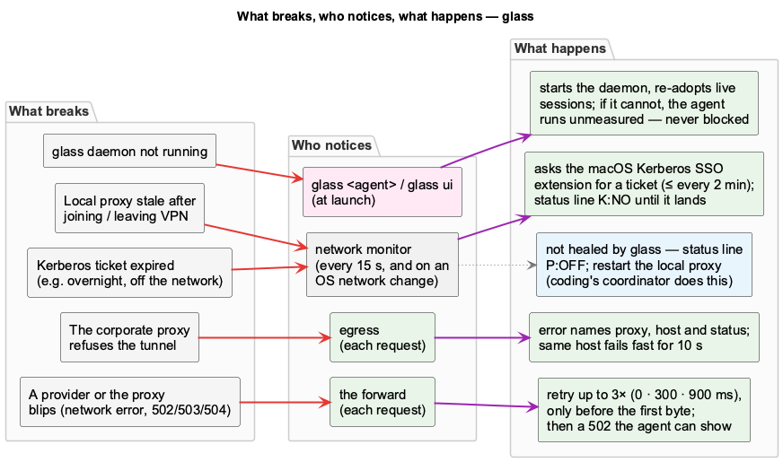
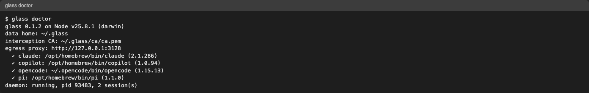

  glass / connectivity
  
  <button type="button" data-fullscreen>Fullscreen</button>

<section class="overview-slide overview-cover" id="slide-1" aria-labelledby="connectivity-title" markdown="1">

Your request, hop by hop

# Every path to the model {#connectivity-title}

An agent call leaves your agent, passes the **glass daemon** and reaches the
model host either **directly** (at home) or through the **local proxy** and the
**corporate proxy** (on VPN or in the office).

**At home**  
agent → glass → model host

**On VPN / corporate**  
agent → glass → local proxy → corporate proxy → model host

**Always on the side**  
the network monitor, behind `N:` `P:` `K:` in the status line

<figure class="overview-figure" markdown="1">

{: target="_blank" rel="noopener" title="Open full-size diagram" }

<figcaption>Red: the request. Orange: the ticket. Dotted: what glass watches.</figcaption>
</figure>

One extra hop on your machine. Nothing else changes.

</section>

<section class="overview-slide" id="slide-2" aria-labelledby="connectivity-in" markdown="1">

Into glass

## Two ways in, both on your machine {#connectivity-in}

**claude** talks to glass in plain HTTP on loopback: `ANTHROPIC_BASE_URL` points
at the daemon. glass forwards to `api.anthropic.com`, or to your own gateway if
you had one set.

**copilot, opencode and pi** use glass as their `HTTPS_PROXY`. glass decrypts
only the **five model hosts** with its own CA; every other host is a blind
tunnel. opencode's plain-HTTP providers go through a relay.

`--no-intercept` leaves copilot, opencode and pi unwired: totals come from their
own files instead.

<figure class="overview-figure" markdown="1">

{: target="_blank" rel="noopener" title="Open full-size diagram" }

<figcaption>Decrypt the model call. Tunnel everything else untouched.</figcaption>
</figure>

Measured on the way through, never routed.
[Architecture](architecture.md)

</section>

<section class="overview-slide" id="slide-3" aria-labelledby="connectivity-needs" markdown="1">

What must be up

## Six things, and what you see if one is missing {#connectivity-needs}

| Element | Needed | Missing looks like |
|---|---|---|
| Agent login | always | the agent's own sign-in error |
| glass daemon | always | `glass ✗ down`; the next `glass` starts it |
| glass CA | copilot · opencode · pi | certificate error; `--no-intercept` |
| Local proxy :3128 | VPN · corporate | `P:OFF`, "fetch failed" |
| Kerberos ticket | VPN · corporate | `K:NO`, 502 "refused the tunnel" |
| Corporate proxy | VPN · corporate | 502 naming the proxy |

The status line checks the last three every 15 s while a session is open.

<figure class="overview-figure" markdown="1">

{: target="_blank" rel="noopener" title="Open full-size image" }

<figcaption>N: where you are · P: the local proxy · K:NO no ticket.</figcaption>
</figure>

Read the bar before reading the logs.
[Status Line](status-line.md)

</section>

<section class="overview-slide" id="slide-4" aria-labelledby="connectivity-recover" markdown="1">

Recovery

## What breaks, and what happens next {#connectivity-recover}

A **blip** is retried up to three times, before the first byte only, so an
answer is never sent twice.

A **refused tunnel** fails with an error that names the proxy, the host and
the status, and is not retried against the same proxy for 10 s.

A **missing ticket** on VPN is requested from macOS's Kerberos SSO at once;
on Linux and WSL, `K:NO` asks you to run `kinit`.

A **missing daemon** is started by the next `glass` command. If it cannot be,
your agent runs unmeasured: glass never blocks your work.

<figure class="overview-figure" markdown="1">

{: target="_blank" rel="noopener" title="Open full-size diagram" }

<figcaption>Each failure has one place that notices it.</figcaption>
</figure>

Fail clearly, recover on its own where it safely can.
[Troubleshooting](troubleshooting.md)

</section>

<section class="overview-slide" id="slide-5" aria-labelledby="connectivity-ticket" markdown="1">

The common one

## Joined VPN, and nothing answers? {#connectivity-ticket}

Your Kerberos ticket lasts about **10 hours**. If it expired overnight while you
were off the network, the corporate proxy refuses every tunnel until there is a
new one.

macOS gets one by itself, but that took **2 min 20 s** in one measured case.
glass asks for it as soon as it sees `K:NO` on VPN: **about 12 s**, without a
dialog if your password is in the keychain.

If a login dialog appears, that is macOS asking for your password, not glass.

<figure class="overview-figure" markdown="1">

{: target="_blank" rel="noopener" title="Open full-size diagram" }

<figcaption>No ticket, no tunnel, whatever the proxies are doing.</figcaption>
</figure>

`K:NO` in the bar? Wait ~15 s, or run `klist`.
[Troubleshooting](troubleshooting.md)

</section>

<section class="overview-slide" id="slide-6" aria-labelledby="connectivity-yours" markdown="1">

What glass leaves to you

## The local proxy is yours {#connectivity-yours}

**glass only watches the local proxy.** After joining or leaving VPN it can need
a restart (`P:OFF` in the bar); with coding installed, its health coordinator
does that for you.

**glass follows your shell's proxy settings.** Each `glass <agent>` sends its
shell's `HTTPS_PROXY` and `NO_PROXY`, and the daemon adopts them for new calls
if they differ from what it had. A daemon started at home switches to the VPN
proxy with the first session you start on VPN.

`glass doctor` and `glass report net` show what glass sees.

<figure class="overview-figure" markdown="1">

{: target="_blank" rel="noopener" title="Open full-size image" }

<figcaption>glass doctor names the egress proxy the daemon would use.</figcaption>
</figure>

Measure, retry, explain, follow your shell. Healing the network stays outside glass.
[Troubleshooting](troubleshooting.md)

</section>

<nav class="overview-controls" aria-label="Presentation controls" hidden>
  <button type="button" data-prev>Previous</button>
  

  <button type="button" data-next>Next</button>
  Arrow keys to navigate / F for fullscreen
</nav>

