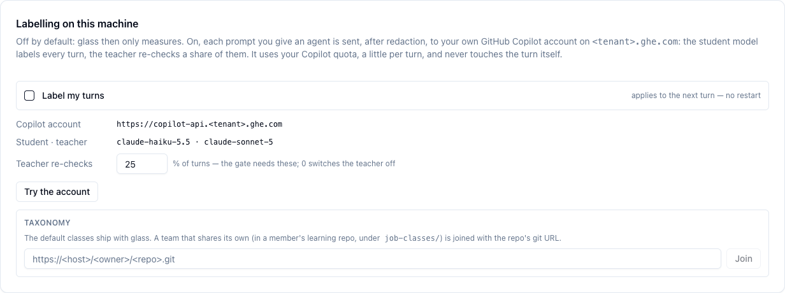
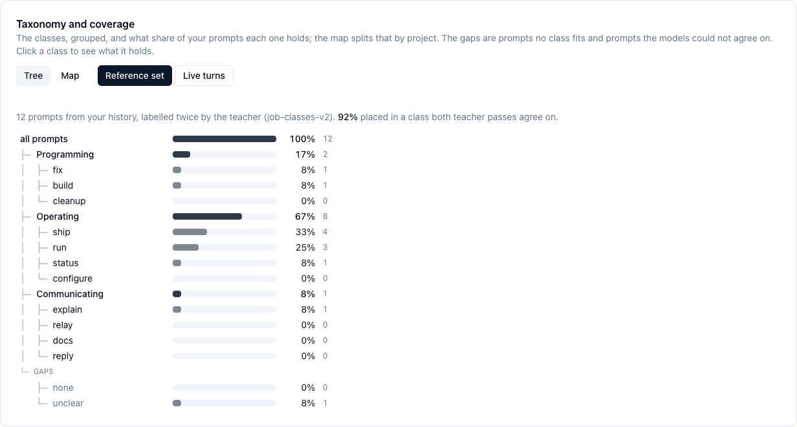

# Job Classes

What kind of job each prompt you give an agent is — fix, build, ship, status, explain, … —
labelled in the background with your own Copilot account. Opt-in, off by default.

=== "⚡ Quick (~3 min)"

    ## What it is for

    Some of what you ask an agent is hard (finding why something broke); much of it is
    routine (commit and push, is it finished, rerun the tests). Today one strong, expensive
    model answers all of it. Job classes sort your prompts into kinds of job, so you can see
    what your work consists of and, later, which kinds a cheaper model does just as well.

    A cheap **student** model labels every turn; a strong **teacher** model re-checks a share
    of them. A class's labels are trusted once the teacher agrees with at least 90 % of them,
    over at least 20 checked turns (the **gate**).

    ## Switch it on

    1. `glass ui` → **Token Usage → Classes**, or in a terminal: `glass job-classes on`.
    2. **Try the account** sends one made-up prompt and shows the label it got.
    3. Tick **Label my turns**. It applies to the next turn; no restart.

    

    Each prompt is redacted first and sent to **your own GitHub Copilot account** — the one
    your `gh` login reaches — never anywhere else. It uses a little of your Copilot quota per
    turn, and never touches the turn itself: the agent's call goes out before the label is
    asked for.

    ## See what your work consists of

    `glass job-classes measure` labels your recent prompts — read from the agents' own
    transcripts, redacted — with the teacher twice and the student once. It prints how well
    the student agrees with the teacher and writes the reference set the tab's tree and map
    read:

    

    ## Your team's classes

    A team can share its own classes from a member's learning repo (folder `job-classes/`).
    Join it with the repo's git URL — in the tab, or `glass job-classes join <url>`;
    `glass job-classes pull` updates it.

    **Next:** what is sent, the commands, and how the gate is counted — open the deep dive.

=== "📚 Deep Dive (full)"

    --8<-- "_tiers/job-classes.deep.md"
