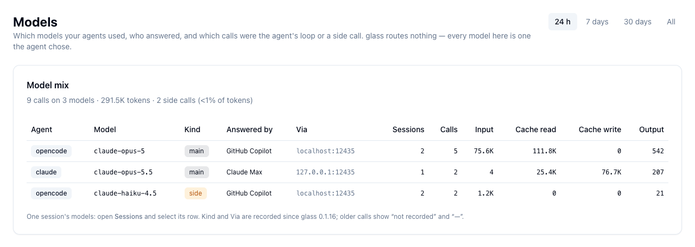
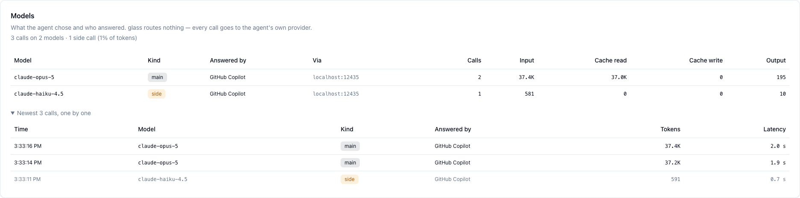

# Models & Accounts

Which models your agents used, which account answered each call, and which calls were the
agent's own loop rather than side requests.

=== "⚡ Quick (~2 min)"

    ## What the agents chose, who answered

    Open `glass ui` → **Models**. One row per agent, model, account and kind for the chosen
    time window (24 h, 7 days, 30 days, all), with sessions, calls and tokens:

    

    | Column | Meaning |
    |---|---|
    | Kind | **main** — the agent's loop (the call carried tool definitions); **side** — a call without tools: a session title, a summary, an intent check; **subagent** — a Claude Code sub-agent |
    | Answered by | The account that served the call (GitHub Copilot, Anthropic, OpenAI, or the account an LLM proxy names) |
    | Via | The host the call went to — the agent's own API host, or a proxy it is configured to use |

    The headline says how many calls were side calls and what share of the tokens they
    took. Above, OpenCode asked a small model for a session title in both of its sessions.

    ## The same calls as flow

    Above the table, **Flow** draws the window's calls from the agent, to the model it
    chose, to the account that answered. Edge thickness is tokens; dashed edges are side
    calls. Hover a node to isolate its paths.

    

    By default there is no decision in the middle: every edge is a choice the agent made,
    and glass forwarded the call to the host the agent addressed. With
    [offload](offload.md) on, your endpoint is an account too — its calls in green — and a
    click on its node opens the switch.

    For **one session**, open **Sessions** and select its row: the same columns appear in a
    Models card above the session's timeline, with its calls one by one.

    

    Unless [offload](offload.md) is on, every model on this card is one the agent chose, and
    every call went to the agent's own provider. **Next:** what filled the main calls —
    [Context Window](context-window.md).

=== "📚 Deep Dive (full)"

    --8<-- "_tiers/models.deep.md"
