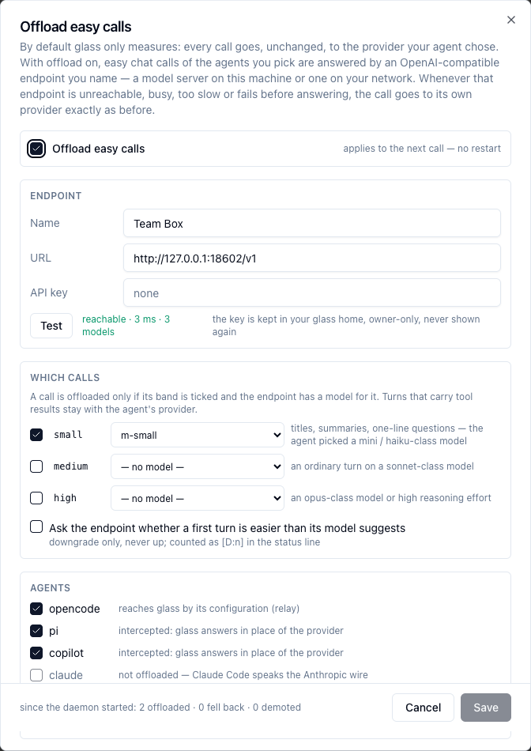
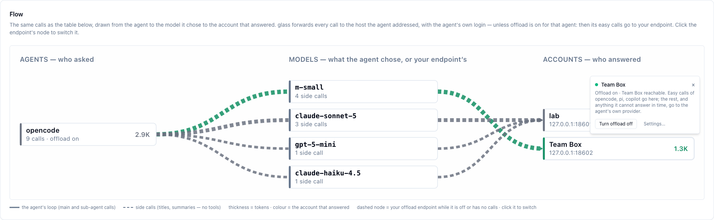

# Offload Easy Calls

Let an OpenAI-compatible endpoint of your own answer the easy calls of your agents —
opt-in, off by default, switched in the UI at any time.

=== "⚡ Quick (~3 min)"

    ## What it does

    By default glass only measures: every call goes, unchanged, to the provider your agent
    chose. With offload on, **easy chat calls** of the agents you pick — session titles,
    summaries, one-line questions — are answered by an endpoint you name instead: a model
    server on this machine, or one on your network.

    Whenever that endpoint is unreachable, busy, too slow or fails before it answers, the
    call goes to the agent's own provider **exactly as before**, with the agent's own login.
    Your GitHub, OpenAI or Anthropic credentials never reach the endpoint.

    ## Switch it on

    1. `glass ui` → the **Offload** pill top right (or Token Usage → **Settings**, or the dashed
       **Your endpoint — not set up** node in **Models → Flow**).
    2. Enter the endpoint's **URL** (e.g. `http://host:8000/v1`) and, if it needs one, its
       **API key**. **Test** checks it and lists its models.
    3. Pick a model for the **small** band (and more bands if you want).
    4. Tick the **agents** — opencode, pi, copilot — and **Offload easy calls**. **Save**.

    

    It applies to the next call: no restart, no relaunch of the agent. Switch it off the same
    way, or from the endpoint's node in **Models → Flow**:

    

    While it is on for a session's agent, the status line counts **`[L:n]`** — calls your
    endpoint answered — and **`[D:n]`** — calls the classifier judged easier than their model
    (when you turn that on). Both are hidden at 0.

    **Next:** what moves and what does not, and the limits — open the deep dive.

=== "📚 Deep Dive (full)"

    --8<-- "_tiers/offload.deep.md"
