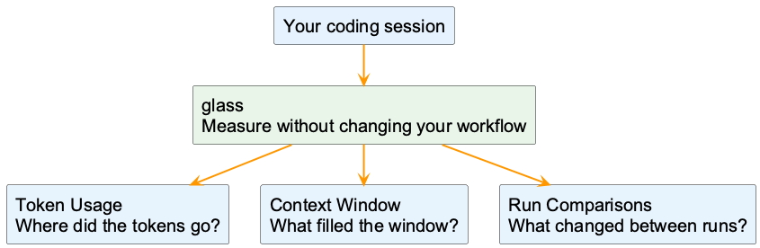
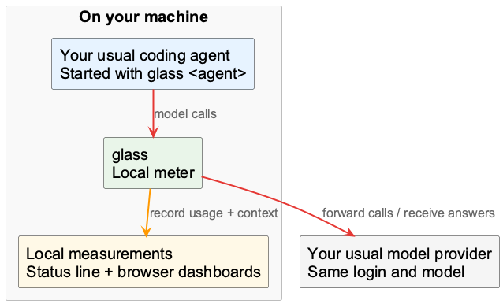
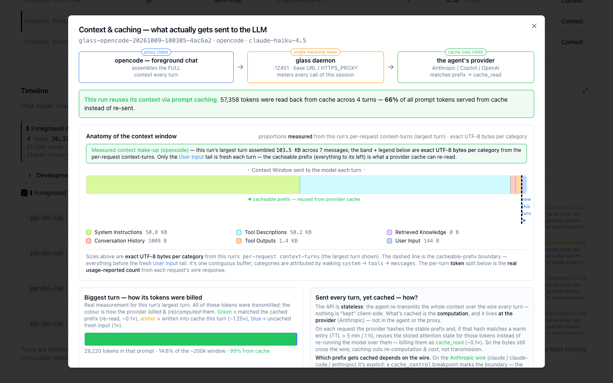
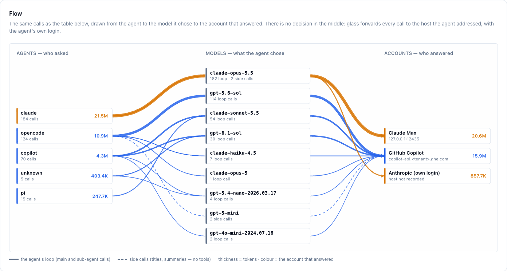
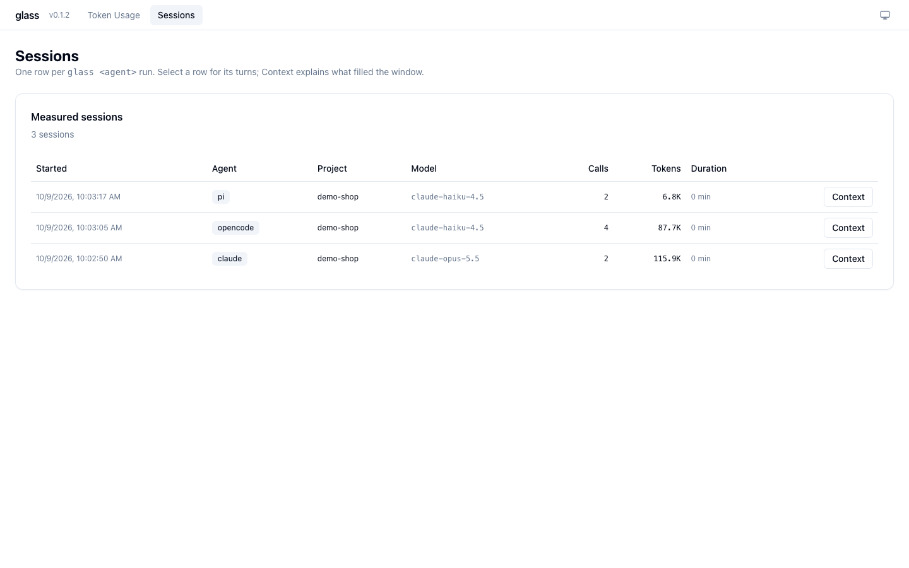
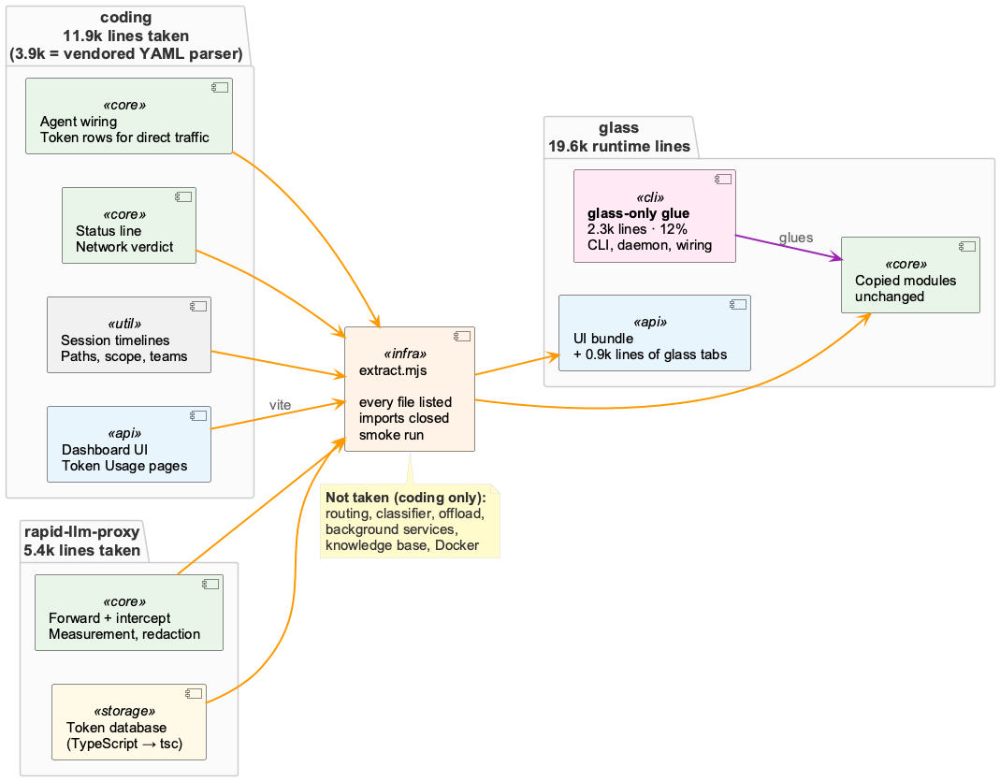

<div class="overview-deck" id="glass-overview" role="region" aria-label="Glass overview presentation" markdown="1">

<div class="overview-toolbar" hidden>
  <span class="overview-label">glass / in twelve slides</span>
  <span class="overview-counter" role="status" aria-live="polite" aria-atomic="true"></span>
  <button type="button" data-fullscreen>Fullscreen</button>
</div>

<div class="overview-stage" markdown="1">

<section class="overview-slide overview-cover" id="slide-1" aria-labelledby="overview-title" markdown="1">
<div class="overview-copy" markdown="1">

<p class="overview-kicker">Your agent, made visible</p>

# See where your agent's tokens go {#overview-title}

Your coding agent does the work. **glass shows what it took**: tokens, model calls,
and what filled the context window.

<div class="overview-benefits" markdown="1">

**Measure**  
Which agent and model used the tokens?

**Understand**  
What's taking up the context window?

**Compare**  
Did a different setup need fewer tokens?

</div>

Use the agent you already know: **Copilot CLI, Claude Code, OpenCode or pi**.

</div>
<figure class="overview-figure" markdown="1">



<figcaption>One measured run. Three ways to understand it.</figcaption>
</figure>
<p class="overview-takeaway">Keep your workflow. Add visibility.</p>
</section>

<section class="overview-slide" id="slide-2" aria-labelledby="overview-flow" markdown="1">
<div class="overview-copy" markdown="1">

<p class="overview-kicker">How it works</p>

## A local meter, not another agent {#overview-flow}

Put `glass` in front of your normal agent command.

```sh
glass copilot
```

glass starts a local background service, measures the model calls, and shows the
results in your terminal and browser.

**Same agent. Same login. Same model provider.** Wiring applies to this run only,
not to your system settings.

Measurements stay on your machine. Your model requests still go to the provider
you already use.

</div>
<figure class="overview-figure" markdown="1">



<figcaption>glass measures the traffic; it does not choose your model or do the task.</figcaption>
</figure>
<p class="overview-takeaway" markdown="1">
Default measurement uses local TLS interception for Copilot CLI, OpenCode and pi.
If policy disallows it, use `--no-intercept` for fewer details.
[Privacy & data](privacy.md)
</p>
</section>

<section class="overview-slide" id="slide-3" aria-labelledby="overview-start" markdown="1">
<div class="overview-copy" markdown="1">

<p class="overview-kicker">Your first run</p>

## Install. Prefix. Work as usual. {#overview-start}

Needs **Node.js 22.13+**, a supported agent already logged in, and access to the
Glass repository. Copilot CLI needs **1.0.93+**.

```sh
gh release download --repo bmw.ghe.com/AIMAAD/glass --pattern 'glass-*.tgz'
npm install -g ./glass-*.tgz
glass doctor
```

Then, from your project:

```sh
glass copilot           # or claude, opencode, pi
glass ui                # in another terminal
```

`glass doctor` tells you what to fix if your setup isn't ready.

</div>
<figure class="overview-figure" markdown="1">

[](images/terminal-statusline-tmux.png){: target="_blank" rel="noopener" title="Open full-size screenshot" }

<figcaption>The status bar gives live context, token counts and this month's Copilot cost (<strong>GH €</strong>). With tmux, click a field for details (here: <strong>ctx</strong>). Without it, use <code>glass watch</code> in a split pane; Claude Code also has its own status line.</figcaption>
</figure>
<p class="overview-takeaway" markdown="1">
No Docker or build tools. [Installation and platform details](getting-started.md)
</p>
</section>

<section class="overview-slide" id="slide-4" aria-labelledby="overview-tokens" markdown="1">
<div class="overview-copy" markdown="1">

<p class="overview-kicker">Question 1 / Where did the tokens go?</p>

## Start with the big picture {#overview-tokens}

Run `glass ui` and open **Token Usage**.

**Overview**  
See usage by agent, provider and model. A larger area means more tokens.

**Evolution**  
See when usage grew over time.

**Recent Calls**  
Find individual calls, their tokens and latency.

Pick a time range to focus on the work you want to understand.

</div>
<figure class="overview-figure" markdown="1">

[](images/ui-token-usage-overview.png){: target="_blank" rel="noopener" title="Open full-size screenshot" }

<figcaption>Example runs, not a benchmark. Input, output and cached tokens are counted separately.</figcaption>
</figure>
<p class="overview-takeaway" markdown="1">
Find the biggest token consumer before changing your setup. Token totals are not a bill.
[Explore Token Usage](token-usage.md)
</p>
</section>

<section class="overview-slide" id="slide-5" aria-labelledby="overview-evolution" markdown="1">
<div class="overview-copy" markdown="1">

<p class="overview-kicker">Question 1 / When did the tokens go?</p>

## Then follow usage over time {#overview-evolution}

Open the **Evolution** tab in **Token Usage**.

The chart splits the time range into short buckets, **stacked by model, agent or
provider** — in tokens, € or $. Switch to **month-to-date** and each line becomes a
running total that restarts on the 1st: rising cost per provider.

Below the chart, **Top Consumers** ranks the models of the time range by tokens,
with their calls and latency.

Drag the brush under the chart to zoom into one stretch of work.

</div>
<figure class="overview-figure" markdown="1">

[](images/ui-token-usage-evolution.png){: target="_blank" rel="noopener" title="Open full-size screenshot" }

<figcaption>Example runs on one machine, not a benchmark. Month-to-date in €: each step is a session's spend; the slope is the burn rate.</figcaption>
</figure>
<p class="overview-takeaway" markdown="1">
Spot the spike, then open the session behind it in **Sessions**.
[Explore Token Usage](token-usage.md)
</p>
</section>

<section class="overview-slide" id="slide-6" aria-labelledby="overview-cost" markdown="1">
<div class="overview-copy" markdown="1">

<p class="overview-kicker">Question 1 / What did it cost?</p>

## Know the bill before it arrives {#overview-cost}

Switch **Tokens · € · $** and open the **Cost** tab.

One tile per account you used this month: **GitHub Copilot** priced at GitHub's
per-model rates — cache reads and writes each at their own rate — with the month-end
projection; the Claude subscription as its API-equivalent; your own hardware as free.

The status line carries the Copilot figure as **`GH €`**; one click opens this tab.

</div>
<figure class="overview-figure" markdown="1">

[](images/ui-token-usage-cost.png){: target="_blank" rel="noopener" title="Open full-size screenshot" }

<figcaption>A contract discount or a fixed euro rate goes into <code>~/.glass/cost.json</code>.</figcaption>
</figure>
<p class="overview-takeaway" markdown="1">
See the month's Copilot spend while it is still going on.
[How cost is calculated](token-usage.md#how-cost-is-calculated)
</p>
</section>

<section class="overview-slide" id="slide-7" aria-labelledby="overview-coverage" markdown="1">
<div class="overview-copy" markdown="1">

<p class="overview-kicker">Question 1 / What does the figure cover?</p>

## Every Copilot call glass can see — and GitHub's total {#overview-coverage}

**Measured per call:** agents started with `glass <agent>` — Copilot CLI, OpenCode, pi — in
any terminal, and coding's background jobs where coding is installed.

**Read after the fact:** VS Code's Copilot Chat, from the chat history VS Code keeps.
Nothing in VS Code's path changes; its cost is an estimate.

**GitHub's own count** for the account sits on the same tile — every client included,
read every 15 minutes with your `gh` login. The difference is what glass did not see:
agents started without `glass`, other machines, github.com.

</div>
<figure class="overview-figure" markdown="1">


<figcaption>Solid: measured per call. Dotted into glass: read afterwards. Dashed: GitHub's own figure.</figcaption>
</figure>
<p class="overview-takeaway" markdown="1">
Your measured spend next to GitHub's — no billing export needed.
[What the Copilot figure covers](token-usage.md#what-the-copilot-figure-covers)
</p>
</section>

<section class="overview-slide" id="slide-8" aria-labelledby="overview-context" markdown="1">
<div class="overview-copy" markdown="1">

<p class="overview-kicker">Question 2 / Why is the context so large?</p>

## See what the model actually received {#overview-context}

In **Sessions**, click **Context** on a run.

The explainer separates **system instructions, tool descriptions, conversation
history, tool output and your input**.

It also shows how much input the **provider's prompt cache** served.
Caching avoids repeated computation, not sending the context.

Need to follow a spike? Click a session row for its timeline, then a turn for
its detail.

</div>
<figure class="overview-figure" markdown="1">

[](images/ui-context-explainer.png){: target="_blank" rel="noopener" title="Open full-size screenshot" }

<figcaption>In this example, instructions and tools take most of the space. The composition bar measures bytes; token usage comes from provider reports.</figcaption>
</figure>
<p class="overview-takeaway" markdown="1">
Don't assume your last prompt filled the window. Look at the whole context.
[Explore Context Window](context-window.md)
</p>
</section>

<section class="overview-slide" id="slide-9" aria-labelledby="overview-models" markdown="1">
<div class="overview-copy" markdown="1">

<p class="overview-kicker">Question 3 / Which models did the work?</p>

## See the model mix behind the tokens {#overview-models}

Open the **Models** tab.

Every call from **the agent, to the model it chose, to the account that answered**, for
the last day, week, month or all time. Thicker edges carried more tokens.

Solid edges are the agent's own loop. **Dashed** edges are side calls it makes on its
own, such as a session title or a summary, often on a smaller model. The table below the
flow has the numbers.

For one session, select its row in **Sessions**: the same view, call by call.

</div>
<figure class="overview-figure" markdown="1">

[](images/ui-models-flow.png){: target="_blank" rel="noopener" title="Open full-size screenshot" }

<figcaption>A week on one machine. No decision in the middle: every model here is one the agent chose; glass measures, it does not route.</figcaption>
</figure>
<p class="overview-takeaway" markdown="1">
Know which model you are paying for before you switch one.
[Explore Models & Accounts](models.md)
</p>
</section>

<section class="overview-slide" id="slide-10" aria-labelledby="overview-offload" markdown="1">
<div class="overview-copy" markdown="1">

<p class="overview-kicker">Opt-in, off by default</p>

## Easy calls to your own endpoint {#overview-offload}

glass can hand **some** calls to an OpenAI-compatible endpoint you name — a model server on
your machine or your network — instead of a paid account. Switched in the UI, any time.

**What moves:** easy chat calls only, such as session titles, side calls and short first
turns. An agent's first turn with all its tools carries 20–28k tokens; a shared server
needs tens of seconds for that, so it stays paid.

**Which agents:** opencode, pi and Copilot CLI, each switched on separately.

**If the endpoint is busy, slow or down:** the original call goes to your own provider with
your own login. Your credentials never reach the endpoint.

</div>
<figure class="overview-figure" markdown="1">

| Measured on a shared 27B model server | |
|---|---|
| Small call (≈2k tokens) | 2–7 s |
| First turn (≈20k tokens, uncached) | ~39 s |
| Same call on Copilot | 1–2 s |
| Gates | ≤ 3k tokens · 8 s to answer · 1 call in flight |

<figcaption>Offload saves paid tokens, not time.</figcaption>
</figure>
<p class="overview-takeaway" markdown="1">
Off, glass is exactly what the previous slides show.
[Offload Easy Calls](offload.md)
</p>
</section>

<section class="overview-slide" id="slide-11" aria-labelledby="overview-compare" markdown="1">
<div class="overview-copy" markdown="1">

<p class="overview-kicker">Question 4 / Which setup fits my task?</p>

## Same task. Two runs. Better evidence. {#overview-compare}

Try the same task from the same starting code with two agents, models or
configurations.

```sh
glass copilot -p "Explain total() in cart.js."
glass claude -p "Explain total() in cart.js."
```

In **Sessions**, compare **calls, tokens and model**. Open **Context** on each
run to understand the difference.

Judge the answer too: fewer tokens don't automatically mean a better result.
**You run the comparison; glass measures it.**

</div>
<figure class="overview-figure" markdown="1">

[](images/ui-sessions.png){: target="_blank" rel="noopener" title="Open full-size screenshot" }

<figcaption>One row per measured run. The sample rows show the UI, not an agent ranking.</figcaption>
</figure>
<p class="overview-takeaway" markdown="1">
Try it on your next real task: `glass <agent>`, then `glass ui`.
[Get started](getting-started.md) · [Compare runs](comparing-runs.md)
</p>
</section>

<section class="overview-slide" id="slide-12" aria-labelledby="overview-built" markdown="1">
<div class="overview-copy" markdown="1">

<p class="overview-kicker">Behind the scenes / How glass is made</p>

## Extracted, not rewritten {#overview-built}

glass is generated from two projects that already measure agents every day:
**coding** and **rapid-llm-proxy**.

A script copies the modules glass needs, unchanged. Every file is listed, and the
build fails if an import reaches a file that isn't.

What glass adds is glue: the `glass` command, the daemon and the wiring. That's
**about 12% of its code**.

The router, background services and knowledge base stay behind in coding.

</div>
<figure class="overview-figure" markdown="1">

[](images/glass-composition.png){: target="_blank" rel="noopener" title="Open full-size diagram" }

<figcaption>Runtime code of v0.1.24 by origin: 11.9k lines from coding, 5.4k from rapid-llm-proxy, 2.3k glass-only.</figcaption>
</figure>
<p class="overview-takeaway" markdown="1">
A fix in coding reaches glass on the next extract.
[Architecture → Where glass comes from](architecture.md)
</p>
</section>

</div>

<nav class="overview-controls" aria-label="Presentation controls" hidden>
  <button type="button" data-prev>Previous</button>
  <div class="overview-dots" aria-label="Choose a slide"></div>
  <button type="button" data-next>Next</button>
  <span class="overview-help">Arrow keys to navigate / F for fullscreen / Esc for home</span>
</nav>
<p class="overview-message" role="status" aria-live="polite"></p>

</div>
