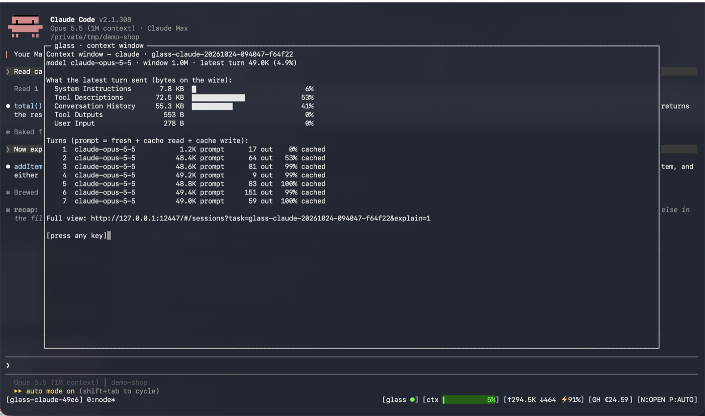

# Status Line

Context gauge and session tokens, live, in the terminal you work in.

=== "⚡ Quick (~3 min)"

    ## Five fields

    `[glass ●] [ctx ▋ 5%] [↑294.5K ↓464 ⚡91%] [GH €24.59] [N:OPEN P:AUTO]`

    | Field | Shows | Click |
    |---|---|---|
    | `glass ●` | daemon running (✗ = down) | opens the UI |
    | `ctx` | latest turn's size vs. the model's window | context report |
    | `↑ ↓ ⚡` | session tokens sent / received, cache share | the session in the UI |
    | `GH €` | this calendar month's GitHub Copilot cost, all sessions (hidden without a Copilot call this month) | Token Usage → [Cost](token-usage.md#cost) |
    | `D:` `L:` | only with [offload](offload.md) on for the agent: calls demoted by the classifier / answered by your endpoint (hidden at 0) | Models |
    | `N:` `P:` `K:NO` | network (`CN` · `VPN` · `OPEN`), the local proxy (`ON` · `AUTO` · `OFF`), `K:NO` when the Kerberos ticket is missing on CN / VPN | network report |

    

    With tmux it is the bar at the bottom; without tmux Claude Code shows it as its own
    status line, and `glass watch` shows it for any agent.

=== "📚 Deep Dive (full)"

    --8<-- "_tiers/status-line.deep.md"
